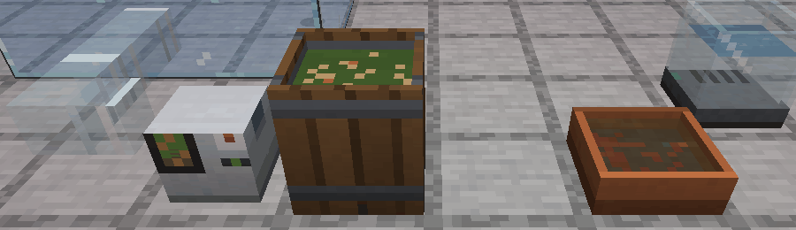
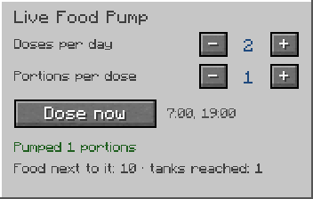

---
navigation:
  title: Live food pump
  icon: bettacraft:live_food_pump
  parent: food/live_food.md
  position: 50
item_ids:
  - bettacraft:live_food_pump
---

# Live food pump

<ItemImage id="bettacraft:live_food_pump" scale="2" />

The live food pump feeds your tanks with live food on its own. Place it **next to a breeder** (daphnia barrel, artemia
hatchery, larva tub or tubifex dish) and join it to the [pipes](../equipment/pipes.md) that lead to the tanks, or place it
right next to a tank. It takes the food out of the breeder and pumps each portion as 250 mB of **live food suspension**
(the fluid `bettacraft:live_food`) into the tanks. There it counts as live food: the hungriest animals eat first, live
food conditions the breeding fish, what nobody needs sinks to the shrimp and snails.

Right-click opens its window:

* **Doses per day** (0 to 8, evenly from 7:00 on; 0 = only by the button) and **portions per dose** (1 to 8).
* **Dose now** pumps one dose at once.
* What it did last, the food in the breeders next to it and the tanks it reaches.

A tank only takes the suspension when somebody there eats that food (adult bettas no artemia nauplii, for example); then
the pump keeps the food in the breeder. A dose that cannot go out waits until the next one, it never piles up. The empty
bottle of a bottled food (artemia nauplii) goes back into the hatchery, which needs it for the next batch. A redstone
signal pauses the pump; with power costs (`power.costs` `EASY` or `HARD`) each portion needs FE (`liveFood.pumpFePerPortion`).
Other mods' tanks and storage (AE2, Refined Storage) keep the suspension like any fluid.

## Obtaining

Crafting:

<RecipesFor id="bettacraft:live_food_pump" />
