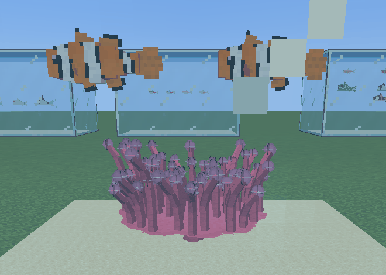

---
navigation:
  title: Phytoplankton and rotifers
  icon: bettacraft:rotifers
  parent: food.md
  position: 15
item_ids:
  - bettacraft:phytoplankton_culture
  - bettacraft:phytoplankton
  - bettacraft:rotifer_culture
  - bettacraft:rotifers
---

# Phytoplankton and rotifers

The food chain of the [clownfish larvae](../saltwater/reef_animals.md): **phytoplankton** (microalgae) feeds the
**rotifers**, the rotifers feed the larvae; later the larvae also take [artemia nauplii](fry_food.md). Switch:
`features.saltwater.larvaRearing`.

## Phytoplankton

1. Mix a <ItemLink id="bettacraft:salt_water_bottle" /> with **seagrass or kelp** and **bone meal**: a
   <ItemLink id="bettacraft:phytoplankton_culture" />.
2. Wait **one in-game day in the light** (light level 9 or more when it is ready).
3. It turns into a <ItemLink id="bettacraft:phytoplankton" />.

Used on a reef tank, a bottle of phytoplankton greens the water (you get the bottle back). It fades over a few days.

## Rotifers

1. **Start:** a bottle of phytoplankton with a bottle of [infusoria](fry_food.md) (rotifers live in it): a
   <ItemLink id="bettacraft:rotifer_culture" />. The aquarist sells cultures too.
2. Wait **one in-game day**: a <ItemLink id="bettacraft:rotifers" />.
3. **Keep it going:** one bottle of rotifers and two of phytoplankton make **two** cultures.

Rotifers are the finest fry food (any fry eats them from the first day). Fed into a reef tank they **stay in the water**: with
phytoplankton they live on and multiply, without it most die within three days. The menu shows rotifers and phytoplankton in
the reef line of the water tab.

## The clownfish larvae

After hatching the clownfish larvae drift for **three days** (`reef.clownLarvaDays`) before they settle as young fish:

| Larva days | Eats |
|---|---|
| first half | rotifers only |
| second half | rotifers or artemia nauplii |

Each larva eats a twentieth of a portion a day (a bottle is 4 portions). Fed they mostly survive (about 80 %); without food only
**5 %** (`reef.clownLarvaSurvival`), so a clutch of 30 gives one or two. When larvae raised on rotifers settle, the log says
so (advancement "Rotifer Rearing").

**The routine:** start phytoplankton and a rotifer culture when the clownfish pair spawns (the eggs need a day and a half), dose
phytoplankton, then a bottle of rotifers every day, later artemia nauplii.

## Obtaining

* <ItemLink id="bettacraft:rotifer_culture" />: **[Aquarist villager](../getting_started/aquarist.md)** (Expert): 1 for 5 emeralds; one of about 5 in this offer (config `features.sources.aquaristVillager`).

Crafting:

<RecipesFor id="bettacraft:phytoplankton_culture" />
<RecipesFor id="bettacraft:rotifer_culture" />
