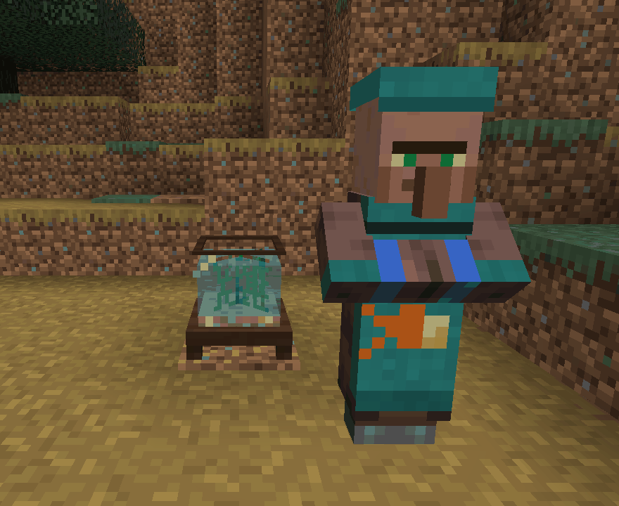
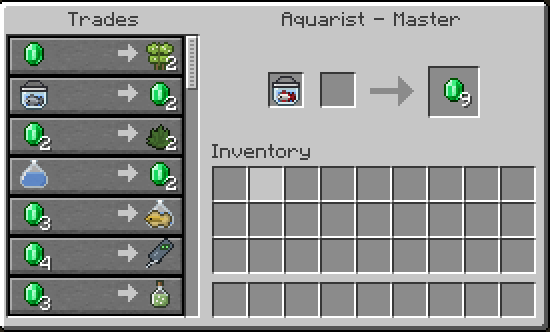

---
navigation:
  title: Aquarist villager
  icon: bettacraft:breeding_basin
  parent: getting_started.md
  position: 30
item_ids:
  - bettacraft:breeding_basin
feature: sources.aquaristVillager
---

# Aquarist villager

The **aquarist** is a villager profession of Bettacraft: a villager in a teal rubber apron with blue gloves who sells
what an aquarium needs and **buys your bettas and bred tankmates** for emeralds, by their genes.

## The breeding basin

<ItemImage id="bettacraft:breeding_basin" />

The <ItemLink id="bettacraft:breeding_basin" /> is a small glass basin with gravel, water and plants on a wooden stand,
the workplace of the aquarist. Place it in a village: an **unemployed villager** nearby claims it and becomes an aquarist,
like the vanilla professions with their workstations. It works in every village (also the villages of other mods); there
is no aquarist house of its own. The basin is decoration only, nothing lives in it.

## Trades

Like every villager he levels up by trading. On every level he has two offers (each picks one of its goods):

| Level | Sells | Buys |
|---|---|---|
| Novice | betta pellets, flakes or floating plants (frogbit, salvinia, duckweed, water lettuce) | **a betta in a bucket** |
| Apprentice | aquarium plants (Java fern, Anubias, Java moss, Cryptocoryne, Vallisneria, Amazon sword, Rotala, Sagittaria) | **a betta or bred tankmates in a fish bag** |
| Journeyman | Neocaridina shrimp, ramshorn, zebra nerite or apple snails; a pH test kit, a TDS meter, artemia cysts or active soil | |
| Expert | an infusoria, artemia or green water culture; a rare plant (tiger lotus, Cryptocoryne 'Flamingo', Bucephalandra, red stem plants, Marimo ...) | |
| Master | two offers of **a pair of a rare bred variety** of a tankmate (albino bristlenose, German Blue ram, koi angelfish ...) | |

The wandering trader keeps his own offers ([where to find what](sources.md)).

## What he pays

Put a bucket or a fish bag with the fish into the trade slot of a buying offer: the result shows what this fish is worth
(the offer itself shows "Price by the genes of the fish"). He only sees the **visible** genes; hidden ones are worth
nothing to him.

* **Bettas** (grown up): 2 emeralds, +1 for a betta bred in a tank, +0.5 for every generation (up to 6), +3 for a named
  variety (Koi, Mustard Gas ...), +1 for every rare fin form, pectoral fin, pattern or sheen (Dumbo, Rosetail,
  Doubletail, Dalmatian, Piebald ...), +1 for long fins, +4 for Betta imbellis or smaragdina; at most 24.
* **Tankmates** (grown up, in a fish bag, also several in one bag): only **bred** fish, no wild-caught ones. 1 for a common
  species, 3 for a rare one, +3 for a bred colour variety (Black ram, albino bristlenose ...), more for the valuable
  species (discus and zebra pleco +5, seahorses +3 / +4, angelfish +2); at most 16 per fish.
* Fry and juveniles are not bought.

The table is a data file: `data/<namespace>/bettacraft/aquarist_prices.json` (ours in the `bettacraft` namespace). A
datapack of a modpack can change single values, e.g. `{"betta": {"base": 4}, "tankmate": {"only_bred": false}}`.

## Settings

Config `features.sources.aquaristVillager` (on by default). Off: no villager becomes an aquarist, aquarists lose their
profession and their offers, the breeding basin cannot be crafted.

## Obtaining

Crafting:

<RecipesFor id="bettacraft:breeding_basin" />
