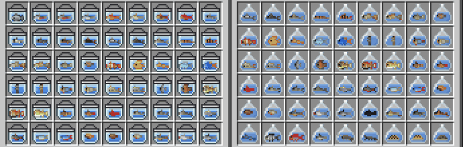

---
navigation:
  title: Catching animals
  icon: bettacraft:tank_net
  parent: getting_started.md
  position: 10
---

# Catching small animals

Right-click open water with the [aquarium net](../plants/floating_plants.md). After a short cooldown you can try
again; the net wears a little. With a chance (30 %, more near plants) something alive is in the net, and it goes into an
**empty fish bag** from your inventory. Without an empty bag it gets away.

## What lives where

| Water | Possible catch |
|---|---|
| River | Neocaridina (wild form), ramshorn (red-brown), bladder snail, rarely a trumpet or an assassin snail |
| Swamp | ramshorn (red-brown), bladder snail, Malaysian trumpet snail, rarely a dwarf clawed frog |
| Mangrove swamp | nerites (zebra, horned, olive), rarely the **red** or **yellow racer nerite** or an assassin snail |
| Beach (brackish water) | nerites |
| Jungle water | apple snail (wild colour), rarely a dwarf clawed frog or a wild dwarf crayfish |
| Lush caves, deep cave water | Malaysian trumpet snail, ramshorn (lush caves), rarely an assassin snail |

* Water near seagrass, kelp, lily pads or plants: more shrimp and ramshorns.
* Sand, gravel or stone at the bottom: more trumpet snails and nerites.
* Wild animals sometimes carry a colour hidden (pink ramshorns, red shrimp, orange crayfish): breed it out.

## Wild animals in the world

The tankmate fish also live wild, rarely and in small shoals, in the waters they come from: tetras, corydoras, plecos
and otocinclus in jungle water, rasboras, kuhli and clown loaches, the dwarf gourami and dwarf clawed frogs in swamps,
guppies, endlers and platys in rivers, the reef fish and seahorses in warm and lukewarm oceans. Catch them with a
bucket of water (sea water for the reef fish) or a fish bag.

Shrimp, crayfish, snails and hermit crabs crawl on the bottom of rivers, swamps, mangroves, beaches, jungle water and
the oceans. Right-click one with the net, a fish bag or a bucket of water to catch it; let it go again and it crawls
off. Every coral of the mod grows on the warm ocean reefs among the vanilla corals: [shears cut a frag](../saltwater/corals.md)
off a colony. Biome mods count too: their swamps, rivers, mangroves and warm oceans are the same waters (see the
[biome tags](../settings.md)).

Most wild animals are wild-coloured, some carry a bred colour hidden, and about 3 in 100 show one openly
(config `wildlife.beautifulWildChance`). What a new animal carries hidden shows the [magnifier](../equipment/magnifier.md).
All spawns with their weights: [Where to find what](sources.md).

## In the bucket, the bag and the tub

Every animal shows in its container: the bucket of a tankmate shows its species, the critter bucket and a filled fish bag
the shrimp, crayfish, snail, hermit crab or fish inside, the transport tub the big animal. Neocaridina, bee shrimp,
crayfish, apple snails and ramshorns show the colour of their genes. A betta and the animals of other mods show as a fish
in their colours.

## Other ways

* A **shovel on mud** in a swamp now and then turns up a Malaysian trumpet snail.
* The **wandering trader**: orange dwarf crayfish and gold or blue apple snails; rarely a pair of Neocaridina of one
  colour line, pink or blue ramshorns, an assassin snail or a dwarf clawed frog.
* And above all **breeding** in your tanks: that is where the colours and grades come from.
