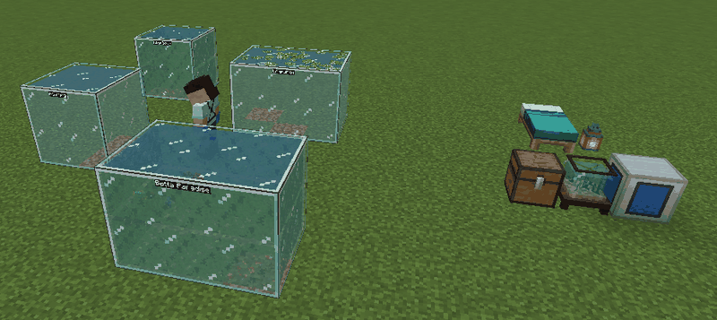
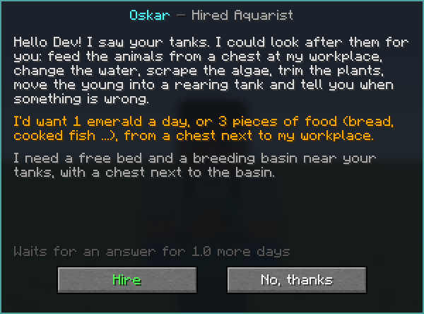
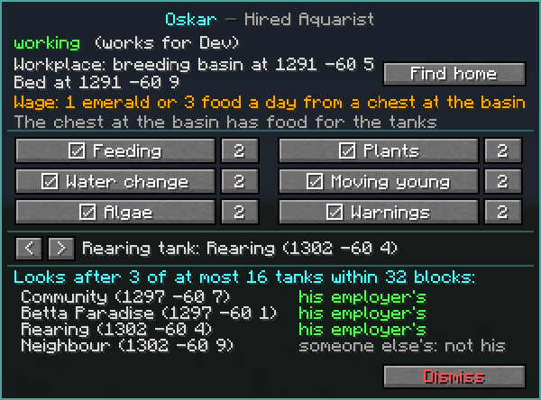
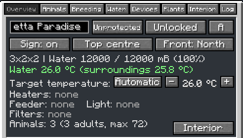
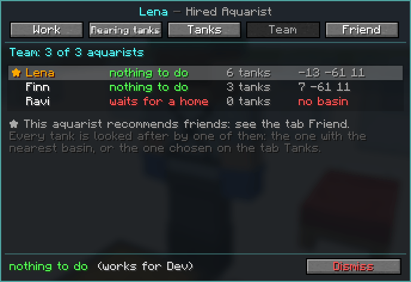
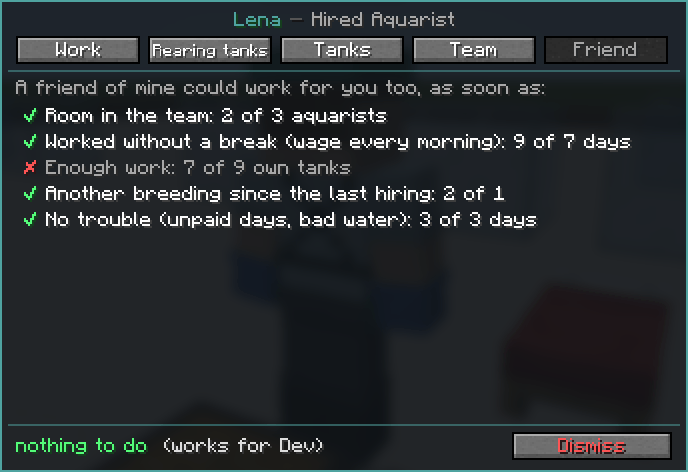
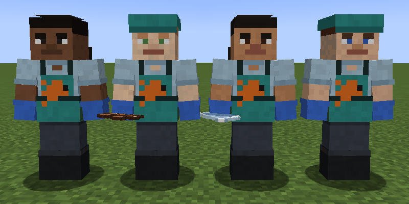

---
navigation:
  title: Hired aquarist
  icon: minecraft:emerald
  parent: getting_started.md
  position: 40
item_ids:
  - bettacraft:hired_aquarist
feature: aquaristNpc.enabled
---

# Hired aquarist

Once you keep a few aquariums and have bred something, an **aquarist** comes by and offers to look after your tanks. He
is a person of his own (not a villager, not the [aquarist villager](aquarist.md) who only trades): a man or woman in a
teal rubber apron with blue gloves and rubber boots, with a first name. Hired, he lives in a bed near a breeding basin,
takes his wage every morning and **really walks to your tanks** to feed, change water, clean, trim and move the young.

## When he comes

* Each player gets his own aquarist. He comes when **you** own at least **3 tanks** and **bred something** (any breeding
  advancement: a betta spawn, a litter, young shrimp, a clutch ...), by day, 10 to 20 blocks from you; he walks up to you.
* He offers his work in the chat with two buttons, **[Hire]** and **[No, thanks]**; right-click him for the same offer in
  his window. He waits one in-game day for the answer.
* **Refused** (or not answered), he leaves. The next one comes after **5 to 10 in-game days and another breeding**. The
  same holds when a hired aquarist leaves (no wage, no home, dismissed).
* `/bettacraft aquarist status` tells you why none has come yet.

## His home and wage

* He needs a **free bed** and a **free [breeding basin](aquarist.md)** (his workplace) within 32 blocks of where he
  stands when you hire him. He takes them for himself (no villager uses them then).
* **Assign basin, bed and chest** (tab **Work** of his menu): **Assign...** next to the basin, the bed or the chest, then right-click the
  free breeding basin (an occupied one is refused), the bed or the chest (barrels and the storage of other mods too) within 32 blocks of his basin; **Auto** gives it back and he looks by himself again.
  Without an assigned chest:
* **Chests next to the basin** (any side, also diagonally; barrels and the storage of other mods too) hold what he needs:
  the **food** for the tanks, the **cuttings** he brings back, and his **wage**.
* Water for the water changes comes from a **reservoir**, a pipe, another mod's tank or a water source **next to the
  basin** (salt water for salt tanks).
* **Wage:** every morning **1 emerald**, or **3 pieces of food** (bread, cooked fish ...) when there is no emerald. The
  first day is free. Without his wage he works at **half speed**; after **3 days** without wage (or without a bed and a
  basin) he leaves.
* At night he sleeps in his bed. He cannot be hurt (only `/kill` removes him), runs away from monsters, cannot be pushed,
  leashed or caught, and only you (or an operator) can use his menu. A name tag renames him (only yours).

## His tasks

Right-click him: his menu has five tabs (the tab Friend only at the one who recommends friends, see below). **Work** shows his basin, bed and chest (with the buttons to assign them), the wage and the six
tasks: click a task's name to switch it on or off, the number to set its level 1 to 3. **Rearing tanks** and **Tanks** are described below.

| Task | What he does | Level 1 / 2 / 3 |
|---|---|---|
| Feeding | takes food from the chests (live food first, several kinds in turn) and feeds every tank; not tanks with their own feeder | once / twice / three times a day |
| Water change | carries water from the reservoir at the basin and changes it, when the interval of the [water change controller](../equipment/water_change.md) has passed or the water is bad | 15 / 25 / 35 % |
| Algae | scrapes the algae off the glass | from 50 / 30 / 15 % algae |
| Plants | thins out floating plants and trims grown aquarium plants; plants and cuttings go into the chest | from 90 / 75 / 60 % cover, full-grown / nearly / half-grown plants |
| Moving young | carries young bettas, young tankmates and froglets into one of his **rearing tanks** (tab Rearing tanks) | 2 / 4 / 8 per trip |
| Warnings | tells you in the chat what is wrong (with a map mod also as a waypoint at the tank, when your waypoint switch is on there) | sick animals and too little water / also temperature, water, hunger, crowding / also the breeding warnings |

He looks after up to **16 tanks within 32 blocks** of his basin (the nearest first) and only tanks that are **loaded**.
Each round he fetches what he needs at the basin, walks from tank to tank and brings the cuttings and the unused food back.
Everything he carries goes back when he leaves; the young go back into their tank when the rearing tank does not take
them (full, wrong water) or into a chest as a filled fish bag when even that fails.

## Whose tanks (multiplayer)

He only works at tanks he may touch; he checks it again right before every job:

* **your own** tanks (the owner is who placed the tank; a tank without an owner goes to the next player who opens it);
* with **FTB Teams** the tanks of the members of your party (server config `hiredAquarist.ftbTeams`);
* tanks of other players only when their owner **released** them: the **A** button in the [tank menu](../aquarium/menu.md)
  (owner or operator) switches between "the owner's aquarist" (A), "every player's aquarist" (A+, for friends who share
  their aquarist's work) and "no aquarist" (A-);
* **never locked tanks** (the lock of the tank menu) and never tanks of strangers.

His menu lists the tanks around his workplace (none without a workplace) and whether they are his employer's, the team's, released,
foreign, locked or unwanted.

## Rearing tanks and what he does where

* **Several rearing tanks** (up to 5; tab **Rearing tanks**): choose a tank with the arrows and put it in with the **check mark** at the right. The young go
  into the **first** rearing tank in the list that takes them (the species, the salt and room). Each rearing tank can be limited to species (the
  button at its row opens a list to tick; nothing ticked: all species). The ✕ takes a tank out of the list. The rearing tank of an
  older version stays his rearing tank.
* **Per tank** (tab **Tanks**): click a tank in the list, then switch the six tasks on or off for that tank. By default he does everything
  at every tank he may work at; a tank with some tasks off shows "4 of 6 tasks".

## A team of aquarists

You can have **up to 3 aquarists** (server config `hiredAquarist.maxAquarists`, up to 10; 1 = only one). Only the first
comes by himself. Every further one is a **friend** whom your aquarist recommends: the one who has worked for you longest
(marked ★). The tab **Friend** of his menu shows each condition with ✔ / ✘ and how far you are ("a friend in 3 days"):

* he worked **7 in-game days without a break** (his wage paid every morning), and 7 days went by since the last hiring;
* **enough work**: you own **3 tanks per aquarist**, the friend included (the second from 6 tanks, the third from 9);
* **another breeding** since the last hiring;
* **no trouble** in the last 3 days: no aquarist of the team went without his wage and no tank in their care had bad water
  (a professional does not recommend a friend into a badly run business);
* the team is not full.

When everything holds he tells you in the chat ("My friend ... is looking for work - talk to me") with a button that
opens his menu at the tab Friend, and the tab shines. **[Hire him]**: the friend comes to him and takes a free bed and a
free breeding basin nearby. Without them he waits next to the one who recommended him (5 days, `friendHomeGraceDays`)
and does not work yet; his tab Work shows what is missing, so you can build them afterwards. **[No, thanks]**: the next
friend after 5 to 10 days and another breeding. When the team is full the tab says "Team full (3/3)".

* **No double work:** every tank is looked after by **exactly one** aquarist: the one whose basin is nearest. On the tab
  **Tanks** click a tank: the button at the right shows who looks after it; click it to give the tank to the next
  aquarist of the team (after the last one it goes back to the nearest). The list shows the tanks of the others as
  "Lena looks after it".
* **Each his own:** bed, breeding basin, chests, rearing tanks and wage are his own (assigned as above, or automatic).
* The tab **Team** in **every** aquarist's menu lists all of them: name, status, tanks, workplace.
* If the first leaves (dismissed, unpaid, `/kill`), the one who has been with you longest recommends the friends from then
  on. Only when nobody is left does a new first aquarist come by himself again.
* The releases A / A+ of the tank menu hold for all aquarists of the owner. Each player has his own team and limit.
* `/bettacraft aquarist status` lists your team and the conditions of the next friend.

## Settings

Config `features.aquaristNpc.enabled` (on by default). Off: no aquarist comes, hired ones only wait (they work again when
it is on), the tank menu hides the button. Server config `hiredAquarist.*`: tanks needed (`minOwnTanks`, 3), the wait
after a refusal (`returnDaysMin` 5, `returnDaysMax` 10), how long he waits for an answer (`offerDays`, 1), tanks and radius
(`maxTanksCared` 16, `workRadius` 32, `homeRadius` 32), the wage (`wage`, `wageEmeralds` 1, `wageFood` 3,
`unpaidDaysUntilLeave` 3, `unpaidWorkSpeed` 0.5) and FTB Teams (`ftbTeams`); the team (`features.aquaristNpc.team`, on by
default; off: no friend is recommended, those hired stay): `maxAquarists` 3, `friendAfterDays` 7, `tanksPerAquarist` 3,
`friendCalmDays` 3, `friendHomeGraceDays` 5. Operators: `/bettacraft aquarist arrive [player]` lets one come now,
`/bettacraft aquarist friend [player]` makes the first recommend his friend now.

