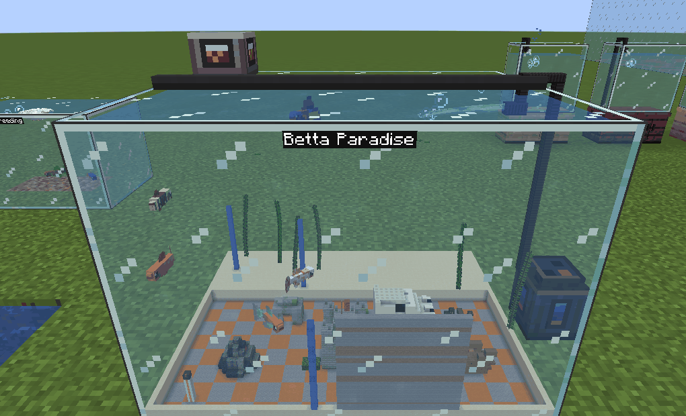

---
navigation:
  title: Bettacraft
  icon: bettacraft:betta_bucket
  position: 0
---

# Bettacraft <Small>by 0verEngineer</Small>

Welcome to the handbook of **Bettacraft**: betta fish (Siamese fighting fish) and aquariums you can build
from any glass, fill with water, decorate from the inside and use to breed bettas with real genetics.

## Chapters

* [First steps](getting_started.md): from the swamp to your first aquarium, catching animals, where to find what.
* [Aquarium](aquarium.md): building tanks, shapes, water, water quality, temperature, algae, inhabitants and the tank menu.
* [Equipment](equipment.md): heaters, coolers, filters, feeders, light, lid, cabinet, power and the tools.
* [Bettas](bettas.md): life stages, health, breeding, genetics, types, fights.
* [Tankmates](tankmates.md): tetras, rasboras, corydoras, plecos, loaches, livebearers and the dwarf gourami, one page per species.
* [Small animals](invertebrates.md): shrimp, dwarf crayfish, ten snails and the dwarf clawed frog.
* [Reef tanks](saltwater.md): salt water, reef technique, corals, reef fish, reef invertebrates and seahorses.
* [Plants](plants.md): every aquarium plant by growth form, the floating plants, care and cuttings.
* [Food and live food](food.md): pellets, larvae, fry food, the larva tub and the artemia hatchery.
* [Interior and decoration](interior.md): step into a tank, substrate and decoration.
* [Progress](progress.md): the advancements.
* [Settings and other mods](settings.md): config options, commands, Jade, JEI, animals of other mods.

Every page is in the navigation on the left: chapters and sub-chapters fold open.

## Quick reference

| | |
|---|---|
| Comfort temperature | 24 to 30 °C, ideal and for breeding 26 to 28 °C |
| Food | 1 pellet or 1 portion of larvae feeds up to 4 bettas |
| Getting sick | 7 days without food or 7 days at a wrong temperature |
| Stocking | from 2 adults per water block the fish get stressed, at most 6; 25 shrimp or 50 snails count as one fish |
| Growing up | about 9 in-game days from egg to adult |

Hold the open-guide key while hovering over a Bettacraft item to jump to its page.
Every Bettacraft item also explains itself in its tooltip when you hold Shift.
