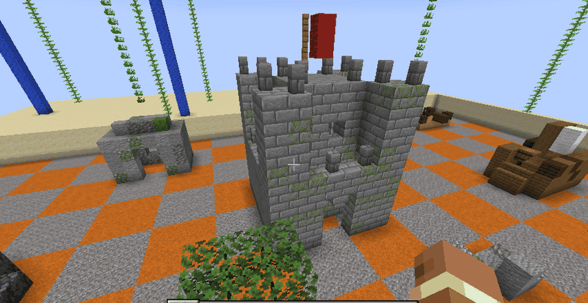
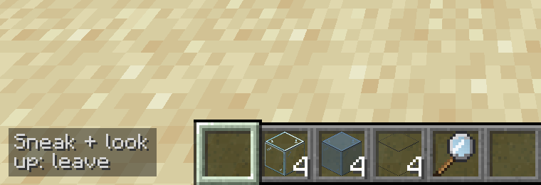

---
navigation:
  title: Interior and decoration
  icon: bettacraft:decor_castle
  position: 100
feature: interior.enabled
---

# Interior and decoration

Every aquarium has a room of its own: its **interior**. Step inside, build whatever you like with any blocks, and the
aquarium shows it as a **miniature** behind the glass.

## Entering and leaving

* **Enter:** **sneak + right-click** the aquarium with an empty hand, or use the *Interior* button in the tank menu.
  The first time the room has to be prepared ("Preparing the tank interior... 40 %"), that takes a moment.
* **Leave:** **sneak and look steeply up** (at the ceiling) for **3 seconds**, or use `/bettacraft interior leave`. You
  return to where you stood. Sneaking alone does not count, so you can sneak to set substrate without being thrown out;
  placing or breaking a block starts the 3 seconds over. A small hint at the bottom left of the screen reminds you
  ("Sneak + look up: leave") and fills a bar while you hold it; the client config `hud.interiorLeaveHint` turns the
  hint off (the bar still shows).
* If you log out inside, you stay inside. Several players can be in the same interior at the same time; each sees what
  the others build, and the miniature outside follows.
* While anyone is inside, the aquarium **cannot be broken**: not by hand (any of its blocks), not by explosions, and
  pistons cannot move tank blocks anyway. The message names who is inside.

* For a locked aquarium only the owner and operators may enter and build.

## Size

At the default **scale 16** one tank block becomes 16x16x16 interior blocks, so one interior block is one pixel of
the aquarium. A 2x1x1 aquarium has an interior of 32x16x16 blocks. Servers can choose scale 8 or 4 for new aquariums
(`interior.defaultScale`); an aquarium keeps the scale it was built with. For an aquarium with a
[free shape](aquarium/shapes.md) the interior covers its bounding box; the parts outside the shape are walled off.

## Building

* Build with any block of the game and of other mods. Walls and floor of the room cannot be broken.
* The interior is **dry**, but water plants work there: seagrass, kelp, corals and sea pickles can be placed and do not
  break; corals do not die.
* **Lily pads** (`#bettacraft:floating_plants`) can be placed anywhere and float. Bettas build their bubble nest under
  them.
* Beds and respawn anchors cannot be used inside.
* **No tank inside a tank:** aquarium blocks (also the fish tanks of Better Fish Tanks, block tag
  `#bettacraft:not_in_tank_interior`) cannot be placed in here, neither by hand nor by machines; one set with a command
  or a building tool breaks at once and drops as an item.
* Bettas swim around solid decoration. Other animals swim through it.
* [Heaters](equipment/heaters.md) and [internal filters](equipment/filters.md) are placed in here.

## The miniature

The miniature is built in the background and updated block by block. Block entities like chests or signs are not
shown. Very large builds stop at a limit (`interior.maxRenderedBlocks`); the tooltip of the interior button in the menu then says
"Render limit reached".

## In this chapter

<SubPages icons={true} />
