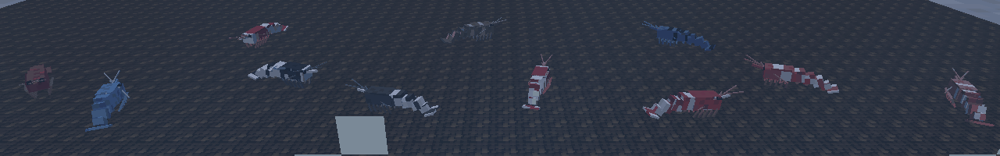

---
navigation:
  title: Active soil
  icon: bettacraft:active_soil
  parent: interior.md
  position: 11
item_ids:
  - bettacraft:active_soil
---

# Active soil

<ItemImage id="bettacraft:active_soil" /> **Active soil** is a substrate of fired clay granules with humic acids, made
for soft-water aquariums. Set it like any [substrate](substrate.md): **sneak + right-click** an interior floor block
with it in your hand (it costs one block per floor block; sneak + right-click with an empty hand gives it back).

What it does, by the share of the floor it covers:

* It pulls the **pH towards 6.2** (normal water ends at about 6.4 on a fully covered floor, softened water lower).
* It makes the water **soft**: the hardness counts half the TDS, and it slowly takes up minerals from the water.
* It feeds the plants: freshwater plants grow up to **a quarter faster** on a fully covered floor.
* It **keeps working**: unlike in the real hobby it never wears out and never needs replacing.

That makes it the substrate for [bee shrimp](../invertebrates/caridina.md) and other soft-water animals. Plain soil
(dirt, mud, podzol, moss ... the tag `#bettacraft:acid_substrate`) still lowers the pH, but only **half as strongly**,
and it does not make normal water soft. Datapacks can add more blocks to the tag `#bettacraft:active_soil`. More in
[water chemistry](../aquarium/water_chemistry.md).

Only for fresh water: in salt water the alkalinity of the sea salt buffers the pH, the substrate hardly moves it.

## Obtaining

* **[Aquarist villager](../getting_started/aquarist.md)** (Journeyman): 8 for 3 emeralds; one of about 4 in this offer (config `features.sources.aquaristVillager`).

Crafting:

<RecipesFor id="bettacraft:active_soil" />
