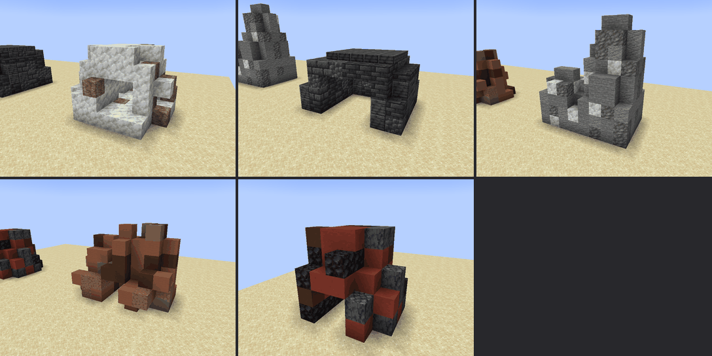

---
navigation:
  title: Stones and caves
  icon: bettacraft:decor_seiryu_stone
  parent: interior/decor.md
  position: 20
item_ids:
  - bettacraft:decor_holey_rock
  - bettacraft:decor_slate_cave
  - bettacraft:decor_seiryu_stone
  - bettacraft:decor_dragon_stone
  - bettacraft:decor_lava_rock
---

# Stones and caves

Stones of the aquascaping trade, most with a cave or holes. What they are made of counts in the
[water chemistry](../../aquarium/water_chemistry.md) like any block of the interior:

* **Holey rock** (Lochgestein): a pale lump of limestone (calcite, dripstone) full of holes, with two tunnels through it.
  Being limestone, it **hardens the water and raises the pH**, as it does for Malawi cichlids in real tanks.
* **Slate cave:** stacked slate plates under a wide roof plate, open to the front, for catfish and plecos.
* **Seiryu stone:** three grey, sharp-edged rocks with white calcite veins; the veins harden the water a little.
* **Dragon stone** (Ohko): clay-coloured, wrinkled and full of holes, with an arch to swim through. Inert; its
  terracotta gives young shrimp places to hide.
* **Lava rock:** porous red-brown and black rock with a small cave; young shrimp hide in its terracotta as well.

| Decoration | Size (width x depth, height) |
|---|---|
| <ItemLink id="bettacraft:decor_holey_rock" /> | 7x6, 5 high |
| <ItemLink id="bettacraft:decor_slate_cave" /> | 8x6, 5 high |
| <ItemLink id="bettacraft:decor_seiryu_stone" /> | 8x6, 9 high |
| <ItemLink id="bettacraft:decor_dragon_stone" /> | 8x6, 6 high |
| <ItemLink id="bettacraft:decor_lava_rock" /> | 6x5, 5 high |

## Obtaining

Crafting:

<RecipesFor id="bettacraft:decor_holey_rock" />
<RecipesFor id="bettacraft:decor_slate_cave" />
<RecipesFor id="bettacraft:decor_seiryu_stone" />
<RecipesFor id="bettacraft:decor_dragon_stone" />
<RecipesFor id="bettacraft:decor_lava_rock" />
