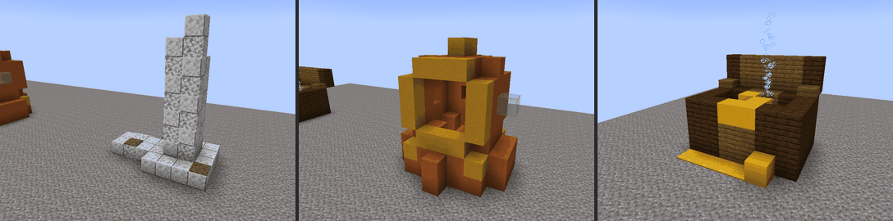

---
navigation:
  title: Ornaments
  icon: bettacraft:decor_treasure_chest
  parent: interior/decor.md
  position: 50
item_ids:
  - bettacraft:decor_ruin_column
  - bettacraft:decor_diver_helmet
  - bettacraft:decor_treasure_chest
---

# Ornaments

Not natural, but fun – like the [mini castle](../decor.md):

* **Ruined column:** a broken antique column on its plinth, a fallen drum and its capital beside it, moss on the stones.
* **Diving helmet:** an old brass helmet on its breastplate, with round side windows. The face window is open: small fish
  swim in and out.
* **Treasure chest:** an open chest full of gold coins (yellow concrete, no real gold) that spill out at the front.
  Hidden among the coins is an [air stone](../../equipment/air_stone.md): **bubbles rise only while an air pump** next to
  the tank drives it, and it counts as one of the pump's outlets.

| Decoration | Size (width x depth, height) |
|---|---|
| <ItemLink id="bettacraft:decor_ruin_column" /> | 7x4, 9 high |
| <ItemLink id="bettacraft:decor_diver_helmet" /> | 7x7, 8 high |
| <ItemLink id="bettacraft:decor_treasure_chest" /> | 6x6, 5 high |

## Obtaining

Crafting:

<RecipesFor id="bettacraft:decor_ruin_column" />
<RecipesFor id="bettacraft:decor_diver_helmet" />
<RecipesFor id="bettacraft:decor_treasure_chest" />
