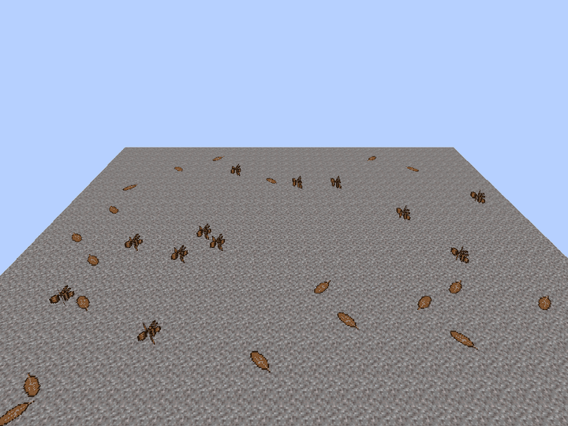

---
navigation:
  title: Leaf litter
  icon: bettacraft:alder_cone
  parent: interior/decor.md
  position: 60
item_ids:
  - bettacraft:alder_cone
  - bettacraft:alder_cones
  - bettacraft:almond_leaf_litter
---

# Leaf litter

Right-click the floor of the [interior](../../interior.md) (or any block) with an
<ItemLink id="bettacraft:almond_leaf" /> or an <ItemLink id="bettacraft:alder_cone" />: it lies there as leaf litter.
Break it to take it back. Right-clicking the tank from outside still puts the leaf into the water as before
([water chemistry](../../aquarium/water_chemistry.md)).

With `features.decor.effects` (and `features.waterChemistry.enabled`) litter in the interior:

* **gives off tannins** all the time: the water settles at about half of what as many leaves put into it would give
  (an alder cone a third of a leaf). That lowers the pH a little and tints the water.
* **feeds the shrimp:** they graze the biofilm on it (food per day 0.05 per leaf, 0.02 per cone, at most 1).
* gives young shrimp a few more places to hide (up to 5 %, fully from 8 pieces).

Alder cones: dry birch leaves in a smoker, furnace or on a campfire (alder and birch are one family).

## Obtaining

Crafting:

<RecipesFor id="bettacraft:alder_cone" />
