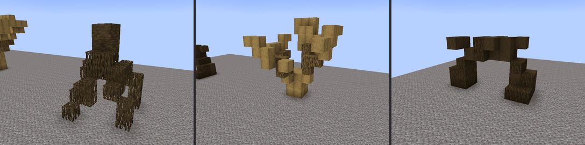

---
navigation:
  title: Roots
  icon: bettacraft:decor_spiderwood
  parent: interior/decor.md
  position: 30
item_ids:
  - bettacraft:decor_mangrove_root
  - bettacraft:decor_spiderwood
  - bettacraft:decor_bogwood_bridge
---

# Roots

Roots of wood. Logs and mangrove roots count as driftwood (`#bettacraft:driftwood`): they **lower the pH a
little** ([water chemistry](../../aquarium/water_chemistry.md)).

* **Mangrove root:** a short trunk raised on arching prop roots; fish swim underneath.
* **Spiderwood:** a light root stock with fine branches that fork again and again; mosses and epiphytes grow on it.
* **Bogwood bridge:** a dark, gnarled root arching over the bottom: a bridge to swim through.

| Decoration | Size (width x depth, height) |
|---|---|
| <ItemLink id="bettacraft:decor_mangrove_root" /> | 7x7, 7 high |
| <ItemLink id="bettacraft:decor_spiderwood" /> | 8x8, 9 high |
| <ItemLink id="bettacraft:decor_bogwood_bridge" /> | 8x4, 5 high |

## Obtaining

Crafting:

<RecipesFor id="bettacraft:decor_mangrove_root" />
<RecipesFor id="bettacraft:decor_spiderwood" />
<RecipesFor id="bettacraft:decor_bogwood_bridge" />
