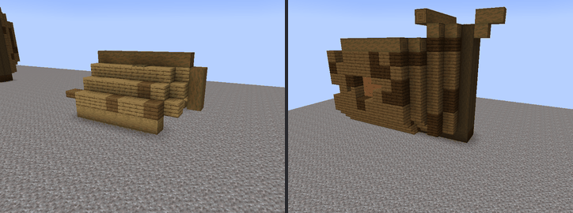

---
navigation:
  title: Wrecks
  icon: bettacraft:decor_ship_bow
  parent: interior/decor.md
  position: 10
item_ids:
  - bettacraft:decor_rowing_boat
  - bettacraft:decor_ship_bow
---

# Wrecks

Two more wrecks besides the [shipwreck](../decor.md):

* **Sunken rowing boat:** keel up on the bottom, a broken oar beside it. Under the hull is a low cave, open at the
  broken stern, where catfish hide.
* **Ship's bow:** the front of a sailing ship, broken off amidships, with its bowsprit, the forecastle deck and the
  stump of the foremast with a rag of sail. In the open hold lies a **clay pipe** of
  [spawning cave](../../tankmates/breeding.md) blocks with its mouth at the broken end: plecos breed in it like in the
  spawning cave, and they find their way in through the broken hull.

| Decoration | Size (width x depth, height) |
|---|---|
| <ItemLink id="bettacraft:decor_rowing_boat" /> | 10x8, 5 high |
| <ItemLink id="bettacraft:decor_ship_bow" /> | 14x10, 11 high |

## Obtaining

Crafting:

<RecipesFor id="bettacraft:decor_rowing_boat" />
<RecipesFor id="bettacraft:decor_ship_bow" />
