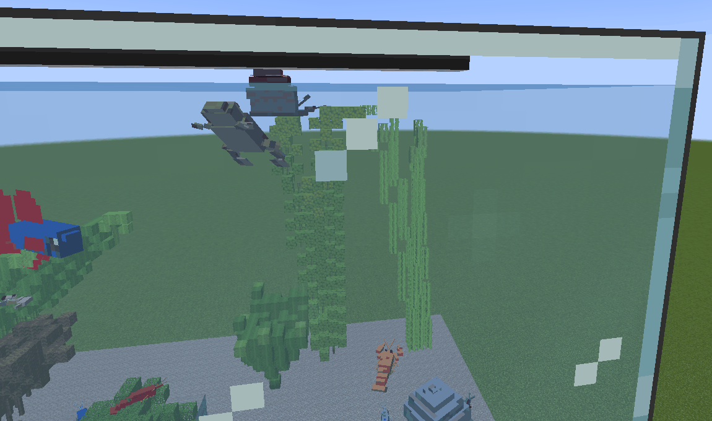
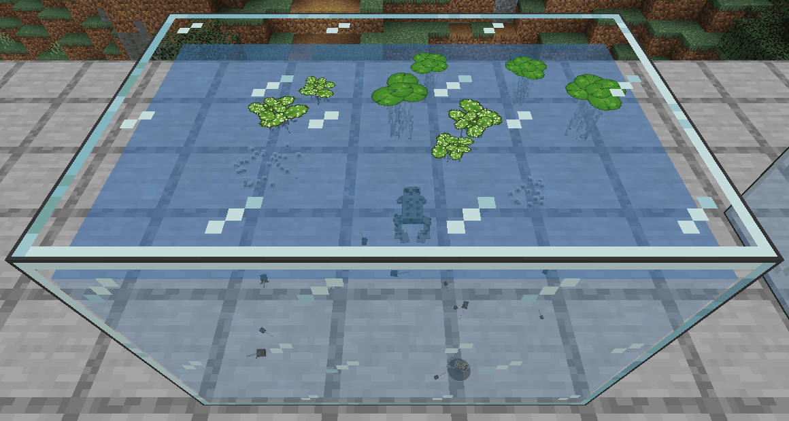
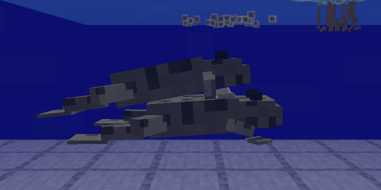

---
navigation:
  title: Dwarf clawed frog
  icon: bettacraft:dwarf_frog_bucket
  parent: invertebrates.md
  position: 40
item_ids:
  - bettacraft:dwarf_frog_bucket
  - bettacraft:dwarf_frog_spawn_egg
---

# Dwarf clawed frogs

The African dwarf clawed frog (*Hymenochirus*, about 3.5 cm) is a real animal in the tank like the bettas. It walks and
paddles along the bottom and every two minutes or so swims up to **breathe at the surface**. It finds its way around
the decoration of the interior (rocks, roots, plants, caves) instead of walking through it.

## Air

* A frog needs **air above the water**: the air gap under the glass (`tank.waterHeadroom` > 0, the default) or a tank
  that is not filled to the top. Without it the frog drowns slowly; the log and the menu warn you.
* In the animals tab of the menu a frog shows its health, its food and its air.

## Food

* Frogs eat **mosquito larvae**, **artemia** and **pellets** (they sink to the bottom), no fry food.
* They are **slow eaters**: with bettas in the tank each frog only gets its share with a chance (40 %,
  `frogs.frogFoodShareWithBettas`): the bettas snatch it away.
* **Sneak + right-click** the tank with food: it goes straight to the frogs. The feeder reaches them more often with
  two or three feedings a day.
* After 4 days without food a frog starts to starve.

## Breeding

Dwarf clawed frogs breed like in nature (config `features.frogs.breeding`):

1. **Amplexus:** a **cool water change** (a quarter of the water within a quarter of a day, 1.5 °C cooler, the trigger
   of the corydoras) into a tank at **24–28 °C** sets a pair off: within the next day a grown, fed male clasps a grown,
   fed female from behind, and she carries him up to the surface. Every frog has a sex (frogs from before 1.37 got one
   from their UUID).
2. **Spawn:** at the surface she releases 20–50 eggs; the spawn floats there among the floating plants for 2 days
   (`frogs.frogSpawnHatchDays`). **Bettas and other fish eat it**, the frogs a little too; **floating plants** hide most
   of it.
3. **Tadpoles** hatch (at most 40 per tank, `frogs.maxTadpoles`). They hover in the open water and need **fine food**:
   [infusoria](../food/live_food.md), artemia nauplii or fry food (a planted tank grows a little by itself). Two days
   without enough food and they starve. **With bettas in the tank hardly one survives**; plants hide them a little.
4. After 6 days (`frogs.tadpoleDays`) a tadpole becomes a small **froglet** that grows up in 4 days
   (`frogs.frogletDays`) and only breeds then.

The tank log tells every step. A tank of its own for the frogs, dense floating plants and an infusoria culture make the
best breeding tank.

## Obtaining

* **[Aquarium net](../equipment/tank_net.md)** in swamps: 1.3 % per swing (about 1 in 76 swings).
* **[Aquarium net](../equipment/tank_net.md)** in jungle water: 4.2–4.8 % per swing (about 1 in 21–24 swings).
* **Wild** in swamps, in groups of 1–2 (spawn weight 3) (config `features.frogs.wildSpawns`).
* **Wild** in jungle water, in groups of 1–2 (spawn weight 4) (config `features.frogs.wildSpawns`).
* **Wandering trader** (rare offers): 1 for 6 emeralds.

The biomes of biome mods count too ([biome tags](../settings.md)).
