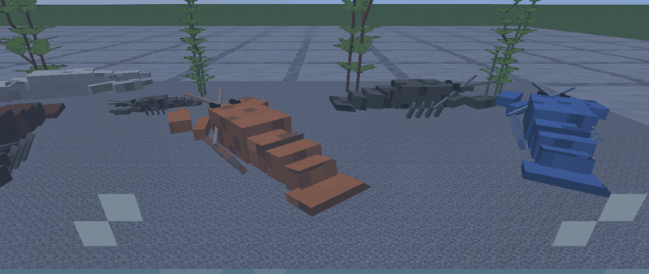

---
navigation:
  title: Florida crayfish
  icon: bettacraft:fish_bag
  parent: invertebrates.md
  position: 21
---

# Florida crayfish

The Florida crayfish *Procambarus alleni* comes from the swamps of Florida and is a **big crayfish**: about 10 cm, more
than twice the size of a [dwarf crayfish](dwarf_crayfish.md), with strong claws. It is famous for its **blue** form; an
**orange** form is bred too. It is not a peaceful clean-up animal: keep it in a tank of its own or with big, fast fish.

## Profile

| | |
|---|---|
| Group | Crayfish |
| Size in the game | about 9.5 cm (0.8 blocks) |
| Temperature | 15–28 °C |
| Water | fresh water, normal |
| Water chemistry | pH 6.0–8.4, TDS 0–700 ppm |
| Breeding | male and female; the female carries the eggs, the young hatch fully formed, 3–6 young |
| Growing up | about 6 days |
| Climbs the glass | no |
| Stocking | counts as 0.75 fish |
| Colour lines | 2 (bred from wild animals) |

## What it does in a tank

A big crayfish (also the [marbled crayfish](marbled_crayfish.md)) is a predator and a digger:

* **Small animals:** it catches shrimp, small snails, the young of the snails and dwarf crayfish (about 0.4 a day,
  `invertebrates.bigCrayfishPreyPerDay`). Dense plants, moss, clay tubes and leaf litter hide them.
* **Fish:** it eats fry, young fish and small bottom fish (corydoras, small loaches) and **pinches** bettas and other slow
  fish that rest near the floor (about 0.15 fish a day, `invertebrates.bigCrayfishFishPerDay`). Plants hide them.
* **Plants:** it eats a grown plant back by a stage now and then, and digs young rooted plants (cuttings) out of the
  substrate (about 0.3 a day, `invertebrates.bigCrayfishPlantsPerDay`). Epiphytes and moss on wood and stone (anubias,
  Java fern, Java moss) are safe: the classic planting for a crayfish tank.
* It eats the leftovers and the food that sinks to the floor, like every crayfish; it moults every few days and is soft
  for half a day afterwards.
* **Stocking:** one big crayfish counts as 0.75 fish. A bag holds 2, a bucket 4.

## Colours

* **Blue** and **orange**: recessive colours (like the shrimp colours), each at its own locus. Blue × orange gives
  wild-coloured young that carry both.
* **Wild form**: red-brown with a bluish sheen. Some wild animals carry blue or orange hidden.

## Breeding

Male and female; the female carries her eggs under the tail for 4 days, 3 to 6 young hatch fully formed and grow up in
6 days. The adults eat their own soft young now and then: plants and shelters help. 15 to 28 °C, hardy water.

## Obtaining

* **[Aquarium net](../equipment/tank_net.md)** in swamps: 1.1–1.4 % per swing (about 1 in 73–95 swings) (config `features.invertebrates.bigCrayfish`).
* **Wild** in swamps, in groups of 2–5 (spawn weight 1) (config `features.invertebrates.bigCrayfish`).
* **Wandering trader** (rare offers): 1 for 8 emeralds (config `features.invertebrates.bigCrayfish`).
* **Breeding** in the aquarium (male and female).

The biomes of biome mods count too ([biome tags](../settings.md)).
