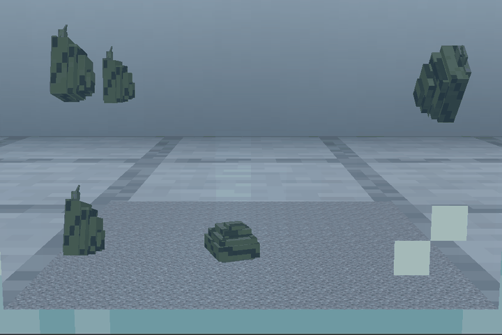

---
navigation:
  title: Olive Nerite
  icon: bettacraft:fish_bag
  parent: invertebrates/snails.md
  position: 30
---

# Olive Nerite

The olive nerite (*Neritina reclivata*) from the coasts of Florida and the Caribbean: a smooth olive-green shell.

## Profile

| | |
|---|---|
| Group | Snails |
| Size in the game | about 2 cm (0.18 blocks) |
| Temperature | 20–28 °C |
| Water | fresh, brackish or sea water, normal |
| Water chemistry | pH 6.8–8.6, TDS 100–700 ppm |
| Breeding | no young in fresh water |
| Algae | grazes 2 glass faces a day |
| Climbs the glass | yes |
| Stocking | 50 count as one fish |

## Care

* A good algae eater.
* Never multiplies in fresh water.

## Obtaining

* **[Aquarium net](../equipment/tank_net.md)** in mangrove swamps: 7.1–8.4 % per swing (about 1 in 12–14 swings), 1–2 at a time.
* **[Aquarium net](../equipment/tank_net.md)** at beaches: 9–11 % per swing (about 1 in 9–11 swings), 1–2 at a time.
* **Wild** in mangrove swamps, in groups of 2–5 (spawn weight 2) (config `features.invertebrates.wildSpawns`).
* **Wild** at beaches, in groups of 2–5 (spawn weight 2) (config `features.invertebrates.wildSpawns`).

The biomes of biome mods count too ([biome tags](../settings.md)).
