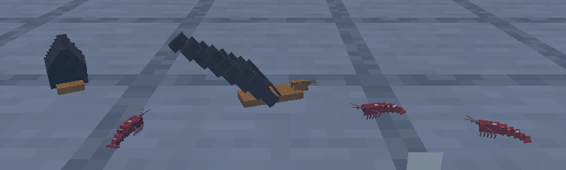

---
navigation:
  title: Tylomelania Snail
  icon: bettacraft:fish_bag
  parent: invertebrates/snails.md
  position: 95
---

# Tylomelania Snail

The Tylomelania ("rabbit snails") of the ancient lakes of **Sulawesi**: big, dark cone-shaped shells and a bright
orange body with long feelers. They live like the [cardinal shrimp](sulawesi_shrimp.md) in **hard, warm, alkaline
water** and graze the algae of the glass and the stones.

## Profile

| | |
|---|---|
| Group | Snails |
| Size in the game | about 5 cm (0.42 blocks) |
| Temperature | 24–30 °C |
| Water | fresh water, normal |
| Water chemistry | pH 7.5–8.6, TDS 150–350 ppm |
| Breeding | male and female, rarely one young at a time, 1–1 young |
| Growing up | about 8 days |
| Algae | grazes 0.8 glass faces a day |
| Climbs the glass | yes |
| Stocking | 50 count as one fish |

## Care

* **pH 7.5 to 8.6, TDS 150 to 350 ppm**, 24 to 30 °C: limestone on the floor or as rocks keeps the water right. Too
  soft or acidic water dissolves their shells: they get sick.
* They do not dig in like the trumpet snails, and they leave the plants alone.

## Breeding

* Male and female. They bear **live young**: now and then a female gives birth to a single, fully formed young snail.
  A group grows only slowly, so do not let them go when they get scarce.

## Obtaining

* **[Aquarium net](../equipment/tank_net.md)** in jungle water: 1.3–2.7 % per swing (about 1 in 36–77 swings) (config `features.invertebrates.sulawesi`).
* **Wild** in jungle water, in groups of 2–5 (spawn weight 1) (config `features.invertebrates.sulawesi`).
* **Wandering trader** (rare offers): 2 for 7 emeralds; one of 2 in this offer (config `features.invertebrates.sulawesi`).
* **Breeding** in the aquarium (male and female).

The biomes of biome mods count too ([biome tags](../settings.md)).
