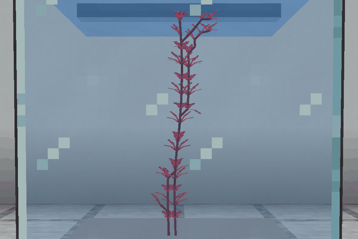

---
navigation:
  title: Alternanthera Reineckii
  icon: bettacraft:alternanthera_reineckii
  parent: plants/stem_plants.md
  position: 30
item_ids:
  - bettacraft:alternanthera_reineckii
---

# Alternanthera Reineckii

*Alternanthera reineckii* from South America: a stem plant with deep red leaves.

## Profile

| | |
|---|---|
| Growth form | stem plant |
| Grows on | substrate (sand, gravel, dirt, the interior floor) |
| Light | very strong (an LED panel or a high-power LED) |
| Full size | after about 3.5 days |
| Spreads | side shoots |
| Cuttings per trim | 3 |
| Colour | redder in strong light |

## Care

* Needs strong light for its colour.

## Obtaining

* **[Aquarium net](../equipment/tank_net.md)** in rivers: 0.4–0.48 % per swing (about 1 in 208–250 swings) (config `features.aquaticPlants.netCatches`).
* **[Aquarium net](../equipment/tank_net.md)** in swamps: 0.77–0.92 % per swing (about 1 in 108–130 swings) (config `features.aquaticPlants.netCatches`).
* **[Aquarium net](../equipment/tank_net.md)** in jungle water: 0.9–1.1 % per swing (about 1 in 92–111 swings) (config `features.aquaticPlants.netCatches`).
* **Fishing** in swamps: 0.19 % per catch (about 1 in 528 catches), instead of the fish.
* **Shears** on a wild plant in swamps: 100 % per cut (config `features.aquaticPlants.wildPlants`).
* **Wandering trader** (usual offers): 1 for 2 emeralds.
* **Cuttings**: shears on a grown plant give 3 cuttings per trim; it also spreads by itself (side shoots).

The biomes of biome mods count too ([biome tags](../settings.md)).
