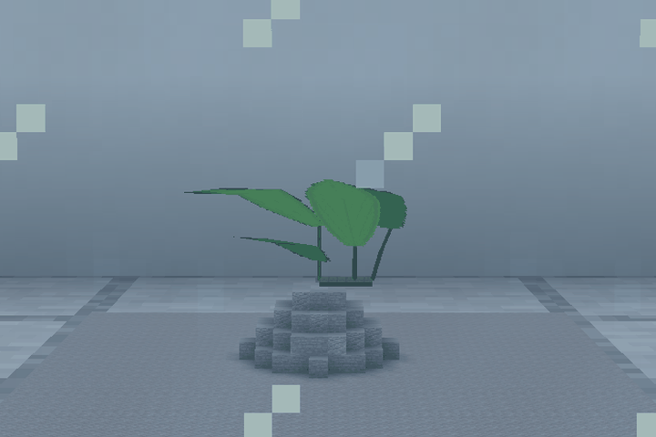

---
navigation:
  title: Anubias Nana
  icon: bettacraft:anubias_nana
  parent: plants/epiphytes.md
  position: 20
item_ids:
  - bettacraft:anubias_nana
---

# Anubias Nana

*Anubias barteri* var. *nana* from West Africa (Cameroon): small, broad dark-green leaves on a rhizome.

## Profile

| | |
|---|---|
| Growth form | epiphyte (rhizome) |
| Grows on | stone and wood (also decoration) |
| Light | low |
| Full size | after about 25 days |
| Spreads | no |
| Cuttings per trim | 1 |

## Care

* On stone or wood; very slow, but almost indestructible.
* Little light is enough.

## Obtaining

* **Fishing** in jungle water: 1 % per catch (about 1 in 97 catches), instead of the fish.
* **Fishing** in rivers: 0.97 % per catch (about 1 in 103 catches), instead of the fish.
* **Shears** on a wild plant in jungle water: 100 % per cut (config `features.aquaticPlants.wildPlants`).
* **[Aquarist villager](../getting_started/aquarist.md)** (Apprentice): 2 for 2 emeralds; one of about 8 in this offer (config `features.sources.aquaristVillager`).
* **Cuttings**: shears on a grown plant give 1 cutting per trim; breaking a rhizome piece divides it.

The biomes of biome mods count too ([biome tags](../settings.md)).
