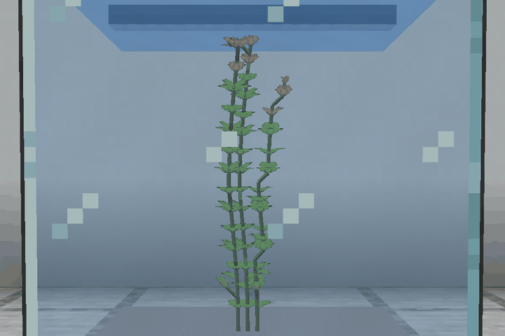

---
navigation:
  title: Bacopa Caroliniana
  icon: bettacraft:bacopa_caroliniana
  parent: plants/stem_plants.md
  position: 110
item_ids:
  - bettacraft:bacopa_caroliniana
---

# Bacopa Caroliniana

*Bacopa caroliniana* from the swamps of North America: thick, round leaves on sturdy stems.

## Profile

| | |
|---|---|
| Growth form | stem plant |
| Grows on | substrate (sand, gravel, dirt, the interior floor) |
| Light | medium |
| Full size | after about 4 days |
| Spreads | side shoots |
| Cuttings per trim | 3 |
| Colour | red tips in strong light |

## Care

* Robust; medium light.
* The tips turn copper in strong light.

## Obtaining

* **[Aquarium net](../equipment/tank_net.md)** in swamps: 0.38–0.46 % per swing (about 1 in 217–260 swings) (config `features.aquaticPlants.netCatches`).
* **Fishing** in swamps: 0.19 % per catch (about 1 in 528 catches), instead of the fish.
* **Shears** on a wild plant in swamps: 100 % per cut (config `features.aquaticPlants.wildPlants`).
* **Cuttings**: shears on a grown plant give 3 cuttings per trim; it also spreads by itself (side shoots).

The biomes of biome mods count too ([biome tags](../settings.md)).
