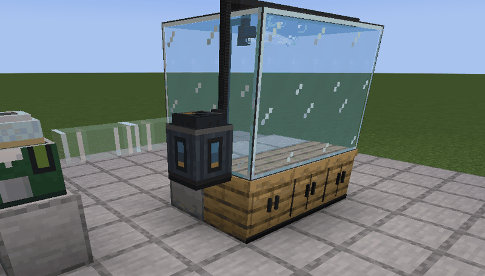
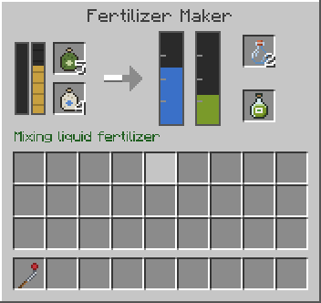

---
navigation:
  title: Fertilizer maker
  icon: bettacraft:fertilizer_maker
  parent: plants.md
  position: 13
feature: fertilizer.enabled
item_ids:
  - bettacraft:fertilizer_maker
---

# Fertilizer maker

<ItemImage id="bettacraft:fertilizer_maker" scale="2" />

The fertilizer maker mixes **one <ItemLink id="bettacraft:kelp_meal" />, one <ItemLink id="bettacraft:nutrient_salt" />
and 250 mB of water** into **250 mB of [liquid fertilizer](fertilizer.md)** (a bottle) in 10 seconds.

* **Water:** a water bucket (or reverse osmosis or sea water), a pipe or the tanks of other mods fill its water tank
  (4000 mB, the blue gauge).
* **Bottles:** empty glass bottles in the bottle slot are filled from the fertilizer tank (the green gauge).
* **Pipes:** while no bottle waits, the fertilizer goes by itself into a pipe or a tank next to it; a tank takes it only up
  to 100 %. Pipes and tanks of other mods may also drain it (fluid `bettacraft:fertilizer`).
* **Drive:** without power it runs on a spring: wind it with the [crank](../equipment/crank.md) (five seconds for a day).
  With power costs on it takes `fertilizer.fertilizerFePerTick` FE per tick while it works, and its spring when the FE
  is short. A shaft of **Create** pointing at it drives it too (64 RPM for full work).
* A redstone signal pauses it; a comparator reads how full the fertilizer tank is. Hoppers, AE2 and Refined Storage put
  kelp meal, nutrient salt and bottles in and take the filled bottles out.

## Obtaining

Crafting:

<RecipesFor id="bettacraft:fertilizer_maker" />
