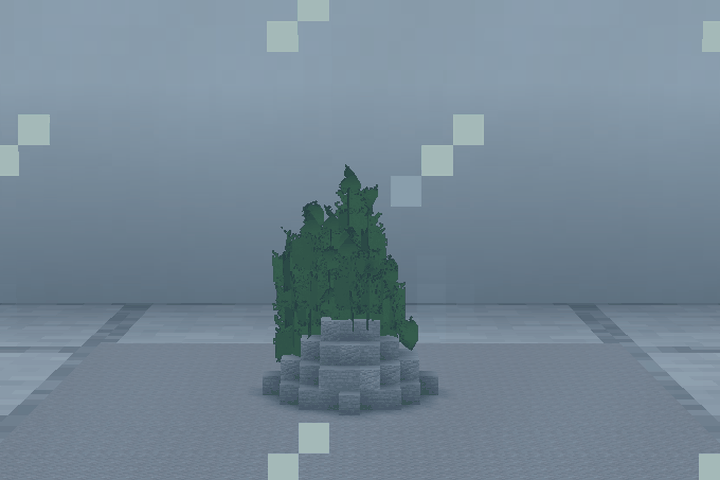

---
navigation:
  title: Flame Moss
  icon: bettacraft:flame_moss
  parent: plants/epiphytes.md
  position: 72
item_ids:
  - bettacraft:flame_moss
---

# Flame Moss

Flame moss (*Taxiphyllum* sp. "Flame"): upright, twisted tufts like little green flames.

## Profile

| | |
|---|---|
| Growth form | moss |
| Grows on | any solid block |
| Light | low |
| Full size | after about 8 days |
| Spreads | no |
| Cuttings per trim | 2 |

## Care

* Holds on to **any solid block**; little light.
* Grows up rather than out: nice on wood and in front of a background.

## Obtaining

* **[Aquarium net](../equipment/tank_net.md)** in rivers: 0.2–0.24 % per swing (about 1 in 417–500 swings) (config `features.aquaticPlants.netCatches`).
* **Fishing** in rivers: 0.1 % per catch (about 1 in 1033 catches), instead of the fish.
* **Shears** on a wild plant in rivers: 100 % per cut (config `features.aquaticPlants.wildPlants`).
* **Shears** on a wild plant in lush caves: 100 % per cut (config `features.aquaticPlants.wildPlants`).
* **Cuttings**: shears on a grown plant give 2 cuttings per trim.

The biomes of biome mods count too ([biome tags](../settings.md)).
