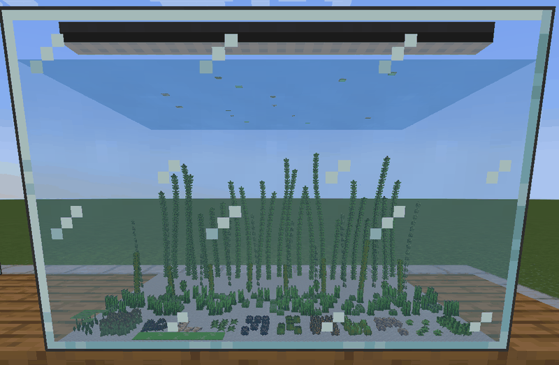
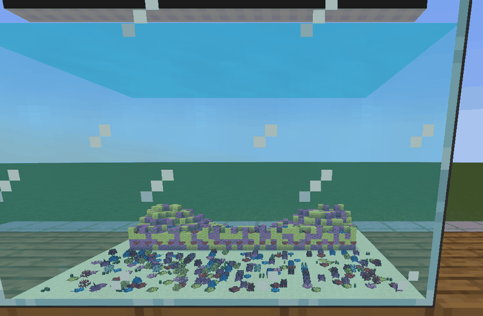

---
navigation:
  title: Plants of other mods
  icon: minecraft:kelp
  parent: plants.md
  position: 14
feature: aquaticPlants.foreignPlants
---

# Plants of other mods



Kelp, seagrass, lily pads, sea pickles and corals of Minecraft and the water plants of other mods can stand in the
[interior](../interior.md) of an aquarium too, and they **work** there like the aquarium plants of Bettacraft: they lower
the nitrate and take up waste, count as plants for breeding (the bonus of a well planted tank, hiding spots after
spawning), for the young shrimp and the food of the small animals, for the oxygen and against algae. Floating leaves
shade the surface like the leaves of a tiger lotus. In the miniature behind the glass they sway like our plants.

They **do not grow** and do not spread, and they have **no needs**: no light minimum, no warmth, no
[liquid fertilizer](fertilizer.md) (they do not use it and do not grow faster with it), no calcium or magnesium for the
corals and no salinity. In return they work a little less than ours.

## How strongly

The blocks of one plant that touch each other are one plant: a kelp column, a seagrass with both halves, a carpet of
algae, a giant lily pad of four blocks. Each plant works like a **full-grown plant of Bettacraft of the same growth form**
(a stem plant, a rosette, a carpet ...), times `interiorPlants.foreignPlantFactor` (default 0.6). At most
`interiorPlants.maxPlantsPerTank` of them count in one aquarium, like our own plants.



The **live rock** of Fintastic is a small biological filter in a salt water aquarium (0.6 times our
[live rock](../saltwater/reef_rock.md)); its dry rock (dead live rock) is decoration. Corals and epiphytes grow on both.
Driftwood: logs of every mod (`#minecraft:logs`) and mangrove roots lower the pH like our driftwood decoration
(`#bettacraft:driftwood`); the driftwood of Aquaculture is an item, not a block, and cannot be placed.

The plants tab of the aquarium shows how many plants of other mods count and their plant mass.

## The plants

| Mod | Blocks | Counts as | Effect |
|---|---|---|---|
| Minecraft | `#minecraft:coral_blocks` | coral | 190 blocks of plant mass per plant |
| Minecraft | `#minecraft:corals`, `#minecraft:wall_corals` | coral | 190 blocks of plant mass per plant |
| Minecraft | `minecraft:kelp`, `minecraft:kelp_plant` | stem plant | 120 blocks of plant mass per plant |
| Minecraft | `minecraft:lily_pad` | floating leaves | 44 blocks of plant mass per plant, shade |
| Minecraft | `minecraft:mangrove_leaves`, `minecraft:mangrove_propagule` | stem plant | 120 blocks of plant mass per plant |
| Minecraft | `minecraft:sea_pickle` | coral | 190 blocks of plant mass per plant |
| Minecraft | `minecraft:seagrass`, `minecraft:tall_seagrass` | ribbon plant | 83 blocks of plant mass per plant |
| Alex's Caves | `alexscaves:ping_pong_sponge` | coral | 190 blocks of plant mass per plant |
| Fintastic | `fintastic:amazon_sword`, `fintastic:tall_amazon_sword` | rosette | 71 blocks of plant mass per plant |
| Fintastic | `fintastic:anubias` | epiphyte | 68 blocks of plant mass per plant |
| Fintastic | `fintastic:aquatic_moss_block`, `fintastic:aquatic_moss_carpet`, `fintastic:aquatic_moss_phyllid` | moss | 78 blocks of plant mass per plant |
| Fintastic | `fintastic:blue_hypnea` | moss | 78 blocks of plant mass per plant |
| Fintastic | `fintastic:caulerpa` | ribbon plant | 83 blocks of plant mass per plant |
| Fintastic | `fintastic:dragons_breath_algae` | moss | 78 blocks of plant mass per plant |
| Fintastic | `fintastic:duckweed` | floating leaves | 44 blocks of plant mass per plant, shade |
| Fintastic | `fintastic:green_algae_block`, `fintastic:green_algae_carpet` | carpet | 44 blocks of plant mass per plant |
| Fintastic | `fintastic:hornwort` | stem plant | 120 blocks of plant mass per plant |
| Fintastic | `fintastic:live_rock`, `fintastic:porous_live_rock`, `fintastic:green_algae_live_rock`, `fintastic:red_algae_live_rock` | live rock | biological filter in salt water, 60 % of our live rock |
| Fintastic | `fintastic:lotus`, `fintastic:lotus_flower` | bulb | 100 blocks of plant mass per plant |
| Fintastic | `fintastic:lotus_pad` | floating leaves | 44 blocks of plant mass per plant, shade |
| Fintastic | `fintastic:mermaid_fan` | moss | 78 blocks of plant mass per plant |
| Fintastic | `fintastic:red_algae`, `fintastic:red_algae_fan`, `fintastic:red_algae_wall_fan` | moss | 78 blocks of plant mass per plant |
| Fintastic | `fintastic:red_algae_block`, `fintastic:red_algae_carpet` | carpet | 44 blocks of plant mass per plant |
| Fintastic | `fintastic:sea_grapes`, `fintastic:sea_grapes_plant` | stem plant | 120 blocks of plant mass per plant |
| Fintastic | `fintastic:stromatolite_growths` | carpet | 44 blocks of plant mass per plant |
| Regions Unexplored | `regions_unexplored:cattail` | ribbon plant | 83 blocks of plant mass per plant |
| Regions Unexplored | `regions_unexplored:duckweed` | floating leaves | 44 blocks of plant mass per plant, shade |
| Regions Unexplored | `regions_unexplored:flowering_lily_pad` | floating leaves | 44 blocks of plant mass per plant, shade |
| Regions Unexplored | `regions_unexplored:giant_lily_pad` | floating leaves | 44 blocks of plant mass per plant, shade |
| Twilight Forest | `twilightforest:huge_lily_pad` | floating leaves | 44 blocks of plant mass per plant, shade |
| Twilight Forest | `twilightforest:huge_water_lily` | floating leaves | 44 blocks of plant mass per plant, shade |

## For modpacks

What a block counts as is in data pack profiles, `data/<namespace>/bettacraft/foreign_plants/<name>.json`:

```json
{ "blocks": ["fintastic:hornwort"], "role": "stem", "factor": 1.0, "required": false }
```

`blocks` takes block ids and `#tags`; `role` is one of `stem`, `rosette`, `epiphyte`, `moss`, `carpet`, `ribbon`,
`bulb`, `floating`, `coral`, `live_rock` or `none` (a later file with `none` takes a default out again); `factor` works on
top of the config factor. Profiles of mods that are not installed are skipped quietly; an id missing from a mod that is
loaded (renamed in a newer version) is written to the log with similar ids of that mod. `/bettacraft foreign plants`
(operators) lists the plants of other mods in the aquarium you look at, or in every aquarium nearby, with their profile,
and the plant blocks of other mods in there that have none. Switch: `features.aquaticPlants.foreignPlants`.
