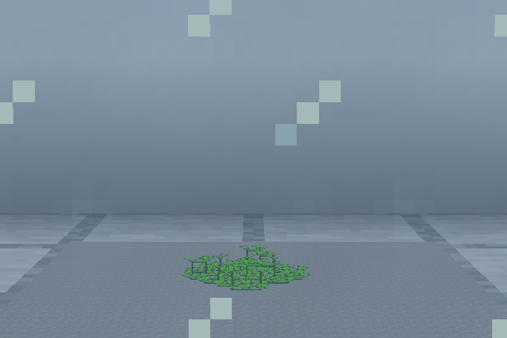

---
navigation:
  title: Hemianthus Callitrichoides 'Cuba'
  icon: bettacraft:hemianthus_callitrichoides
  parent: plants/runners.md
  position: 30
item_ids:
  - bettacraft:hemianthus_callitrichoides
---

# Hemianthus Callitrichoides 'Cuba'

Dwarf baby tears (*Hemianthus callitrichoides* "Cuba") from Cuba: the smallest leaves of all aquarium plants, a bright green cushion over the floor.

## Profile

| | |
|---|---|
| Growth form | carpet |
| Grows on | substrate (sand, gravel, dirt, the interior floor) |
| Light | very strong (an LED panel or a high-power LED) |
| Full size | after about 4 days |
| Spreads | runners |
| Cuttings per trim | 2 |
| CO2 | needed: without CO2 it grows at 40 % speed |

## Care

* Needs **very strong light** (an [LED panel](../equipment/led_panel.md) or a [high-power LED](../equipment/high_power_led.md)) and grows well only with [CO2](../equipment/co2.md).
* Spreads by runners into a dense carpet; trim it now and then.

## Obtaining

* **[Aquarium net](../equipment/tank_net.md)** in rivers: 0.08–0.1 % per swing (about 1 in 1042–1250 swings) (config `features.aquaticPlants.netCatches`).
* **Fishing** in rivers: 0.03 % per catch (about 1 in 3100 catches), instead of the fish.
* **Shears** on a wild plant in swamps: 100 % per cut (config `features.aquaticPlants.wildPlants`).
* **Cuttings**: shears on a grown plant give 2 cuttings per trim; it also spreads by itself (runners).

The biomes of biome mods count too ([biome tags](../settings.md)).
