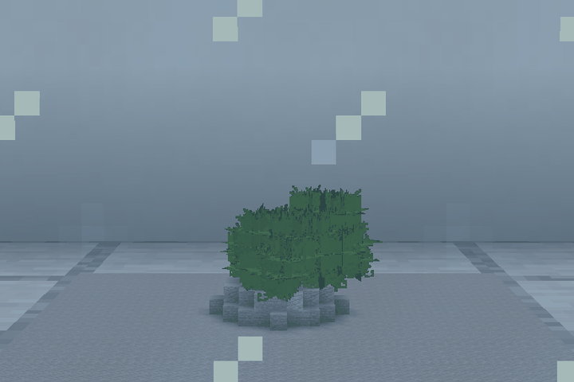

---
navigation:
  title: Java Moss
  icon: bettacraft:java_moss
  parent: plants/epiphytes.md
  position: 70
item_ids:
  - bettacraft:java_moss
---

# Java Moss

Java moss (*Taxiphyllum barbieri*) from South-East Asia: fine green sprigs that cover stones, wood and the ground.

## Profile

| | |
|---|---|
| Growth form | moss |
| Grows on | any solid block |
| Light | low |
| Full size | after about 6 days |
| Spreads | no |
| Cuttings per trim | 2 |

## Care

* Holds on to **any solid block**; little light.
* A favourite place for eggs of the egg scatterers and for shrimp.

## Obtaining

* **[Aquarium net](../equipment/tank_net.md)** in rivers: 0.6–0.72 % per swing (about 1 in 139–167 swings) (config `features.aquaticPlants.netCatches`).
* **[Aquarium net](../equipment/tank_net.md)** in jungle water: 0.68–0.81 % per swing (about 1 in 123–148 swings) (config `features.aquaticPlants.netCatches`).
* **Shears** on a moss block next to water: 50 % per cut.
* **Shears** on a wild plant in rivers: 100 % per cut (config `features.aquaticPlants.wildPlants`).
* **Shears** on a wild plant in mangrove swamps: 100 % per cut (config `features.aquaticPlants.wildPlants`).
* **Shears** on a wild plant in lush caves: 100 % per cut (config `features.aquaticPlants.wildPlants`).
* **[Aquarist villager](../getting_started/aquarist.md)** (Apprentice): 2 for 2 emeralds; one of about 12 in this offer (config `features.sources.aquaristVillager`).
* **Cuttings**: shears on a grown plant give 2 cuttings per trim.

The biomes of biome mods count too ([biome tags](../settings.md)).
