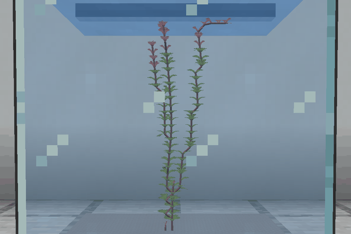

---
navigation:
  title: Rotala Wallichii
  icon: bettacraft:rotala_wallichii
  parent: plants/stem_plants.md
  position: 60
item_ids:
  - bettacraft:rotala_wallichii
---

# Rotala Wallichii

*Rotala wallichii* from South and Southeast Asia: fine needle leaves in dense whorls with pink tips.

## Profile

| | |
|---|---|
| Growth form | stem plant |
| Grows on | substrate (sand, gravel, dirt, the interior floor) |
| Light | very strong (an LED panel or a high-power LED) |
| Full size | after about 3.5 days |
| Spreads | side shoots |
| Cuttings per trim | 3 |
| Colour | red tips in strong light |
| CO2 | needed: without CO2 it grows at 40 % speed |
| Water chemistry | soft water: best up to pH 7 and 300 TDS, slower in hard water |

## Care

* Demanding: very strong light (an [LED panel or a high-power LED](../equipment/light.md)), [CO2](../equipment/co2.md) and soft water ([water chemistry](../aquarium/water_chemistry.md)).
* The tips turn pink in strong light.

## Obtaining

* **Fishing** in swamps: 0.09 % per catch (about 1 in 1057 catches), instead of the fish.
* **Shears** on a wild plant in jungle water: 100 % per cut (config `features.aquaticPlants.wildPlants`).
* **Cuttings**: shears on a grown plant give 3 cuttings per trim; it also spreads by itself (side shoots).

The biomes of biome mods count too ([biome tags](../settings.md)).
