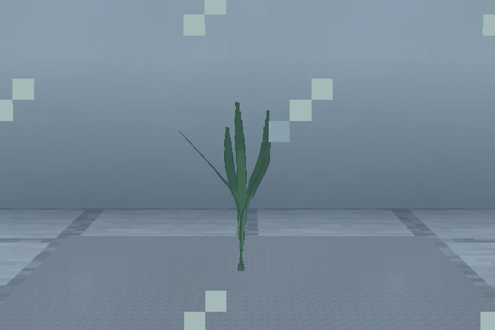

---
navigation:
  title: Sagittaria Subulata
  icon: bettacraft:sagittaria_subulata
  parent: plants/rosettes.md
  position: 60
item_ids:
  - bettacraft:sagittaria_subulata
---

# Sagittaria Subulata

Dwarf sagittaria (*Sagittaria subulata*) from the Americas: grass-like, narrow leaves.

## Profile

| | |
|---|---|
| Growth form | rosette |
| Grows on | substrate (sand, gravel, dirt, the interior floor) |
| Light | low |
| Full size | after about 4 days |
| Spreads | runners |
| Cuttings per trim | 1 |

## Care

* Undemanding, little light.
* Spreads quickly by runners.

## Obtaining

* **[Aquarium net](../equipment/tank_net.md)** in rivers: 0.24–0.29 % per swing (about 1 in 347–417 swings) (config `features.aquaticPlants.netCatches`).
* **Fishing** in rivers: 0.13 % per catch (about 1 in 775 catches), instead of the fish.
* **Shears** on a wild plant in rivers: 100 % per cut (config `features.aquaticPlants.wildPlants`).
* **[Aquarist villager](../getting_started/aquarist.md)** (Apprentice): 2 for 2 emeralds; one of about 12 in this offer (config `features.sources.aquaristVillager`).
* **Cuttings**: shears on a grown plant give 1 cutting per trim; it also spreads by itself (runners).

The biomes of biome mods count too ([biome tags](../settings.md)).
