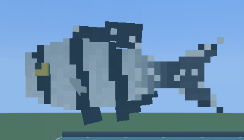

---
navigation:
  title: Banggai Cardinalfish
  icon: bettacraft:banggai_cardinal_bucket
  parent: saltwater/reef_animals.md
  position: 70
item_ids:
  - bettacraft:banggai_cardinal_bucket
  - bettacraft:banggai_cardinal_spawn_egg
---

# Banggai Cardinalfish

The Banggai cardinalfish (*Pterapogon kauderni*): silver with three black bars and long fins dotted white; calm, slow and the easiest reef fish to breed.

**Origin:** the shallow bays of the Banggai islands off Sulawesi (Indonesia); nowhere else in the wild.

## Profile

| | |
|---|---|
| Group | Cardinalfish |
| Scientific name | *Pterapogon kauderni* |
| Size in the game | about 7 cm (0.6 blocks) |
| Temperature | 24–28 °C |
| Breeding temperature | 25–28 °C |
| Water | sea water, normal |
| Water chemistry | pH 7.8–8.6 |
| Shoal | alone or as a pair |
| Swims | in the middle |
| Stocking | counts as 0.8 fish |
| Breeding | Mouthbrooder: the male carries the eggs in his mouth, the young come out fully formed, 8–20 young |

## Breeding

A **mouthbrooder** whose **male** broods: at 25–28 °C the female passes her eggs to the male, who carries them in his mouth
(the log says so). After half again the gestation of a livebearer (`tankmates.gestationDays` x 1.5) he releases 8–20 young that
come out **fully formed**: they are juveniles at once, need no fry food and no breeding box. Keep a pair; other fish rarely
catch the young.

## Keeping

* Sea water, 24–28 °C, water: normal. Peaceful; hangs calmly in the middle of the tank.

## Obtaining

* **[Aquarium net](../equipment/tank_net.md)** in warm oceans (coral reefs): 0.67–0.8 % per swing (about 1 in 124–148 swings).
* **Wild** in warm oceans (coral reefs), alone (spawn weight 2) (config `features.saltwater.moreReefAnimals`).
* **Wandering trader** (usual offers): 2 for 3 emeralds; one of 5 in this offer.
* **[Breeding](reef_animals.md)**: Mouthbrooder: the male carries the eggs in his mouth, the young come out fully formed.

The biomes of biome mods count too ([biome tags](../settings.md)).
