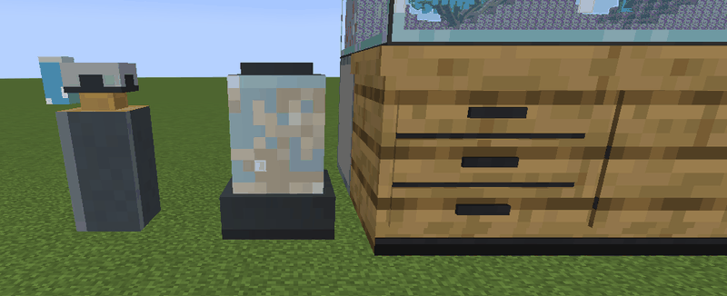
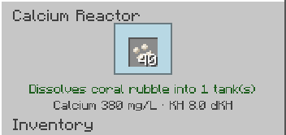

---
navigation:
  title: Calcium reactor
  icon: bettacraft:calcium_reactor
  parent: saltwater/technique.md
  position: 45
item_ids:
  - bettacraft:calcium_reactor
  - bettacraft:coral_rubble
---

# Calcium reactor

The **calcium reactor** is the other way besides the [dosing pump](dosing_pump.md) to give the stony corals what they use:
the tank water runs through a closed column of **coral rubble**; **CO2** makes it acidic, the rubble (calcium carbonate)
dissolves and the water comes back with **calcium and alkalinity** in the ratio the corals use them.

* **Place it** next to a salt water tank, next to the [cabinet of its sump](../equipment/sump.md), or on a
  [pipe](../equipment/pipes.md) to the tanks (pipes join it on every side but the front).
* **CO2:** a [CO2 gas cylinder](../equipment/co2.md) with gas next to it (any side); it takes a little gas while it runs.
* **Coral rubble:** by hand or with a hopper into its slot. One dead coral block makes 4, a calcite block 2.
* It adds **40 mg/L calcium a day** in one block of water (`sump.calciumReactorCalciumPerDay`; the alkalinity follows) and
  uses 2 rubble a day (`sump.calciumReactorRubblePerDay`). It holds the calcium at about **440 mg/L**: above that its valve
  closes.
* Right-click: its window with the rubble, what it does and the calcium and KH of the tank. A comparator reads how full the
  column is.

Switch: `features.sump.calciumReactor` (needs corals and CO2 on).

## Obtaining

Crafting:

<RecipesFor id="bettacraft:calcium_reactor" />
<RecipesFor id="bettacraft:coral_rubble" />
