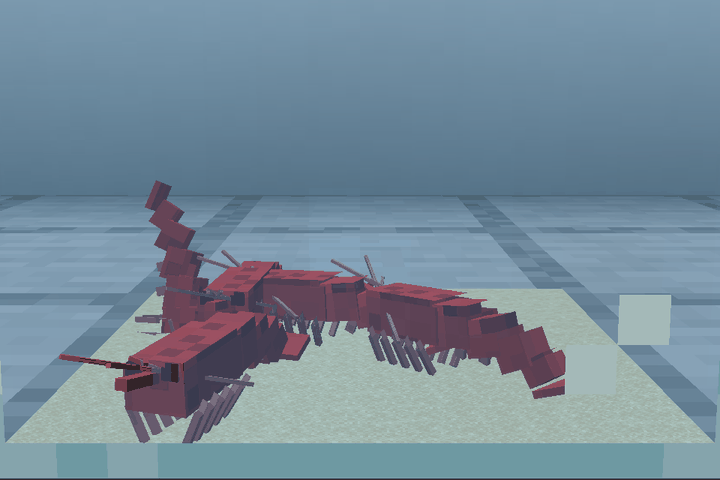

---
navigation:
  title: Pacific Cleaner Shrimp
  icon: bettacraft:fish_bag
  parent: saltwater/reef_invertebrates.md
  position: 10
---

# Pacific Cleaner Shrimp

The Pacific cleaner shrimp (*Lysmata amboinensis*) from the Indo-Pacific: red and white striped with long white feelers; it picks parasites and dead skin off the fish.

## Profile

| | |
|---|---|
| Group | Shrimp |
| Size in the game | about 5.5 cm (0.45 blocks) |
| Temperature | 23–28 °C |
| Water | sea water, sensitive |
| Water chemistry | pH 7.8–8.6 |
| Breeding | does not breed in a tank |
| Algae | grazes 0.05 glass faces a day |
| Climbs the glass | yes |
| Stocking | 25 count as one fish |

## Care

* The fish in its tank **heal half again as fast**.
* Sea water only; it does not breed in a tank.

## Obtaining

* **[Aquarium net](../equipment/tank_net.md)** in warm oceans (coral reefs): 6–6.9 % per swing (about 1 in 14–17 swings), 1–3 at a time.
* **[Aquarium net](../equipment/tank_net.md)** in lukewarm oceans: 1.8–2.1 % per swing (about 1 in 47–55 swings), 1–3 at a time.
* **Wild** in warm oceans (coral reefs), in groups of 2–5 (spawn weight 1) (config `features.invertebrates.wildSpawns`).
* **Wild** in lukewarm oceans, in groups of 2–5 (spawn weight 1) (config `features.invertebrates.wildSpawns`).
* **Wandering trader** (rare offers): 1 for 5 emeralds; one of 2 in this offer.

The biomes of biome mods count too ([biome tags](../settings.md)).
