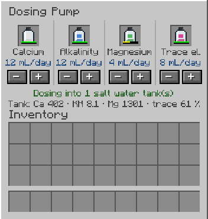

---
navigation:
  title: Dosing pump
  icon: bettacraft:dosing_pump
  parent: saltwater/technique.md
  position: 40
item_ids:
  - bettacraft:dosing_pump
  - bettacraft:dosing_canister
  - bettacraft:calcium_canister
  - bettacraft:alkalinity_canister
  - bettacraft:magnesium_canister
  - bettacraft:trace_canister
---

# Dosing pump

<GameScene zoom="4" interactive={true}>
  <Block id="bettacraft:tank" x="0" p:east="true" p:fill="14" />
  <Block id="bettacraft:tank" x="1" p:west="true" p:fill="14" />
  <Block id="bettacraft:dosing_pump" x="2" p:facing="west" />
</GameScene>

The dosing pump keeps the [reef chemistry](reef_chemistry.md) of a salt water tank steady: four channels, each with a
canister of solution and its own mL per day. It doses a little every second, day and night, and needs no power.

* **Place it next to a salt water tank** (any side), or **join it to pipes** that lead into tanks: pipes join it on
  every side but the front (the [pipes](../equipment/pipes.md) of the aquarium). Several tanks share the dose.
* **Right-click**: put the canisters into the four slots (any canister in any channel) and set the mL per day of each
  channel with **-** and **+** (sneak: by 10; 0 = off). The window shows what the pump does and the calcium, alkalinity,
  magnesium and trace elements of the tank.
* It **only doses into salt water** (from 20 ‰). Fresh and brackish tanks are left alone.
* A canister holds 500 mL (`dosing.canisterMl`). Used up it turns into an empty canister: refill it in the crafting
  grid. Hoppers put full canisters in and take empty ones out; a comparator reads how full the emptiest canister is.

## How much?

One mL of solution raises one block of water by 2 mg/L calcium, 0.07 dKH alkalinity, 4 mg/L magnesium or 15 % trace
elements (`dosing.*PerMl`): a tank of 40 water blocks with 10 mL of calcium a day gets 0.5 mg/L a day. Watch the values
in the window or the [tank menu](../aquarium/menu.md) for a few days and adjust:

* **Calcium and alkalinity** in about **equal mL**: the stony corals use them in that ratio.
* **Magnesium**: a few mL a day are enough.
* **Trace elements**: enough to stay above 60 % for the strong colours.

Too much does no harm to the animals, but it is wasted.

## Obtaining

Crafting:

<RecipesFor id="bettacraft:dosing_pump" />
<RecipesFor id="bettacraft:dosing_canister" />
<RecipesFor id="bettacraft:calcium_canister" />
<RecipesFor id="bettacraft:alkalinity_canister" />
<RecipesFor id="bettacraft:magnesium_canister" />
<RecipesFor id="bettacraft:trace_canister" />
