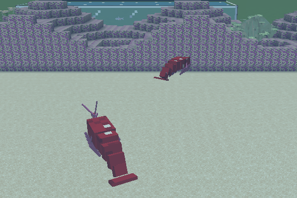

---
navigation:
  title: Fire Shrimp
  icon: bettacraft:fish_bag
  parent: saltwater/reef_invertebrates.md
  position: 15
---

# Fire Shrimp

The fire shrimp or blood red cleaner shrimp (*Lysmata debelius*) from the Indo-Pacific: deep red with white dots, white legs and long white feelers; shy, it hides in the rock by day.

## Profile

| | |
|---|---|
| Group | Shrimp |
| Size in the game | about 5 cm (0.42 blocks) |
| Temperature | 24–28 °C |
| Water | sea water, sensitive |
| Water chemistry | pH 7.8–8.6 |
| Breeding | does not breed in a tank |
| Climbs the glass | yes |
| Stocking | 25 count as one fish |

## Care

* A cleaner like the cleaner shrimp: the fish in its tank **heal half again as fast**.
* Sea water only; it does not breed in a tank.

## Obtaining

* **[Aquarium net](../equipment/tank_net.md)** in warm oceans (coral reefs): 1.8–2.1 % per swing (about 1 in 48–56 swings), 1–3 at a time (config `features.saltwater.moreReefAnimals`).
* **[Aquarium net](../equipment/tank_net.md)** in lukewarm oceans: 0.73–0.86 % per swing (about 1 in 117–136 swings), 1–3 at a time (config `features.saltwater.moreReefAnimals`).
* **Wild** in warm oceans (coral reefs), in groups of 2–5 (spawn weight 1) (config `features.saltwater.moreReefAnimals`).
* **Wild** in lukewarm oceans, in groups of 2–5 (spawn weight 1) (config `features.saltwater.moreReefAnimals`).
* **Wandering trader** (rare offers): 1 for 8 emeralds.

The biomes of biome mods count too ([biome tags](../settings.md)).
