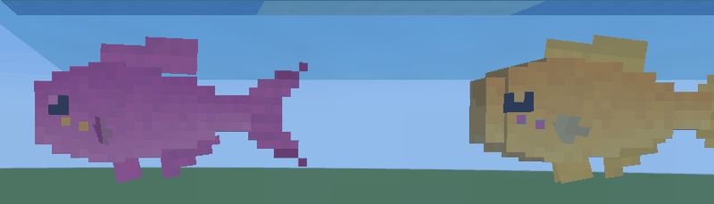

---
navigation:
  title: Lyretail Anthias
  icon: bettacraft:lyretail_anthias_bucket
  parent: saltwater/reef_animals.md
  position: 80
item_ids:
  - bettacraft:lyretail_anthias_bucket
  - bettacraft:lyretail_anthias_spawn_egg
---

# Lyretail Anthias

The lyretail anthias or sea goldie (*Pseudanthias squamipinnis*), a fairy basslet: the females orange-gold with a violet streak below the eye, the male magenta with a long first dorsal ray and a lyre tail.

**Origin:** reef slopes of the Indo-Pacific and the Red Sea, in big shoals above the corals.

## Profile

| | |
|---|---|
| Group | Anthias |
| Scientific name | *Pseudanthias squamipinnis* |
| Size in the game | about 7 cm (0.6 blocks) |
| Temperature | 23–28 °C |
| Water | sea water, sensitive |
| Water chemistry | pH 7.8–8.6 |
| Shoal | from 5 fish |
| Swims | in the middle |
| Stocking | counts as 0.7 fish |
| Breeding | Does not breed in a tank |

## Keeping

* A **shoal of 5 or more**: alone or in twos they are stressed.
* It picks plankton from the open water all day and is **hungry again after a third of a day**: feed it three times a day, or
  set an automatic feeder to short intervals.
* Sea water, 23–28 °C, water: sensitive. Does not breed in a tank.

## Obtaining

* **[Aquarium net](../equipment/tank_net.md)** in warm oceans (coral reefs): 1–1.2 % per swing (about 1 in 83–99 swings), 1–4 at a time.
* **[Aquarium net](../equipment/tank_net.md)** in lukewarm oceans: 0.71–0.85 % per swing (about 1 in 118–142 swings), 1–4 at a time.
* **Wild** in warm oceans (coral reefs), in groups of 3–5 (spawn weight 3) (config `features.saltwater.moreReefAnimals`).
* **Wild** in lukewarm oceans, in groups of 3–5 (spawn weight 1) (config `features.saltwater.moreReefAnimals`).
* **Wandering trader** (rare offers): 6 for 8 emeralds; one of 5 in this offer.

The biomes of biome mods count too ([biome tags](../settings.md)).
