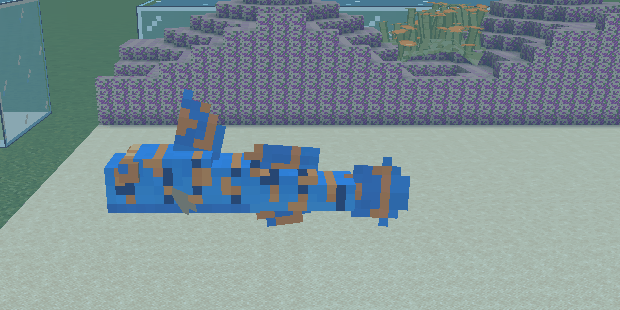

---
navigation:
  title: Mandarinfish
  icon: bettacraft:mandarinfish_bucket
  parent: saltwater/reef_animals.md
  position: 60
item_ids:
  - bettacraft:mandarinfish_bucket
  - bettacraft:mandarinfish_spawn_egg
---

# Mandarinfish

The mandarin dragonet (*Synchiropus splendidus*): a small, slow bottom fish with a maze of orange wavy lines on bright blue. It hovers over the rock and picks tiny copepods all day long.

**Origin:** lagoons and sheltered reef flats of the western Pacific, from the Philippines to Australia.

## Profile

| | |
|---|---|
| Group | Dragonets |
| Scientific name | *Synchiropus splendidus* |
| Size in the game | about 6 cm (0.5 blocks) |
| Temperature | 24–28 °C |
| Water | sea water, sensitive |
| Water chemistry | pH 7.8–8.6 |
| Shoal | alone or as a pair |
| Swims | on the bottom |
| Stocking | counts as 0.6 fish |
| Breeding | Does not breed in a tank |

## Copepods

The mandarin takes **no fed food at all**: no pellets, no flakes, no frozen or live food. It lives on the **copepods** of the
[live rock](reef_rock.md):

* Live rock in salt water holds copepods: about 24 portions per tank block of live rock (16 x 16 x 16 interior blocks at scale
  16; config `reef.copepodsPerLiveRock`). They grow back by themselves, fastest at half the stock, and a few always come out
  of the rock. A new rock pile needs about a week to fill up: let the tank mature before the mandarin moves in.
* A grown mandarin eats one portion a day (`reef.mandarinCopepodsPerDay`), a young one half. With half of that or more he stays
  fed; with less he goes hungry, gets sick and starves like any fish.
* The other small reef fish pick some copepods too: a mandarin needs a **quiet tank** with few competitors. One mandarin wants
  about a quarter of a tank block of live rock (a floor of rock in a 2 x 2 tank) to itself.
* The menu shows the copepods in the reef line of the water tab (in % of what the rock holds); the tank log says when they run
  short.

## Keeping

* Sea water only, calm and clean (water: sensitive).
* Does not breed in a tank.

## Obtaining

* **[Aquarium net](../equipment/tank_net.md)** in warm oceans (coral reefs): 0.51–0.6 % per swing (about 1 in 166–198 swings).
* **Wild** in warm oceans (coral reefs), alone (spawn weight 2) (config `features.saltwater.moreReefAnimals`).
* **Wandering trader** (rare offers): 2 for 6 emeralds; one of 5 in this offer.

The biomes of biome mods count too ([biome tags](../settings.md)).
