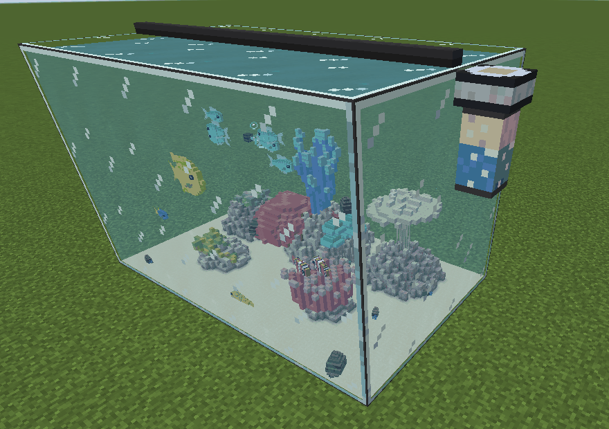

---
navigation:
  title: Reef technique
  icon: bettacraft:protein_skimmer
  parent: saltwater.md
  position: 20
---

# Reef technique

## Light

Corals live on the light of their algae: under a [tank light](../equipment.md) they grow, in the dark not at all. The
colour matters (the M18 coloured lights): **actinic** blue light (blue, light blue, cyan or purple) mixed with white is
best (100 %), only blue 85 %, only white 70 %, other colours 40 %, sunlight 60 %. Under actinic light the corals glow
in their brightest colours.

## In this chapter

<SubPages icons={true} />
