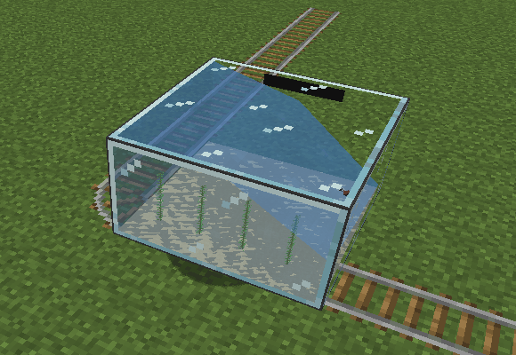
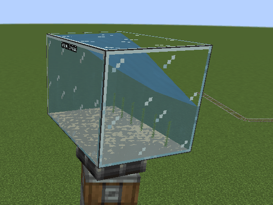
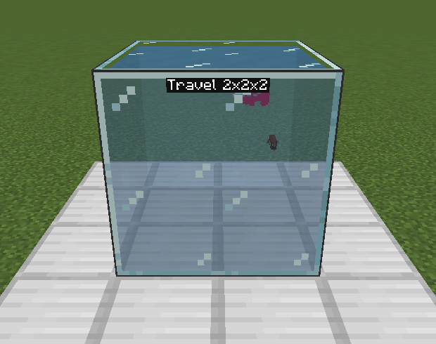

---
navigation:
  title: Moving tanks with Create
  icon: minecraft:minecart
  parent: settings.md
  position: 30
feature: compat.create.enabled
---

# Moving tanks with Create

With **Create** an aquarium can travel: on a mechanical piston, a bearing, a rope pulley, a gantry, a minecart or a
train, and with **Create Aeronautics** on an airship (the switch `features.compat.create.contraptions`, on by default).

## The trip

* **The whole tank goes.** All blocks of an aquarium hold together like glued, so a contraption that takes one of them
  takes the whole tank. Equipment outside the glass only comes along when it is part of the contraption (glued to the
  tank with super glue, or a cabinet glued under it): an external filter with its heaters and coolers, the cabinet with
  its filter, a [drive adapter](../equipment/drive_adapter.md). What stays behind works again once the tank is back.
* **The animals are packed** into the tank for the trip, like into a fish bag: bettas, tankmates and the fish of other
  mods. On the contraption you see the aquarium with its water, its miniature interior and the animals swimming their
  rounds: a picture of the packed animals as they are now (a hungry or sick animal swims slower and lower).
* **The care goes on** while the tank travels (switch `features.compat.create.travelCare`, on by default), see below.
  With the switch off it pauses as before: nobody gets hungry, the water stays as it is, nothing grows or breeds.
* **Put down** (the piston retracts, the bearing stops, the train arrives, the airship is disassembled), the tank is the
  same aquarium again: its water, the values of the water, its name and log, the floating plants, shrimp and snails,
  the interior with its plants and decorations, and every animal at the place it had in the tank. A tank put down turned
  takes its interior with it; lying on its side, its old floor substrate comes out as items.
* Blocks of a tank that do not arrive (the contraption could not put them down) count as broken.

## Care on the road

On a Create contraption the aquarium has no block of its own while it moves, only its data. Every second of the trip
that data is cared for like a tank on the ground:

* **Hunger and health:** bettas, tankmates and the animals of other mods with a care profile get hungry, and bad water
  or the wrong temperature stress them, as in the tank. On the road nobody dies: an animal at the brink waits for the
  arrival (then the normal care decides). Shrimp, snails and the other small animals simply wait.
* **Temperature:** the water goes towards the air of the biome the contraption is in, by day and night. Heaters and
  coolers that travel along (heater rods in the interior, heaters in a filter on the contraption) hold the target.
* **Water quality:** the waste of the animals dirties the water, the filters that travel along clean it (internal and
  corner filters of the interior, an external filter or cabinet filter on the contraption, live rock).
* **Breeding pauses** on a contraption, and nobody can be put in or taken out.
* **Arrived:** the tank's log tells how long it was on the road, how much of the time its devices had power and how
  much FE the contraption gave.

## Power on the road

Where a server makes the devices need FE (`power.heater`, `power.filter`), the travelling filters and heaters take it
like on the ground. Without it they stop and the values slowly get worse, as in a power cut. On a contraption the FE
comes from:

* the tank's own **buffer** (what it had stored when it left);
* **drive adapters** at the tank that travel along: no Create network turns on a contraption, so an adapter turns with
  the trip itself. At `createTravel.dynamoFullSpeed` blocks per second (8 by default) it gives the full power of an input
  (`createDrive.fePerTickPerInput`), slower proportionally; on a bearing it counts how fast the adapter moves, so one at
  the axis gives nothing;
* **FE batteries** of other mods glued to the contraption next to the tank (up to `createTravel.batteryFePerTick` FE per
  tick each).

The advancement **Fish Transport with Power** comes with the first trip whose filter and heater ran on that power.

## Sloshing water

The water of a travelling tank is not stiff: when the contraption speeds up, brakes or takes a curve, or a bearing
turns it, the surface tilts the way the water is pushed and swings back after a stop, with waves running over it. It
also stays level when a bearing tilts the tank. Only the picture changes, not the water or the animals. `render.travelSloshing`
(client config) makes it stronger or weaker, 0 turns it off.

## If a tank cannot be put down

Create drops a block it cannot place (an unbreakable block is in the way) as an item. Nothing of the aquarium is lost:

* If other blocks of the tank came down, they are the aquarium, with its water, values, interior and every animal; only
  the missing block counts as broken.
* If none came down (a tank of one block, or all of them failed), the dropped tank block is a **packed tank**: its
  tooltip says how many animals travel in it. Placed again anywhere, it is the same aquarium with its interior and
  animals; it stands as that one block (the interior of the other blocks comes out as items).

If a contraption with a tank on it is destroyed (killed by a command, fallen out of the world), the tank is gone with
it, and so is its interior. Trains that go into unloaded chunks keep their tanks.

## Rotation for the devices

A turning Create shaft, cogwheel, gearbox or motor whose shaft points at a **water pump**, **filter pump head**,
**water change controller**, **level sensor**, **reverse osmosis unit** or **food maker** drives it instead of FE
(switch `features.compat.create.rotation`):

* **64 RPM** (either direction) is full work, slower is proportional: 32 RPM is half the flow, half the boost.
* The pumps and controllers need the rotation only where a server makes them need FE (`power.costs`).
* The reverse osmosis unit gets its pressure-pump boost from rotation even with power costs off.
* The food maker on FE runs on the rotation; without FE the rotation winds its spring (at full speed twice as fast as
  the machine uses it), no crank needed.
* The devices cost **no stress**: they are not part of Create's network, they only take the speed of the shaft.
  An overstressed network gives them nothing.

**The whole tank on one shaft:** a [drive adapter](../equipment/drive_adapter.md) on a tank wall or under the tank, or a
shaft on the side of the cabinet under it, charges the tank's FE buffer, so every device of the tank runs on rotation.
These two cost **real stress**, by the load of the devices (switch `features.compat.create.drive`).

## Display Links

A Create **Display Link** placed on an aquarium block reads **Tank values**: one line per value (temperature, water
quality, pH, TDS, oxygen, CO2, nitrate, fill, animals, food, salinity and so on), as many as the target has rows, so a
sign shows the first four and a display board as many as it is high. On a **monitor** it reads **Monitored tanks**:
one line per tank of the monitor with its name, temperature and water quality (switch `features.compat.create.displayLinks`).

## Create pipes

Create's fluid pipes, pumps, spouts and hose pulleys fill and drain aquariums through the same connection as the
Bettacraft pipes: fresh water in, used water out, like the pipes of every other mod.

## When a tank cannot travel

The contraption does not start, and players nearby read why:

* somebody is inside the tank's interior;
* there are eggs in the bubble nest;
* eggs or young of the tankmates, the breeding box or turtle eggs would not survive the trip.

## On an airship

On a Create Aeronautics airship the aquarium stays a real block on the ship. With `features.compat.create.travelCare` on
it simply lives on: the bettas and the other animals of Bettacraft swim in it on the ship, eat, grow and breed, and the
care, the devices and the power work as on the ground: a filter, heater or light on the ship, FE from cables and
batteries, a [drive adapter](../equipment/drive_adapter.md) on a shaft that a generator of the ship turns. The
temperature comes from the air where the ship flies. Animals of Minecraft and of other mods travel packed (the airship
would push them out of it), and nobody can enter the interior while it flies. Disassembled, everything is back on the
ground. With the switch off the tank waits packed until the airship is disassembled again, as before.

