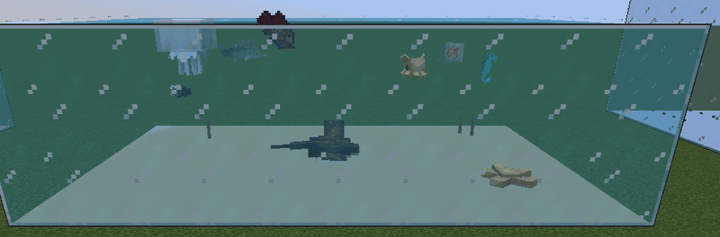
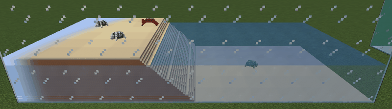

---
navigation:
  title: List of animals of other mods
  icon: minecraft:pufferfish_bucket
  parent: settings.md
  position: 25
feature: foreignAnimals.enabled
---

# List of animals of other mods

Every animal of another mod that Bettacraft ships a [profile](foreign_profiles.md) for, and the animals it refuses. The
tables below are made from the profiles themselves. A mod that is not installed simply has no animals in the game.

## What is special

* **Big fish** (arapaima, coelacanth, tuna, gar, the big catfish, the manta ray and the shark of Living Things ...) go into
  [big tanks](../big_tanks.md) by the size rule with their real length: per metre 12 × 6 × 3 blocks and 100 blocks of
  water. Put them in and take them out with the large net and the transport tub (or their own bucket). They do not breed
  in a tank; the big predators among them eat small fish.
* **Turtles of Aquaculture** live by our turtle rules: the box turtle in a humid terrarium, the arrau turtle (0.8 m, a big
  animal) and the starshell turtle in a paludarium, with UV, a basking spot and land. A female and a male lay their eggs
  into sand or soil, and the **temperature of the nest decides the sex** of the young like in our turtles: a warm nest gives
  females, a cool one males (half and half at the temperature of the table). The tank menu shows ♀ and ♂.
* **Fish of Thieves** pass their colour variant on: every young takes the variant of one parent. **Trophy fish** go into a
  tank but do not breed, and no young is born a trophy.
* **Jellyfish** live in sea water on live food. (Real ones need a round tank with a gentle current; Bettacraft keeps it
  simple, filters do not suck them in.)
* **Look-alikes:** Fintastic's dwarf frog, the seahorse and the crab of Living Things live next to our
  [dwarf clawed frog](../invertebrates/dwarf_clawed_frog.md), our [seahorses](../saltwater/seahorses.md) and crabs; each keeps the
  name of its mod.
* **Food of other mods:** Fintastic's copepods, daphnia and fairy shrimp are live food (and Fintastic's daphnia start a
  [daphnia barrel](../food/daphnia_barrel.md)); the fish flakes of Fish Eggs are flake food; its fish eggs and squid eggs are
  protein-rich frozen food that conditions for breeding like tubifex.

## Water animals

| Mod | Animals | Water | Size rule | Food | Breeding |
|---|---|---|---|---|---|
| Aquaculture 2 | `aquaculture:arapaima` | fresh, 24–30 °C | 2.5 m: 30 × 15 × 8 blocks, 1563 blocks of room | pellets and flakes, live and frozen food, `#c:foods/raw_fish` | no |
| Aquaculture 2 | `aquaculture:atlantic_cod` | sea, 2–15 °C | 1 m: 12 × 6 × 3 blocks, 100 blocks of room | pellets and flakes, live and frozen food, `#c:foods/raw_fish` | no |
| Aquaculture 2 | `aquaculture:bayad` | fresh, 20–28 °C | 0.8 m: 10 × 5 × 3 blocks, 52 blocks of room | pellets and flakes, live and frozen food, `#c:foods/raw_fish` | no |
| Aquaculture 2 | `aquaculture:blackfish` | sea, 8–22 °C | – | pellets and flakes, live and frozen food | eggs, from 24 water blocks |
| Aquaculture 2 | `aquaculture:capitaine` | fresh, 22–30 °C | 1.5 m: 18 × 9 × 5 blocks, 338 blocks of room | pellets and flakes, live and frozen food, `#c:foods/raw_fish` | no |
| Aquaculture 2 | `aquaculture:carp` | fresh, 4–30 °C | – | pellets and flakes, live and frozen food | eggs on plants, from 24 water blocks |
| Aquaculture 2 | `aquaculture:catfish` | fresh, 10–30 °C | 1 m: 12 × 6 × 3 blocks, 100 blocks of room | pellets and flakes, live and frozen food, `#c:foods/raw_fish` | no |
| Aquaculture 2 | `aquaculture:bluegill`, `aquaculture:perch`, `aquaculture:smallmouth_bass` | fresh, 6–28 °C | – | pellets and flakes, live and frozen food | eggs, from 24 water blocks |
| Aquaculture 2 | `aquaculture:gar` | fresh to brackish, 15–30 °C | 1.5 m: 18 × 9 × 5 blocks, 338 blocks of room | pellets and flakes, live and frozen food, `#c:foods/raw_fish` | no |
| Aquaculture 2 | `aquaculture:atlantic_halibut`, `aquaculture:pacific_halibut` | sea, 2–12 °C | 1.5 m: 18 × 9 × 5 blocks, 338 blocks of room | pellets and flakes, live and frozen food, `#c:foods/raw_fish` | no |
| Aquaculture 2 | `aquaculture:atlantic_herring` | sea, 2–16 °C | – | pellets and flakes, live and frozen food | eggs, from 24 water blocks |
| Aquaculture 2 | `aquaculture:jellyfish` | sea, 12–26 °C | – | live and frozen food, fry food | no |
| Aquaculture 2 | `aquaculture:minnow` | fresh, 4–24 °C | – | pellets and flakes, live and frozen food | eggs on plants |
| Aquaculture 2 | `aquaculture:muskellunge` | fresh, 4–26 °C | 1.2 m: 15 × 8 × 4 blocks, 173 blocks of room | pellets and flakes, live and frozen food, `#c:foods/raw_fish` | no |
| Aquaculture 2 | `aquaculture:pink_salmon` | fresh or sea, 4–16 °C | – | pellets and flakes, live and frozen food | eggs, from 24 water blocks |
| Aquaculture 2 | `aquaculture:pollock` | sea, 2–14 °C | 0.9 m: 11 × 6 × 3 blocks, 73 blocks of room | pellets and flakes, live and frozen food, `#c:foods/raw_fish` | no |
| Aquaculture 2 | `aquaculture:red_grouper` | sea, 18–28 °C | 0.9 m: 11 × 6 × 3 blocks, 73 blocks of room | pellets and flakes, live and frozen food, `#c:foods/raw_fish` | no |
| Aquaculture 2 | `aquaculture:synodontis` | fresh, 22–28 °C | – | pellets and flakes, live and frozen food | no |
| Aquaculture 2 | `aquaculture:tambaqui` | fresh, 24–30 °C | 0.9 m: 11 × 6 × 3 blocks, 73 blocks of room | pellets and flakes, live and frozen food, `#c:foods/fruit` | no |
| Aquaculture 2 | `aquaculture:boulti`, `aquaculture:piranha` | fresh, 22–30 °C | – | pellets and flakes, live and frozen food | eggs, from 24 water blocks |
| Aquaculture 2 | `aquaculture:brown_trout`, `aquaculture:rainbow_trout` | fresh, 4–18 °C | – | pellets and flakes, live and frozen food | eggs, from 24 water blocks |
| Aquaculture 2 | `aquaculture:tuna` | sea, 14–28 °C | 2 m: 24 × 12 × 6 blocks, 800 blocks of room | pellets and flakes, `#c:foods/raw_fish` | no |
| Critters and Companions | `crittersandcompanions:dumbo_octopus` | sea, 2–10 °C | – | live and frozen food, pellets and flakes | no |
| Critters and Companions | `crittersandcompanions:koi_fish` | fresh, 4–28 °C | – | pellets and flakes, live and frozen food | eggs on plants, from 16 water blocks, variants inherited |
| Critters and Companions | `crittersandcompanions:sea_bunny` | sea, 18–28 °C | – | pellets and flakes | no |
| Fintastic | `fintastic:arapaima` | fresh, 24–30 °C | 2.5 m: 30 × 15 × 8 blocks, 1563 blocks of room | pellets and flakes, live and frozen food, `#c:foods/raw_fish` | no |
| Fintastic | `fintastic:catfish` | fresh to brackish, 20–28 °C | 1.2 m: 15 × 8 × 4 blocks, 173 blocks of room | pellets and flakes, live and frozen food, `#c:foods/raw_fish` | no |
| Fintastic | `fintastic:fintastic_cod` | sea, 2–18 °C | – | pellets and flakes, live and frozen food | eggs, from 24 water blocks, variants inherited |
| Fintastic | `fintastic:coelacanth` | sea, 14–22 °C | 2 m: 24 × 12 × 6 blocks, 800 blocks of room | pellets and flakes, live and frozen food, `#c:foods/raw_fish` | no |
| Fintastic | `fintastic:dwarf_frog` | fresh, 22–28 °C | – | live and frozen food, pellets and flakes | eggs on plants, variants inherited |
| Fintastic | `fintastic:featherback` | fresh, 24–30 °C | 0.8 m: 10 × 5 × 3 blocks, 52 blocks of room | pellets and flakes, live and frozen food, `#c:foods/raw_fish` | no |
| Fintastic | `fintastic:gourami` | fresh, 24–29 °C | – | pellets and flakes, live and frozen food | eggs, variants inherited |
| Fintastic | `fintastic:guppy` | fresh to brackish, 22–28 °C | – | pellets and flakes, live and frozen food, fry food | live young, variants inherited |
| Fintastic | `fintastic:minnow` | fresh, 14–26 °C | – | pellets and flakes, live and frozen food, fry food | eggs on plants, variants inherited |
| Fintastic | `fintastic:moony` | brackish, 24–28 °C | – | pellets and flakes, live and frozen food | no |
| Fintastic | `fintastic:pleco` | fresh, 21–28 °C | – | pellets and flakes, live and frozen food | eggs, variants inherited |
| Fintastic | `fintastic:fintastic_salmon` | fresh or sea, 2–20 °C | – | pellets and flakes, live and frozen food | eggs, from 24 water blocks, variants inherited |
| Fintastic | `fintastic:freshwater_shark` | fresh, 22–28 °C | – | pellets and flakes, live and frozen food | eggs on plants, from 16 water blocks, variants inherited |
| Fintastic | `fintastic:small_catfish` | fresh, 20–26 °C | – | pellets and flakes, live and frozen food | eggs |
| Fish of Thieves | `fishofthieves:ancientscale` | fresh or sea, 16–26 °C | – | pellets and flakes, live and frozen food | eggs, from 8 water blocks, variants inherited, trophies do not breed |
| Fish of Thieves | `fishofthieves:battlegill` | fresh or sea, 20–28 °C | – | pellets and flakes, live and frozen food | eggs, from 8 water blocks, variants inherited, trophies do not breed |
| Fish of Thieves | `fishofthieves:devilfish` | fresh or sea, 24–32 °C | – | pellets and flakes, live and frozen food | eggs, from 8 water blocks, variants inherited, trophies do not breed |
| Fish of Thieves | `fishofthieves:islehopper` | fresh or sea, 20–28 °C | – | pellets and flakes, live and frozen food | eggs, from 8 water blocks, variants inherited, trophies do not breed |
| Fish of Thieves | `fishofthieves:plentifin` | fresh or sea, 20–28 °C | – | pellets and flakes, live and frozen food | eggs, from 8 water blocks, variants inherited, trophies do not breed |
| Fish of Thieves | `fishofthieves:pondie` | fresh, 16–26 °C | – | pellets and flakes, live and frozen food | eggs, from 8 water blocks, variants inherited, trophies do not breed |
| Fish of Thieves | `fishofthieves:splashtail` | sea, 18–28 °C | – | pellets and flakes, live and frozen food | eggs, from 8 water blocks, variants inherited, trophies do not breed |
| Fish of Thieves | `fishofthieves:stormfish` | sea, 10–24 °C | – | pellets and flakes, live and frozen food | eggs, from 8 water blocks, variants inherited, trophies do not breed |
| Fish of Thieves | `fishofthieves:wildsplash` | fresh or sea, 22–30 °C | – | pellets and flakes, live and frozen food | eggs, from 8 water blocks, variants inherited, trophies do not breed |
| Fish of Thieves | `fishofthieves:wrecker` | sea, 12–24 °C | – | pellets and flakes, live and frozen food | eggs, from 8 water blocks, variants inherited, trophies do not breed |
| Living Things | `livingthings:mantaray` | sea, 22–28 °C | 2.5 m: 30 × 15 × 8 blocks, 1563 blocks of room | live and frozen food, fry food, pellets and flakes | no |
| Living Things | `livingthings:seahorse` | sea, 22–26 °C | – | live and frozen food, fry food | live young, variants inherited |
| Living Things | `livingthings:shark` | sea, 22–28 °C | 2 m: 24 × 12 × 6 blocks, 800 blocks of room | `#c:foods/raw_fish`, pellets and flakes, live and frozen food | no |
| Naturalist | `naturalist:clam` | sea, 24–29 °C | 0.6 m: 8 × 4 × 2 blocks, 22 blocks of room | fry food, live and frozen food | no |
| Naturalist | `naturalist:bass`, `naturalist:catfish` | fresh, 6–30 °C | – | pellets and flakes, live and frozen food | eggs, from 24 water blocks |
| Naturalist | `naturalist:giant_isopod` | sea, 4–14 °C | – | pellets and flakes, `#c:foods/raw_fish` | no |
| Naturalist | `naturalist:jellyfish` | sea, 12–26 °C | 0.3 m: 4 × 2 × 1 blocks, 3 blocks of room | live and frozen food, fry food | no |
| Naturalist | `naturalist:piranha` | fresh, 23–30 °C | – | pellets and flakes, live and frozen food | eggs on plants, from 16 water blocks |
| Naturalist | `naturalist:ray` | sea, 20–28 °C | 0.8 m: 10 × 5 × 3 blocks, 52 blocks of room | pellets and flakes, live and frozen food, `#c:foods/raw_fish` | no |
| Naturalist | `naturalist:starfish` | sea, 18–26 °C | – | pellets and flakes, `#c:foods/raw_fish` | no |

## Land and marsh animals

| Mod | Animals | Tank | Size rule | Food | Breeding |
|---|---|---|---|---|---|
| Aquaculture 2 | `aquaculture:arrau_turtle` | paludarium, 26–34 °C | 0.8 m: 10 × 5 × 3 blocks, 52 blocks of room | `#bettacraft:turtle_greens`, `#c:foods/fruit`, pellets and flakes | eggs into a nest on the land, the nest temperature decides the sex (half and half at 33.5 °C) |
| Aquaculture 2 | `aquaculture:box_turtle` | terrarium, 22–30 °C | – | `#bettacraft:turtle_greens`, `#bettacraft:feeder_insects`, `#c:foods/fruit` | eggs into a nest on the land, the nest temperature decides the sex (half and half at 28.5 °C) |
| Aquaculture 2 | `aquaculture:starshell_turtle` | paludarium, 22–32 °C | – | `#bettacraft:turtle_greens`, pellets and flakes, live and frozen food | eggs into a nest on the land, the nest temperature decides the sex (half and half at 29 °C) |
| Critters and Companions | `crittersandcompanions:dragonfly` | paludarium, 18–32 °C | 0.1 m: 2 × 1 × 1 blocks, 1 blocks of room | `#bettacraft:small_feeder_insects` | no |
| Critters and Companions | `crittersandcompanions:ferret` | terrarium, 5–28 °C | 0.5 m: 6 × 3 × 2 blocks, 13 blocks of room | `#c:foods/raw_meat`, `minecraft:egg` | live young, a female and a male |
| Critters and Companions | `crittersandcompanions:jumping_spider` | terrarium, 20–30 °C | – | `#bettacraft:small_feeder_insects`, `#bettacraft:feeder_insects` | no |
| Critters and Companions | `crittersandcompanions:ladybug` | terrarium, 15–28 °C | – | `#minecraft:leaves`, `#minecraft:flowers`, `#bettacraft:turtle_greens` | no |
| Critters and Companions | `crittersandcompanions:leaf_insect` | terrarium, 22–30 °C | – | `#minecraft:leaves` | eggs into a nest on the land |
| Critters and Companions | `crittersandcompanions:otter` | paludarium, 0–28 °C | 1 m: 12 × 6 × 3 blocks, 100 blocks of room | `#minecraft:fishes`, `#c:foods/raw_fish`, `crittersandcompanions:clam` | live young |
| Critters and Companions | `crittersandcompanions:red_panda` | terrarium, 0–25 °C | 0.6 m: 8 × 4 × 2 blocks, 22 blocks of room | `minecraft:bamboo`, `#c:foods/fruit`, `minecraft:sweet_berries`, `#minecraft:leaves` | live young, a female and a male |
| Critters and Companions | `crittersandcompanions:roly_poly` | terrarium, 15–27 °C | – | `#minecraft:leaves`, `#bettacraft:turtle_greens`, `minecraft:carrot`, `minecraft:potato` | live young |
| Critters and Companions | `crittersandcompanions:shima_enaga` | terrarium, -5–25 °C | – | `#c:seeds`, `#bettacraft:small_feeder_insects` | eggs, a female and a male |
| Critters and Companions | `crittersandcompanions:snail` | terrarium, 15–26 °C | – | `#bettacraft:turtle_greens`, `#minecraft:leaves`, `minecraft:carrot`, `minecraft:beetroot` | eggs into a nest on the land |
| Critters and Companions | `crittersandcompanions:stag_beetle` | terrarium, 18–28 °C | – | `#c:foods/fruit`, `minecraft:sugar`, `minecraft:sweet_berries` | no |
| Critters and Companions | `crittersandcompanions:stick_bug` | terrarium, 22–30 °C | – | `#minecraft:leaves` | no |
| Critters and Companions | `crittersandcompanions:weevil` | terrarium, 15–28 °C | – | `#c:seeds`, `minecraft:sweet_berries`, `#c:foods/fruit` | no |
| Living Things | `livingthings:crab` | paludarium, 18–30 °C | – | pellets and flakes, `#c:foods/raw_fish` | no |
| Living Things | `livingthings:flamingo` | paludarium, 18–36 °C | 1.2 m: 15 × 8 × 4 blocks, 173 blocks of room | live and frozen food, fry food | eggs into a nest on the land, a female and a male |
| Living Things | `livingthings:koala` | terrarium, 15–32 °C | 0.7 m: 9 × 5 × 3 blocks, 35 blocks of room | `#minecraft:leaves` | live young, a female and a male |
| Living Things | `livingthings:monkey` | terrarium, 22–32 °C | 0.6 m: 8 × 4 × 2 blocks, 22 blocks of room | `#c:foods/fruit`, `minecraft:melon_slice`, `minecraft:sweet_berries` | live young, a female and a male |
| Living Things | `livingthings:owl` | terrarium, 0–28 °C | 0.5 m: 6 × 3 × 2 blocks, 13 blocks of room | `#c:foods/raw_meat` | eggs, a female and a male, variants inherited |
| Living Things | `livingthings:peacock` | terrarium, 10–32 °C | 1 m: 12 × 6 × 3 blocks, 100 blocks of room | `#c:seeds`, `minecraft:wheat`, `#bettacraft:turtle_greens` | eggs into a nest on the land, a female and a male |
| Living Things | `livingthings:penguin` | paludarium, -10–12 °C | 0.9 m: 11 × 6 × 3 blocks, 73 blocks of room | `#c:foods/raw_fish`, `#minecraft:fishes` | eggs into a nest on the land, a female and a male |
| Living Things | `livingthings:raccoon` | terrarium or paludarium, 0–30 °C | 0.6 m: 8 × 4 × 2 blocks, 22 blocks of room | `#c:foods/fruit`, `#c:foods/raw_fish`, `#c:seeds`, `minecraft:sweet_berries` | live young, a female and a male |
| Living Things | `livingthings:snail` | terrarium, 15–26 °C | – | `#bettacraft:turtle_greens`, `#minecraft:leaves`, `minecraft:carrot`, `minecraft:beetroot` | eggs into a nest on the land, variants inherited |
| Minecraft | `minecraft:armadillo` | terrarium, 18–36 °C | – | `#minecraft:armadillo_food`, `#bettacraft:feeder_insects` | live young, a female and a male |
| Minecraft | `minecraft:bat` | terrarium, 10–30 °C | 0.2 m: 2 × 1 × 1 blocks, 1 blocks of room | `#bettacraft:feeder_insects`, `#bettacraft:small_feeder_insects`, `#c:foods/fruit` | live young, a female and a male |
| Minecraft | `minecraft:bee` | terrarium, 12–32 °C; needs flowers and a beehive | – | `#minecraft:bee_food`, `#minecraft:flowers`, `minecraft:honey_bottle` | live young |
| Minecraft | `minecraft:cat` | terrarium, 5–32 °C | 0.5 m: 6 × 3 × 2 blocks, 13 blocks of room | `#minecraft:cat_food` | live young, a female and a male, variants inherited |
| Minecraft | `minecraft:chicken` | terrarium, 5–30 °C | – | `#minecraft:chicken_food`, `#c:seeds`, `#bettacraft:feeder_insects` | eggs into a nest on the land, a female and a male |
| Minecraft | `minecraft:cow` | terrarium, -10–28 °C; needs grass | 2 m: 24 × 12 × 6 blocks, 800 blocks of room | `#minecraft:cow_food` | no |
| Minecraft | `minecraft:donkey`, `minecraft:mule` | terrarium, -5–35 °C; needs grass | 1.9 m: 23 × 12 × 6 blocks, 686 blocks of room | `#minecraft:horse_food` | no |
| Minecraft | `minecraft:fox` | terrarium, -15–28 °C | 0.6 m: 8 × 4 × 2 blocks, 22 blocks of room | `#minecraft:fox_food`, `minecraft:chicken`, `minecraft:rabbit` | live young, a female and a male, variants inherited |
| Minecraft | `minecraft:frog` | paludarium, 10–30 °C | – | `#bettacraft:feeder_insects`, `#bettacraft:small_feeder_insects`, `minecraft:slime_ball`, live and frozen food | eggs, a female and a male, variants inherited |
| Minecraft | `minecraft:goat` | terrarium, -15–25 °C; needs grass | 1.2 m: 15 × 8 × 4 blocks, 173 blocks of room | `#minecraft:goat_food` | live young, a female and a male, variants inherited |
| Minecraft | `minecraft:horse` | terrarium, -10–32 °C; needs grass | 2.2 m: 27 × 14 × 7 blocks, 1065 blocks of room | `#minecraft:horse_food` | no |
| Minecraft | `minecraft:llama`, `minecraft:trader_llama` | terrarium, -15–25 °C; needs grass | 2 m: 24 × 12 × 6 blocks, 800 blocks of room | `#minecraft:llama_food` | no |
| Minecraft | `minecraft:mooshroom` | terrarium, 5–26 °C | 2 m: 24 × 12 × 6 blocks, 800 blocks of room | `#minecraft:cow_food`, `minecraft:brown_mushroom`, `minecraft:red_mushroom` | no |
| Minecraft | `minecraft:ocelot` | terrarium, 20–34 °C | 0.6 m: 8 × 4 × 2 blocks, 22 blocks of room | `#minecraft:ocelot_food` | live young, a female and a male |
| Minecraft | `minecraft:panda` | terrarium, 0–28 °C | 1.6 m: 20 × 10 × 5 blocks, 410 blocks of room | `#minecraft:panda_food`, `minecraft:bamboo`, `minecraft:cake` | no |
| Minecraft | `minecraft:parrot` | terrarium, 20–34 °C | 0.4 m: 5 × 3 × 2 blocks, 5 blocks of room | `#minecraft:parrot_food`, `#c:foods/fruit` | eggs, a female and a male, variants inherited |
| Minecraft | `minecraft:pig` | terrarium, -5–30 °C | 1.2 m: 15 × 8 × 4 blocks, 173 blocks of room | `#minecraft:pig_food` | live young, a female and a male |
| Minecraft | `minecraft:polar_bear` | terrarium or paludarium, -30–10 °C | 2.2 m: 27 × 14 × 7 blocks, 1065 blocks of room | `#minecraft:fishes`, `minecraft:cod`, `minecraft:salmon`, `#c:foods/raw_meat` | no |
| Minecraft | `minecraft:rabbit` | terrarium, 0–28 °C; needs grass | – | `#minecraft:rabbit_food`, `#bettacraft:turtle_greens` | live young, a female and a male, variants inherited |
| Minecraft | `minecraft:sheep` | terrarium, -10–28 °C; needs grass | 1.3 m: 16 × 8 × 4 blocks, 220 blocks of room | `#minecraft:sheep_food` | live young, a female and a male, variants inherited |
| Minecraft | `minecraft:wolf` | terrarium, -20–28 °C | 1 m: 12 × 6 × 3 blocks, 100 blocks of room | `#minecraft:wolf_food` | live young, a female and a male, variants inherited |
| Naturalist | `naturalist:alligator` | paludarium, 24–36 °C | 2 m: 24 × 12 × 6 blocks, 800 blocks of room | `#c:foods/raw_meat`, `#c:foods/raw_fish` | eggs into a nest on the land, variants inherited |
| Naturalist | `naturalist:ant` | terrarium, 20–32 °C | – | `minecraft:sugar`, `#c:seeds`, `minecraft:sweet_berries`, `#c:foods/fruit` | no |
| Naturalist | `naturalist:bear` | terrarium, -10–26 °C | 2.2 m: 27 × 14 × 7 blocks, 1065 blocks of room | `#c:foods/raw_meat`, `#c:foods/raw_fish`, `minecraft:sweet_berries`, `minecraft:honey_bottle`, `minecraft:honeycomb` | no |
| Naturalist | `naturalist:bird` | terrarium, 5–30 °C | – | `#c:seeds`, `#bettacraft:small_feeder_insects`, `minecraft:sweet_berries` | eggs, a female and a male, variants inherited |
| Naturalist | `naturalist:black_bear` | terrarium, -10–28 °C | 1.7 m: 21 × 11 × 6 blocks, 492 blocks of room | `#c:foods/raw_meat`, `#c:foods/raw_fish`, `minecraft:sweet_berries`, `minecraft:honey_bottle`, `minecraft:honeycomb` | no |
| Naturalist | `naturalist:boar` | terrarium, -5–30 °C | 1.4 m: 17 × 9 × 5 blocks, 275 blocks of room | `#c:foods/fruit`, `minecraft:carrot`, `minecraft:potato`, `minecraft:beetroot`, `#c:seeds` | no |
| Naturalist | `naturalist:butterfly` | terrarium, 20–32 °C | – | `#minecraft:flowers`, `minecraft:honey_bottle`, `minecraft:sweet_berries` | no |
| Naturalist | `naturalist:capybara` | paludarium, 20–34 °C | 1.2 m: 15 × 8 × 4 blocks, 173 blocks of room | `#bettacraft:turtle_greens`, `minecraft:melon_slice`, `minecraft:sugar_cane` | live young |
| Naturalist | `naturalist:caterpillar` | terrarium, 16–30 °C | – | `#minecraft:leaves`, `#bettacraft:turtle_greens` | no |
| Naturalist | `naturalist:crab` | paludarium, 18–30 °C | – | pellets and flakes, `#c:foods/raw_fish` | no |
| Naturalist | `naturalist:deer` | terrarium, -10–28 °C | 1.7 m: 21 × 11 × 6 blocks, 492 blocks of room | `#bettacraft:turtle_greens`, `#minecraft:leaves`, `minecraft:wheat`, `minecraft:apple` | no |
| Naturalist | `naturalist:desert_scorpion` | terrarium, 24–38 °C | – | `#bettacraft:feeder_insects` | live young |
| Naturalist | `naturalist:dragonfly` | paludarium, 18–32 °C | 0.1 m: 2 × 1 × 1 blocks, 1 blocks of room | `#bettacraft:small_feeder_insects` | no |
| Naturalist | `naturalist:duck` | paludarium, 5–30 °C | 0.6 m: 8 × 4 × 2 blocks, 22 blocks of room | pellets and flakes, `#c:seeds`, `#bettacraft:turtle_greens`, `#c:foods/raw_fish` | eggs into a nest on the land |
| Naturalist | `naturalist:firefly` | terrarium or paludarium, 15–30 °C | – | `#minecraft:flowers`, `#bettacraft:small_feeder_insects` | no |
| Naturalist | `naturalist:hedgehog` | terrarium, 10–28 °C | 0.3 m: 3 × 2 × 1 blocks, 2 blocks of room | `#bettacraft:feeder_insects`, `#bettacraft:small_feeder_insects`, `#c:foods/raw_meat`, `#c:foods/fruit` | live young, a female and a male, variants inherited |
| Naturalist | `naturalist:jungle_scorpion` | terrarium, 22–30 °C | 0.2 m: 3 × 2 × 1 blocks, 1 blocks of room | `#bettacraft:feeder_insects` | live young, variants inherited |
| Naturalist | `naturalist:komodo_dragon` | terrarium, 26–38 °C | 2.5 m: 30 × 15 × 8 blocks, 1563 blocks of room | `#c:foods/raw_meat`, `#c:foods/raw_fish` | no |
| Naturalist | `naturalist:lion`, `livingthings:lion` | terrarium, 18–40 °C | 2 m: 24 × 12 × 6 blocks, 800 blocks of room | `#c:foods/raw_meat` | no |
| Naturalist | `naturalist:lizard` | terrarium, 24–38 °C | – | `#bettacraft:feeder_insects`, `#bettacraft:turtle_greens` | eggs into a nest on the land, variants inherited |
| Naturalist | `naturalist:mole` | terrarium, 5–26 °C | 0.2 m: 3 × 2 × 1 blocks, 1 blocks of room | `#bettacraft:feeder_insects`, `#bettacraft:small_feeder_insects`, `#c:foods/raw_meat` | live young, a female and a male, variants inherited |
| Naturalist | `naturalist:ostrich`, `livingthings:ostrich` | terrarium, 10–40 °C | 2 m: 24 × 12 × 6 blocks, 800 blocks of room | `#c:seeds`, `#bettacraft:turtle_greens`, `minecraft:wheat` | no |
| Naturalist | `naturalist:rat` | terrarium, 10–30 °C | 0.3 m: 3 × 2 × 1 blocks, 2 blocks of room | `#c:seeds`, `#c:foods/fruit`, `minecraft:bread`, `minecraft:carrot`, `minecraft:wheat` | live young, a female and a male, variants inherited |
| Naturalist | `naturalist:snail` | terrarium, 15–26 °C | – | `#bettacraft:turtle_greens`, `minecraft:carrot`, `minecraft:beetroot` | eggs into a nest on the land |
| Naturalist | `naturalist:snake` | terrarium, 22–32 °C | – | `#bettacraft:snake_prey` | eggs into a nest on the land, variants inherited |
| Naturalist | `naturalist:tiger` | terrarium, 5–34 °C | 2.4 m: 29 × 15 × 8 blocks, 1383 blocks of room | `#c:foods/raw_meat`, `#c:foods/raw_fish` | no |
| Naturalist | `naturalist:tortoise` | terrarium, 22–35 °C | 1 m: 12 × 6 × 3 blocks, 100 blocks of room | `#bettacraft:turtle_greens` | eggs into a nest on the land, variants inherited |
| Naturalist | `naturalist:turkey` | terrarium, 0–30 °C | 1 m: 12 × 6 × 3 blocks, 100 blocks of room | `#c:seeds`, `minecraft:wheat`, `#bettacraft:turtle_greens` | eggs into a nest on the land, a female and a male |
| Naturalist | `naturalist:vulture` | terrarium, 15–38 °C | 1 m: 12 × 6 × 3 blocks, 100 blocks of room | `#c:foods/raw_meat` | no |
| Naturalist | `naturalist:zebra` | terrarium, 15–38 °C | 2.3 m: 28 × 14 × 7 blocks, 1217 blocks of room | `minecraft:wheat`, `minecraft:hay_block`, `#bettacraft:turtle_greens` | no |

## Refused animals

| Mod | Animals | Why |
|---|---|---|
| Alex's Caves | `alexscaves:radgill`, `alexscaves:gammaroach`, `alexscaves:trilocaris`, `alexscaves:gloomoth`, `alexscaves:sweetish_fish`, `alexscaves:gum_worm` | bound to their cave world |
| Alex's Caves | `alexscaves:lanternfish`, `alexscaves:tripodfish`, `alexscaves:sea_pig`, `alexscaves:gossamer_worm` | deep-sea animals (cold, dark, high pressure) |
| Alex's Caves | `alexscaves:deep_one`, `alexscaves:deep_one_knight`, `alexscaves:deep_one_mage` | hostile creatures |
| Alex's Caves | `alexscaves:hullbreaker` | far too big for any tank |
| Aquaculture 2 | `aquaculture:brown_shrooma`, `aquaculture:red_shrooma` | mushroom creatures, no water animals |
| Living Things | `livingthings:baby_ender_dragon` | not for a tank |
| Living Things | `livingthings:nether_knight`, `livingthings:ancient_blaze` | hostile creatures |
| Living Things | `livingthings:shroomie` | mushroom creatures, no water animals |
| Living Things | `livingthings:elephant`, `livingthings:giraffe` | far too big for any tank |
| Minecraft | `minecraft:camel`, `minecraft:sniffer` | far too big for any tank |
| Minecraft | `minecraft:strider`, `minecraft:skeleton_horse`, `minecraft:zombie_horse` | not for a tank |
| Naturalist | `naturalist:anglerfish`, `naturalist:blobfish` | deep-sea animals (cold, dark, high pressure) |
| Naturalist | `naturalist:great_white_shark`, `naturalist:whale` | far too big for any tank |
| Naturalist | `naturalist:elephant`, `naturalist:mammoth`, `naturalist:giraffe`, `naturalist:hippo`, `naturalist:rhino` | far too big for any tank |
| Twilight Forest | `twilightforest:fire_beetle`, `twilightforest:pinch_beetle`, `twilightforest:slime_beetle`, `twilightforest:helmet_crab`, `twilightforest:hedge_spider`, `twilightforest:king_spider`, `twilightforest:swarm_spider` | hostile creatures |
