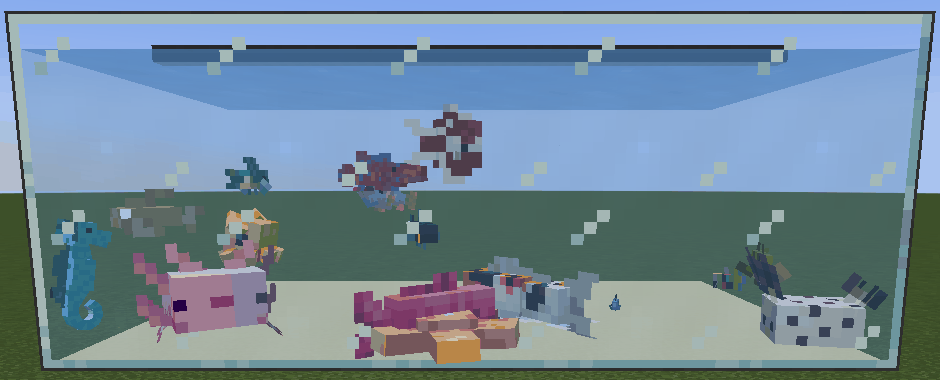
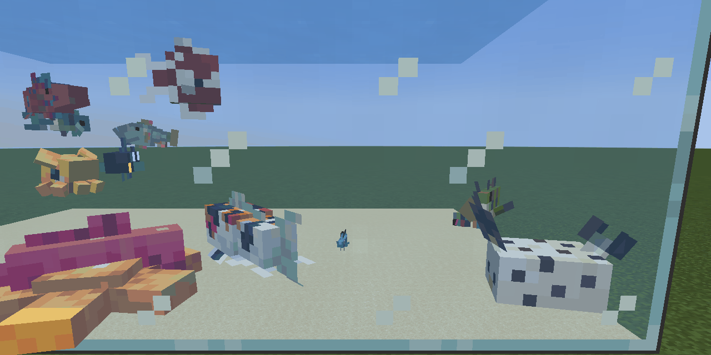

---
navigation:
  title: Animals of other mods
  icon: minecraft:axolotl_bucket
  parent: settings.md
  position: 10
feature: foreignAnimals.enabled
---

# Animals of other mods

Every small water animal of vanilla Minecraft and of other mods can live in a Bettacraft aquarium: fish, axolotls,
tadpoles, squids, sea slugs, seahorses, starfish and more. Bettacraft does not need to know the mod; it looks at the
animal itself. Put it in with its own bucket or with a fish bag (see [Inhabitants](../aquarium/inhabitants.md)).

## What is refused

The aquarium refuses an animal with a message that says why:

* **too big:** its hitbox is wider or taller than 0.8 blocks (`inhabitants.maxHitbox`). The size of the animal itself
  counts, so variants of other mods differ: a Fintastic dwarf gourami fits, a giant gourami does not. Animals of known
  length (the big fish of other mods by their [profile](foreign_profiles.md), dolphins, sea turtles) go into
  [big tanks](../big_tanks.md) by the size rule instead; the message names the tank they need.
* **a boss** (`#c:bosses`), e.g. the Leviathan of L_Ender's Cataclysm.
* **hostile:** mobs of the spawn category monster, e.g. guardians or the Cataclysm lionfish (`inhabitants.refuseHostile`).
* **no water animal:** land animals in buckets of other mods (Naturalist's butterflies, snails, crabs ...).
* **unsuitable, with the reason:** deep-sea animals (Naturalist's angler fish and blob fish, the creatures of the abyss of
  Alex's Caves), animals far too big for any tank (Naturalist's great white shark and whale), mushroom creatures
  (Aquaculture's shroomas), the creatures of Alex's Caves bound to their caves and the hostile beetles and spiders of the
  Twilight Forest. Their profiles say so (`"refuse"`); the [list](foreign_animal_list.md) names them all.
* **does not belong in an aquarium:** animals in `#bettacraft:tank_blacklist`: the tuna of Sushi Go Crafting, frogs and
  the pets of L_Ender's Cataclysm (they follow and teleport to their owner). The giant fish of Aquaculture and Fintastic
  and the manta ray of Living Things are big animals now (see above).

Server owners can change this: `inhabitants.allow` always lets an animal in (`modid:name` or `modid:*`),
`inhabitants.deny` never; the entity tags `#bettacraft:tank_inhabitants` and `#bettacraft:tank_blacklist` do the same in
a data pack. `/bettacraft wateranimals` (operators) lists every water animal of the loaded mods and whether aquariums
take it, in `bettacraft-water-animals.tsv` in the server folder.

## In the aquarium

Animals of other mods keep their own behaviour. Bettacraft holds them in the water of the real tank shape and counts
them for the stocking. Animals **with a profile** (by default the fish, invertebrates and turtles of Fintastic,
Aquaculture, Fish of Thieves, Naturalist, Critters and Companions and Living Things, see the
[list](foreign_animal_list.md)) also get our care in the aquarium: hunger, their temperature and water, sickness and
death, and they breed by our rules, see [Profiles for animals of other mods](foreign_profiles.md). Animals without a
profile are never hurt by our care. The vanilla **axolotl** has its own care and breeding (cool water, eggs on the plants, colour
genetics), see [Axolotl](../invertebrates/axolotl.md).

* **Predators** (`#bettacraft:predators`) hunt small fish and fry: pufferfish, **axolotls**, piranhas, the Otherside
  angler fish and the predators of the aquarium mods. See [Fights, flaring and predators](../bettas/fighting.md).
* **Tadpoles** grow up in the aquarium. The young frog hops out and lands in front of the tank (log entry). With
  `inhabitants.tadpoles = STAY_TADPOLE` they stay tadpoles as long as they live in an aquarium.
* **Squids and glow squids** have no bucket: catch them with a fish bag, which keeps the whole animal. They also come
  out with a fish bag only.
* **Shiny** swaps vanilla animals for their shiny versions as they spawn. A shiny fish goes into an aquarium and comes out
  again shiny (the fish bag keeps the whole animal); the animals of Bettacraft are never swapped (their colours come from
  their genes).
* **Fintastic** swaps vanilla cod and salmon for its own when they spawn. A cod or salmon from a bucket stays what it is
  in a Bettacraft aquarium.
* **Their own breeding** (love from food, the breeding of their mod) is suppressed in a Bettacraft aquarium
  (`features.foreignAnimals.suppressOwnBreeding`); outside it nothing changes. Animals with a profile breed by our rules instead.
