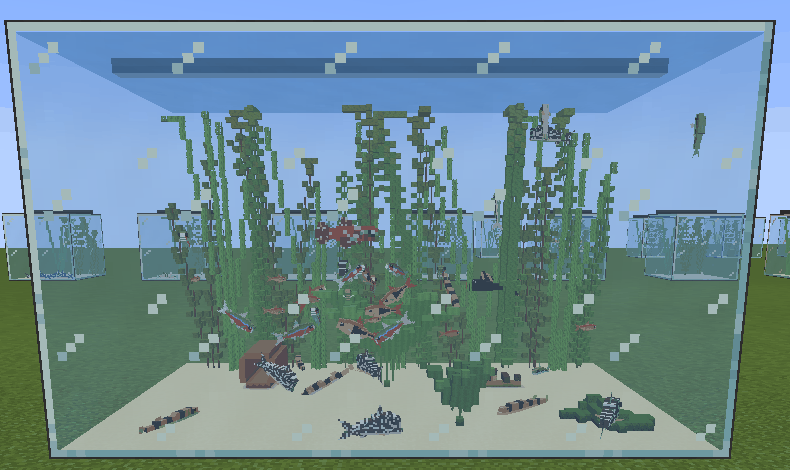
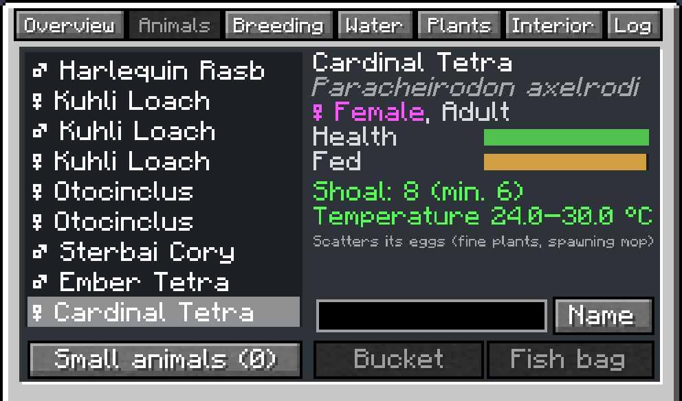

---
navigation:
  title: Tankmates
  icon: bettacraft:neon_tetra_bucket
  position: 50
feature: tankmates.enabled
---

# Tankmates

Popular aquarium fish can share a tank with the bettas (or live without them): **tetras**, **rasboras**,
**corydoras**, **plecos**, **otocinclus**, **loaches**, the **livebearers** guppy, endler, platy, molly and swordtail, the **gouramis**,
the **rainbowfish**, the **cichlids** (rams, Apistogramma, angelfish, discus), the **barbs** and the **puffers**. They are real animals like the bettas, swim in the zone of the water their species likes, shoal with their
kind, rest on the bottom or stick to the glass, and every species breeds the way it does in nature.

## In short

* They come in a **bucket** of their species or in a **fish bag** (a whole shoal fits into one bag). Right-click the
  tank to put them in; the menu takes them out one by one.
* A shoaling fish alone or in a small group is **stressed** and gets sick after a while: keep at least the minimum. The
  [tank menu](aquarium/menu.md) names every shoal that is too small with its fish and the minimum ("Neon Tetra: 3 of 6": in
  the overview, the breeding tab and the info overlays), its fish show in orange in the animal list.
* Outside a tank (wild ones and fish you let go) a shoaling species swims as a **school** too: they follow a leader of
  their kind like in a tank (switch `features.tankmates.wildSchools`).
* Every species has its **temperature range**; the classic betta tank (26-28 °C) suits the cardinal, ember, harlequin,
  mosquito rasbora, sterbai cory, kuhli loach and the L-numbers, not the neon, the panda cory or the platy.
* **Male bettas chase male guppies and dwarf and pearl gouramis**. Every adult eats the fry and the eggs it can reach.
* The [tank menu](aquarium/menu.md) shows each fish with its shoal, temperature and breeding state, the breeding tab
  the clutches of every species; Jade, The One Probe and WTHIT list the tankmates.

## All species

| Species | °C | Shoal | Betta tank | Breeding |
|---|---|---|---|---|
| <ItemImage id="bettacraft:neon_tetra_bucket" /> [Neon Tetra](tankmates/neon_tetra.md) | 20–27 | 6 | too cool | Scatters its eggs (fine plants, spawning mop) |
| <ItemImage id="bettacraft:cardinal_tetra_bucket" /> [Cardinal Tetra](tankmates/cardinal_tetra.md) | 24–30 | 6 | yes | Scatters its eggs (fine plants, spawning mop) |
| <ItemImage id="bettacraft:green_neon_tetra_bucket" /> [Green Neon Tetra](tankmates/green_neon_tetra.md) | 24–30 | 6 | yes | Scatters its eggs (fine plants, spawning mop) |
| <ItemImage id="bettacraft:ember_tetra_bucket" /> [Ember Tetra](tankmates/ember_tetra.md) | 22–29 | 6 | yes | Scatters its eggs (fine plants, spawning mop) |
| <ItemImage id="bettacraft:glowlight_tetra_bucket" /> [Glowlight Tetra](tankmates/glowlight_tetra.md) | 23–28 | 6 | yes | Scatters its eggs (fine plants, spawning mop) |
| <ItemImage id="bettacraft:harlequin_rasbora_bucket" /> [Harlequin Rasbora](tankmates/harlequin_rasbora.md) | 22–28 | 6 | yes | Scatters its eggs (fine plants, spawning mop) |
| <ItemImage id="bettacraft:mosquito_rasbora_bucket" /> [Mosquito Rasbora](tankmates/mosquito_rasbora.md) | 22–28 | 8 | yes | Scatters its eggs (fine plants, spawning mop) |
| <ItemImage id="bettacraft:pygmy_cory_bucket" /> [Pygmy Cory](tankmates/pygmy_cory.md) | 22–27 | 8 | too cool | Glues its eggs to the glass (after a cool water change) |
| <ItemImage id="bettacraft:panda_cory_bucket" /> [Panda Cory](tankmates/panda_cory.md) | 20–26 | 6 | too cool | Glues its eggs to the glass (after a cool water change) |
| <ItemImage id="bettacraft:sterbai_cory_bucket" /> [Sterbai Cory](tankmates/sterbai_cory.md) | 24–30 | 6 | yes | Glues its eggs to the glass (after a cool water change) |
| <ItemImage id="bettacraft:green_gold_cory_bucket" /> [Green Gold Cory](tankmates/green_gold_cory.md) | 22–27 | 6 | too cool | Glues its eggs to the glass (after a cool water change) |
| <ItemImage id="bettacraft:leopard_frog_pleco_bucket" /> [L134 Leopard Frog Pleco](tankmates/leopard_frog_pleco.md) | 25–30 | – | yes | Spawns in a cave, the male guards |
| <ItemImage id="bettacraft:zebra_pleco_bucket" /> [L046 Zebra Pleco](tankmates/zebra_pleco.md) | 26–31 | – | yes | Spawns in a cave, the male guards |
| <ItemImage id="bettacraft:bristlenose_pleco_bucket" /> [Bristlenose Pleco](tankmates/bristlenose_pleco.md) | 21–28 | – | yes | Spawns in a cave, the male guards |
| <ItemImage id="bettacraft:otocinclus_bucket" /> [Otocinclus](tankmates/otocinclus.md) | 21–27 | 5 | too cool | Glues its eggs to the glass (after a cool water change) |
| <ItemImage id="bettacraft:kuhli_loach_bucket" /> [Kuhli Loach](tankmates/kuhli_loach.md) | 24–30 | 5 | yes | Scatters its eggs (fine plants, spawning mop) |
| <ItemImage id="bettacraft:clown_loach_bucket" /> [Clown Loach](tankmates/clown_loach.md) | 25–30 | 5 | too big | Does not breed in a tank |
| <ItemImage id="bettacraft:guppy_bucket" /> [Guppy](tankmates/guppy.md) | 22–28 | 3 | females only | Bears live young |
| <ItemImage id="bettacraft:endler_guppy_bucket" /> [Endler Guppy](tankmates/endler_guppy.md) | 23–30 | 3 | yes | Bears live young |
| <ItemImage id="bettacraft:platy_bucket" /> [Platy](tankmates/platy.md) | 20–27 | 3 | too cool | Bears live young |
| <ItemImage id="bettacraft:dwarf_gourami_bucket" /> [Dwarf Gourami](tankmates/dwarf_gourami.md) | 24–29 | – | no | Builds a foam nest |
| <ItemImage id="bettacraft:ram_cichlid_bucket" /> [Ram Cichlid](tankmates/ram_cichlid.md) | 25–31 | – | with care (big tank) | Open brooder: the pair spawns on a stone, leaf or the glass and guards the brood |
| <ItemImage id="bettacraft:bolivian_ram_bucket" /> [Bolivian Ram](tankmates/bolivian_ram.md) | 22–29 | – | with care (big tank) | Open brooder: the pair spawns on a stone, leaf or the glass and guards the brood |
| <ItemImage id="bettacraft:cockatoo_cichlid_bucket" /> [Cockatoo Dwarf Cichlid](tankmates/cockatoo_cichlid.md) | 22–29 | – | with care (big tank) | Cave brooder: the female spawns in a small cave and guards the brood |
| <ItemImage id="bettacraft:agassiz_dwarf_cichlid_bucket" /> [Agassiz's Dwarf Cichlid](tankmates/agassiz_dwarf_cichlid.md) | 24–29 | – | with care (big tank) | Cave brooder: the female spawns in a small cave and guards the brood |
| <ItemImage id="bettacraft:angelfish_bucket" /> [Angelfish](tankmates/angelfish.md) | 24–30 | – | no (big, nips fins) | Open brooder: the pair spawns on a stone, leaf or the glass and guards the brood |
| <ItemImage id="bettacraft:discus_bucket" /> [Discus](tankmates/discus.md) | 27–32 | 3 | too warm | Open brooder: the pair spawns on a stone, leaf or the glass and guards the brood |
| <ItemImage id="bettacraft:dwarf_puffer_bucket" /> [Dwarf Puffer](tankmates/dwarf_puffer.md) | 22–29 | – | no (nips fins) | Scatters its eggs (fine plants, spawning mop) |
| <ItemImage id="bettacraft:red_eye_puffer_bucket" /> [Red-Eye Puffer](tankmates/red_eye_puffer.md) | 23–29 | – | no (nips fins) | Scatters its eggs (fine plants, spawning mop) |
| <ItemImage id="bettacraft:green_spotted_puffer_bucket" /> [Green Spotted Puffer](tankmates/green_spotted_puffer.md) | 24–29 | – | too big | Does not breed in a tank |
| <ItemImage id="bettacraft:tiger_barb_bucket" /> [Tiger Barb](tankmates/tiger_barb.md) | 20–28 | 6 | no (nips fins) | Scatters its eggs (fine plants, spawning mop) |
| <ItemImage id="bettacraft:odessa_barb_bucket" /> [Odessa Barb](tankmates/odessa_barb.md) | 18–26 | 6 | too cool | Scatters its eggs (fine plants, spawning mop) |
| <ItemImage id="bettacraft:cherry_barb_bucket" /> [Cherry Barb](tankmates/cherry_barb.md) | 22–28 | 6 | yes | Scatters its eggs (fine plants, spawning mop) |
| <ItemImage id="bettacraft:dwarf_chain_loach_bucket" /> [Dwarf Chain Loach](tankmates/dwarf_chain_loach.md) | 24–29 | 6 | yes | Does not breed in a tank |
| <ItemImage id="bettacraft:reticulated_loach_bucket" /> [Reticulated Loach](tankmates/reticulated_loach.md) | 24–30 | 5 | yes | Does not breed in a tank |
| <ItemImage id="bettacraft:garra_rufa_bucket" /> [Garra](tankmates/garra_rufa.md) | 18–32 | 5 | yes | Scatters its eggs (fine plants, spawning mop) |
| <ItemImage id="bettacraft:zebra_danio_bucket" /> [Zebra Danio](tankmates/zebra_danio.md) | 18–27 | 6 | too cool | Scatters its eggs (fine plants, spawning mop) |
| <ItemImage id="bettacraft:celestial_pearl_danio_bucket" /> [Celestial Pearl Danio](tankmates/celestial_pearl_danio.md) | 20–26 | 6 | too cool | Scatters its eggs (fine plants, spawning mop) |
| <ItemImage id="bettacraft:forktail_rainbow_bucket" /> [Forktail Rainbowfish](tankmates/forktail_rainbow.md) | 23–28 | 6 | yes | Scatters its eggs (fine plants, spawning mop) |
| <ItemImage id="bettacraft:neon_dwarf_rainbow_bucket" /> [Neon Dwarf Rainbowfish](tankmates/neon_dwarf_rainbow.md) | 23–28 | 6 | yes | Scatters its eggs (fine plants, spawning mop) |
| <ItemImage id="bettacraft:honey_gourami_bucket" /> [Honey Gourami](tankmates/honey_gourami.md) | 22–28 | – | yes | Builds a foam nest |
| <ItemImage id="bettacraft:chocolate_gourami_bucket" /> [Chocolate Gourami](tankmates/chocolate_gourami.md) | 25–30 | 4 | yes | Mouthbrooder |
| <ItemImage id="bettacraft:pearl_gourami_bucket" /> [Pearl Gourami](tankmates/pearl_gourami.md) | 24–30 | – | no | Builds a foam nest |
| <ItemImage id="bettacraft:emperor_tetra_bucket" /> [Emperor Tetra](tankmates/emperor_tetra.md) | 23–27 | 6 | too cool | Scatters its eggs (fine plants, spawning mop) |
| <ItemImage id="bettacraft:rummy_nose_tetra_bucket" /> [Rummy-Nose Tetra](tankmates/rummy_nose_tetra.md) | 24–29 | 8 | yes | Scatters its eggs (fine plants, spawning mop) |
| <ItemImage id="bettacraft:black_phantom_tetra_bucket" /> [Black Phantom Tetra](tankmates/black_phantom_tetra.md) | 22–28 | 6 | yes | Scatters its eggs (fine plants, spawning mop) |
| <ItemImage id="bettacraft:black_molly_bucket" /> [Black Molly](tankmates/black_molly.md) | 22–30 | 3 | yes | Bears live young |
| <ItemImage id="bettacraft:swordtail_bucket" /> [Swordtail](tankmates/swordtail.md) | 22–28 | 3 | yes | Bears live young |
| <ItemImage id="bettacraft:bronze_cory_bucket" /> [Bronze Cory](tankmates/bronze_cory.md) | 20–28 | 6 | yes | Glues its eggs to the glass (after a cool water change) |
| <ItemImage id="bettacraft:panda_garra_bucket" /> [Panda Garra](tankmates/panda_garra.md) | 20–26 | 5 | too cool | Scatters its eggs (fine plants, spawning mop) |
| <ItemImage id="bettacraft:archerfish_bucket" /> [Archerfish](brackish/archerfish.md) | 24–30 | 3 | no (big, nips fins) | Does not breed in a tank |

## In this chapter

<SubPages icons={true} />
