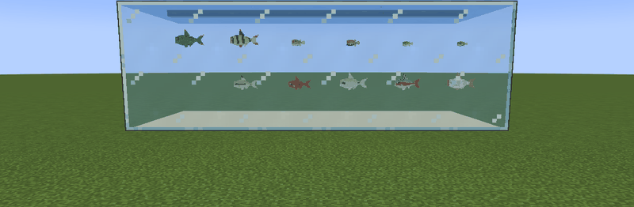

---
navigation:
  title: Barbs
  icon: bettacraft:tiger_barb_bucket
  parent: tankmates.md
  position: 45
feature: tankmates.barbsAndLoaches
---

# Barbs

Barbs (Cyprinidae) are lively, deep-bodied shoaling fish from South and South-East Asia that scatter many eggs into plants.
The **tiger barb** is a notorious fin nipper; the **odessa barb** and the **cherry barb** are peaceful.

## Species

| Species | °C | Shoal | Betta tank | Breeding |
|---|---|---|---|---|
| <ItemImage id="bettacraft:tiger_barb_bucket" /> [Tiger Barb](tiger_barb.md) | 20–28 | 6 | no (nips fins) | Scatters its eggs (fine plants, spawning mop) |
| <ItemImage id="bettacraft:odessa_barb_bucket" /> [Odessa Barb](odessa_barb.md) | 18–26 | 6 | too cool | Scatters its eggs (fine plants, spawning mop) |
| <ItemImage id="bettacraft:cherry_barb_bucket" /> [Cherry Barb](cherry_barb.md) | 22–28 | 6 | yes | Scatters its eggs (fine plants, spawning mop) |

## Getting along

* **Tiger barbs** nip the long fins of bettas, angelfish, gouramis and male guppies (`tankmates.behaviour.finNipping`), in a
  shoal smaller than 6 twice as hard. Keep a big shoal, without bettas.
* **Cherry barbs** suit a betta tank; **odessa barbs** like it cooler (up to 26 °C).
