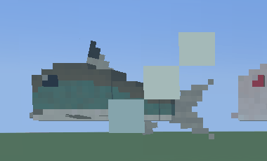
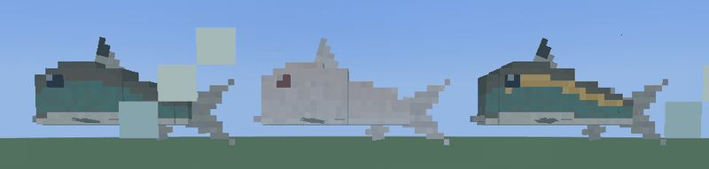

---
navigation:
  title: Bronze Cory
  icon: bettacraft:bronze_cory_bucket
  parent: tankmates/corydoras.md
  position: 25
item_ids:
  - bettacraft:bronze_cory_bucket
  - bettacraft:bronze_cory_spawn_egg
---

# Bronze Cory

The classic cory of the trade: metallic green-bronze flanks, a pale belly and a dark spot in the dorsal fin. One of the hardiest corydoras.

**Origin:** rivers and floodplains east of the Andes, from Colombia and Trinidad to the Rio de la Plata.

## Profile

| | |
|---|---|
| Group | Corydoras |
| Scientific name | *Corydoras aeneus* |
| Size in the game | about 6.5 cm (0.55 blocks) |
| Temperature | 20–28 °C |
| Breeding temperature | 22–26 °C |
| Water | fresh water, hardy |
| Water chemistry | pH 6.0–8.0, TDS 0–600 ppm |
| Shoal | from 6 fish |
| Swims | on the bottom |
| Stocking | counts as 0.6 fish |
| Breeding | Glues its eggs to the glass (after a cool water change), 15–40 young |
| Betta tank | yes |
| Special | gulps air at the surface, 3 colour varieties |

## Varieties

Varieties: Wild type, Albino, Gold Laser. The **Albino** is pink-white with red eyes, the **Gold Laser** keeps the bronze colours
with a bright orange-gold stripe along the back. Both are recessive: only two equal alleles show the form (carriers look wild).
Of an albino and a gold laser allele the albino shows. Wild fish and the wild-type fish of the trader now and then carry a form
hidden; the menu shows the genes in a tooltip. Switch: `features.tankmates.tetraCoryForms`.

## Breeding

A cool water change sets them off: at least a quarter of the water fresh, cooling the tank by 1.5 °C. The female glues 15–40
eggs to the glass, the decoration and leaves. The other fish like to eat them: take them out with the net into a fish bag and
raise them in a tank without adults.

## Keeping

* Hardy and peaceful: takes 20–28 °C and soft to medium-hard water, a good first cory.
* Bottom fish: gets only part of the sinking food while faster fish are around - algae wafers go straight to it.
* Darts up to the surface for a gulp of air now and then.

## Obtaining

* **[Aquarium net](../equipment/tank_net.md)** in rivers: 0.65–0.77 % per swing (about 1 in 130–154 swings), 1–4 at a time.
* **[Aquarium net](../equipment/tank_net.md)** in jungle water: 0.26–0.31 % per swing (about 1 in 323–383 swings), 1–4 at a time.
* **Wild** in rivers, in groups of 3–6 (spawn weight 4) (config `features.tankmates.moreBottomFish`).
* **Wild** in jungle water, in groups of 3–6 (spawn weight 3) (config `features.tankmates.moreBottomFish`).
* **Wandering trader** (usual offers): 6 for 5 emeralds; one of 37 in this offer.
* **[Aquarist villager](../getting_started/aquarist.md)** (Master): 2 for 14 emeralds; one of about 20 in this offer (config `features.tankmates.moreBottomFish`).
* **[Breeding](breeding.md)**: Glues its eggs to the glass (after a cool water change).

The biomes of biome mods count too ([biome tags](../settings.md)).
