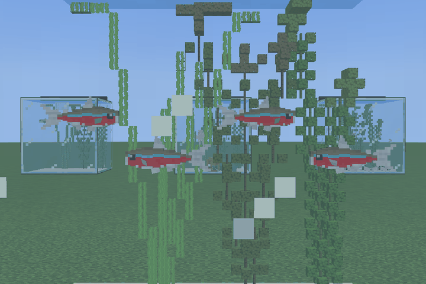

---
navigation:
  title: Cardinal Tetra
  icon: bettacraft:cardinal_tetra_bucket
  parent: tankmates/tetras.md
  position: 20
item_ids:
  - bettacraft:cardinal_tetra_bucket
  - bettacraft:cardinal_tetra_spawn_egg
---

# Cardinal Tetra

Like the neon, but the red runs the whole length of the belly; likes it warmer, good with bettas.

**Origin:** the Rio Negro and Orinoco (Brazil, Venezuela), warm blackwater.

## Profile

| | |
|---|---|
| Group | Tetras |
| Scientific name | *Paracheirodon axelrodi* |
| Size in the game | about 4 cm (0.32 blocks) |
| Temperature | 24–30 °C |
| Breeding temperature | 26–28 °C |
| Water | fresh water, sensitive |
| Water chemistry | pH 5.0–7.8, TDS 0–450 ppm |
| Shoal | from 6 fish |
| Swims | in the middle |
| Stocking | counts as 0.4 fish |
| Breeding | Scatters its eggs (fine plants, spawning mop), 20–50 young |
| Betta tank | yes |
| Special | 2 colour varieties |

## Varieties

Varieties: Wild type, Gold. The **Gold** cardinal has a pale golden body with a silvery stripe and a faded red belly. The wild type is dominant, the bred forms are recessive: only two equal alleles show the form (carriers look wild). Of two different bred forms the one listed first shows. Wild fish and the wild-type fish of the trader now and then carry a form hidden; the menu shows the genes in a tooltip. Switch: `features.tankmates.tetraCoryForms`.

## Breeding

At 26–28 °C a pair scatters 20–50 eggs into fine-leaved plants, java moss or a **spawning mop**. The parents and every other fish eat the eggs they reach; in a spawning mop most are safe. Live food (mosquito larvae) gets them ready faster.

## Obtaining

* **[Aquarium net](../equipment/tank_net.md)** in jungle water: 0.96–1.1 % per swing (about 1 in 88–104 swings), 1–4 at a time.
* **Wild** in jungle water, in groups of 3–6 (spawn weight 11) (config `features.tankmates.wildSpawns`).
* **Wandering trader** (usual offers): 6 for 4 emeralds; one of 37 in this offer.
* **[Aquarist villager](../getting_started/aquarist.md)** (Master): 2 for 14 emeralds; one of about 20 in this offer (config `features.tankmates.wildSpawns`).
* **[Breeding](breeding.md)**: Scatters its eggs (fine plants, spawning mop).

The biomes of biome mods count too ([biome tags](../settings.md)).
