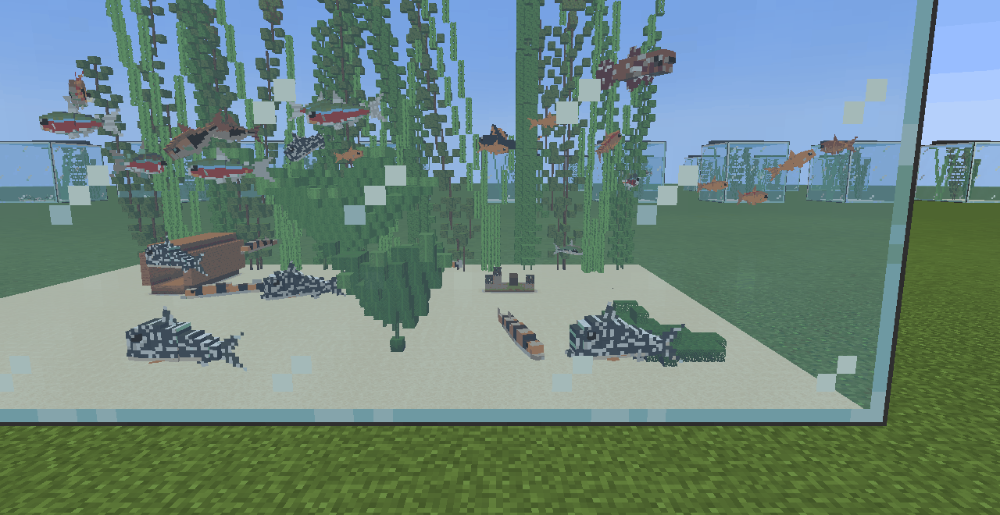

---
navigation:
  title: Care of the tankmates
  icon: bettacraft:algae_wafer
  parent: tankmates.md
  position: 10
---

# Care of the tankmates

Tankmates have the same health timers as the bettas: hunger, the wrong temperature, bad water and stress make them sick
after a few days (7 by default), and sick fish die if nothing changes.

## Shoals

* Tetras, rasboras, corydoras, otocinclus, kuhli and clown loaches are **shoaling fish**. In a group smaller than the
  minimum of their species (shown in the menu, 5 to 8) they are stressed (config `tankmates.behaviour.shoalStress`).
* Livebearers want a small group (3), the plecos and the dwarf gourami are fine alone.
* The shoal follows a leader through the tank; corydoras forage together on the bottom.

## Temperature and water

* Every species tolerates its own range (see [the table](../tankmates.md)); outside it the fish is stressed.
* Some are **sensitive to bad water** (otocinclus, cardinals, zebra plecos): keep the water quality high with filters
  and water changes. Livebearers and bristlenoses are hardy.
* Fresh water has the temperature of the surroundings: a **water change cools a heated tank down a little**
  (`tankmates.breeding.waterChangeCools`). That sets the corydoras off (see [Breeding](breeding.md)).

## Food

* Tankmates eat the bettas' food: pellets and mosquito larvae (live food gets them ready to spawn), the fry
  <ItemLink id="bettacraft:fry_powder" /> (or infusoria and artemia like the betta fry).
* **Bottom fish** (corydoras, plecos, otocinclus, loaches) only get part of the food that sinks past faster fish
  (`tankmates.behaviour.bottomFoodShare`, 0.6). <ItemLink id="bettacraft:algae_wafer" /> sink straight to them: the
  bettas and the midwater fish do not eat wafers.
* **Algae eaters** (otocinclus, bristlenose; the L134 a little) graze the [algae](../aquarium/algae.md) on the
  glass and live on them while there are any.

## Stocking

* Every species counts a share of a fish: a mosquito rasbora 0.12, a neon 0.35, a cory 0.2 to 0.6, a bristlenose 1.2, a
  clown loach 2.5 (`tankmates.behaviour.tankmateStockingFactor`). The young count less, like young bettas.
* They count for the stocking limits, the bioload of the water (a neon a third of a betta) and the breeding stop: a full
  tank does not get more young.

## Bettas and other fish

* **Male bettas chase male guppies** (long colourful fins) **and male dwarf gouramis** (labyrinth fish rivals; they
  fight back) and wound them (`tankmates.behaviour.bettaAggression`). Female guppies, endlers and platys are fine.
* Two male dwarf gouramis fight over their territory; pleco males without a cave of their own are chased off.
* **Clown loaches eat snails** (`tankmates.behaviour.clownLoachSnailsPerDay`): a natural snail control, but not for a
  snail tank.
* Every adult (bettas and tankmates) **hunts the fry** of the tankmates and eats the eggs it can reach
  (`fryEatenPerDay`, `eggsEatenPerDay`). Plants, java moss and floating plants hide the fry, a spawning mop the eggs.
