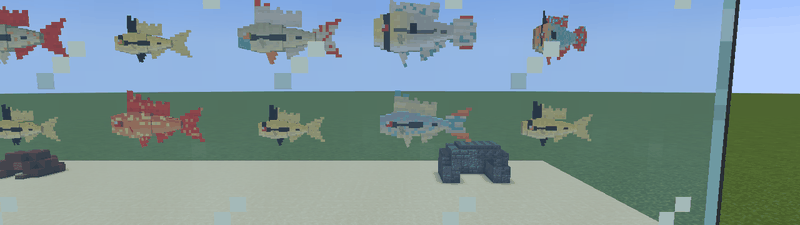
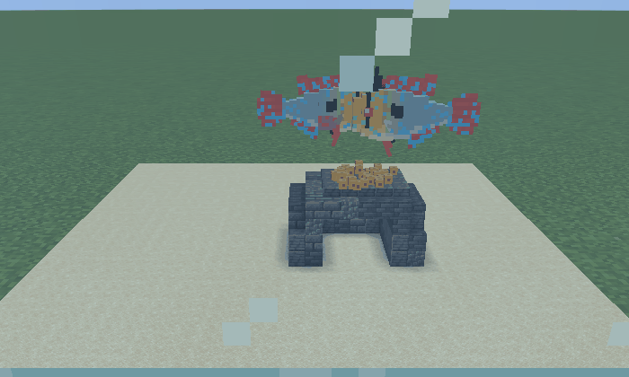

---
navigation:
  title: Cichlids
  icon: bettacraft:angelfish_bucket
  parent: tankmates.md
  position: 95
feature: tankmates.cichlids
---

# Cichlids

South American cichlids (Cichlidae) care for their brood: **open brooders** (the rams, the angelfish and the discus) spawn as a
pair on a flat stone, a broad leaf or the glass and guard eggs and young together; **cave brooders** (the Apistogramma) spawn in a
small cave that the female claims, and she guards the brood alone. Parents drive every other fish away from their brood, the
males are territorial, the angelfish eats small fish and shrimp, and discus young feed on their parents' skin.

## Species

| Species | °C | Shoal | Betta tank | Breeding |
|---|---|---|---|---|
| <ItemImage id="bettacraft:ram_cichlid_bucket" /> [Ram Cichlid](ram_cichlid.md) | 25–31 | – | with care (big tank) | Open brooder: the pair spawns on a stone, leaf or the glass and guards the brood |
| <ItemImage id="bettacraft:bolivian_ram_bucket" /> [Bolivian Ram](bolivian_ram.md) | 22–29 | – | with care (big tank) | Open brooder: the pair spawns on a stone, leaf or the glass and guards the brood |
| <ItemImage id="bettacraft:cockatoo_cichlid_bucket" /> [Cockatoo Dwarf Cichlid](cockatoo_cichlid.md) | 22–29 | – | with care (big tank) | Cave brooder: the female spawns in a small cave and guards the brood |
| <ItemImage id="bettacraft:agassiz_dwarf_cichlid_bucket" /> [Agassiz's Dwarf Cichlid](agassiz_dwarf_cichlid.md) | 24–29 | – | with care (big tank) | Cave brooder: the female spawns in a small cave and guards the brood |
| <ItemImage id="bettacraft:angelfish_bucket" /> [Angelfish](angelfish.md) | 24–30 | – | no (big, nips fins) | Open brooder: the pair spawns on a stone, leaf or the glass and guards the brood |
| <ItemImage id="bettacraft:discus_bucket" /> [Discus](discus.md) | 27–32 | 3 | too warm | Open brooder: the pair spawns on a stone, leaf or the glass and guards the brood |

## Getting along

* **Rams and bettas** live at the same temperature; it works in a big tank with a flat stone for the rams (near their brood they
  bite the betta).
* **Apistogramma**: one male with one or more females, a small cave for each female (coconut shell, slate cave, spawning cave).
* **Angelfish** eat neons, embers, mosquito rasboras and shrimp, and do not belong with bettas.
* **Discus** need 30 °C and very soft water; few tankmates like that.
