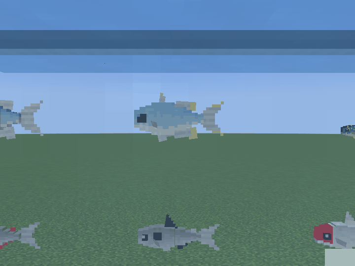

---
navigation:
  title: Forktail Rainbowfish
  icon: bettacraft:forktail_rainbow_bucket
  parent: tankmates/rainbowfish.md
  position: 10
item_ids:
  - bettacraft:forktail_rainbow_bucket
  - bettacraft:forktail_rainbow_spawn_egg
---

# Forktail Rainbowfish

A small blue-eye rainbowfish: blue-silver with big eyes, the male with yellow fin edges and yellow tips on its forked tail.

**Origin:** the rainforest streams of eastern Papua New Guinea.

## Profile

| | |
|---|---|
| Group | Rainbowfish |
| Scientific name | *Pseudomugil furcatus* |
| Size in the game | about 5 cm (0.4 blocks) |
| Temperature | 23–28 °C |
| Breeding temperature | 25–27 °C |
| Water | fresh water, normal |
| Water chemistry | pH 6.5–8.5, TDS 50–700 ppm |
| Shoal | from 6 fish |
| Swims | near the surface |
| Stocking | counts as 0.4 fish |
| Breeding | Scatters its eggs (fine plants, spawning mop), 10–30 young |
| Betta tank | yes |

## Breeding

At 25–27 °C a pair scatters 10–30 eggs into fine-leaved plants, java moss or a **spawning mop**. The parents and every other fish eat the eggs they reach; in a spawning mop most are safe. Live food gets them ready faster.

## Keeping

* Swims at the surface in a shoal; peaceful, fine with a betta.
* Spawns a few eggs every day into moss or a spawning mop.

## Obtaining

* **[Aquarium net](../equipment/tank_net.md)** in rivers: 0.24–0.29 % per swing (about 1 in 347–411 swings), 1–4 at a time.
* **[Aquarium net](../equipment/tank_net.md)** in jungle water: 0.26–0.31 % per swing (about 1 in 323–383 swings), 1–4 at a time.
* **Wild** in rivers, in groups of 3–6 (spawn weight 2) (config `features.tankmates.communityFish`).
* **Wild** in jungle water, in groups of 3–6 (spawn weight 3) (config `features.tankmates.communityFish`).
* **Wandering trader** (usual offers): 6 for 4 emeralds; one of 37 in this offer.
* **[Breeding](breeding.md)**: Scatters its eggs (fine plants, spawning mop).

The biomes of biome mods count too ([biome tags](../settings.md)).
