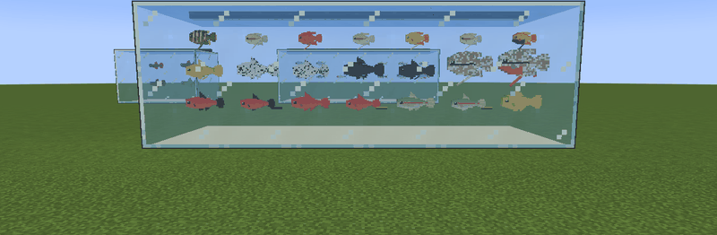

---
navigation:
  title: Gouramis
  icon: bettacraft:dwarf_gourami_bucket
  parent: tankmates.md
  position: 90
---

# Gouramis

Gouramis (Osphronemidae) are labyrinth fish like the bettas: they breathe air at the surface. The dwarf, honey and pearl gourami build foam nests like a betta, the chocolate gourami female broods the eggs in her mouth.

## Species

| Species | °C | Shoal | Betta tank | Breeding |
|---|---|---|---|---|
| <ItemImage id="bettacraft:dwarf_gourami_bucket" /> [Dwarf Gourami](dwarf_gourami.md) | 24–29 | – | no | Builds a foam nest |
| <ItemImage id="bettacraft:honey_gourami_bucket" /> [Honey Gourami](honey_gourami.md) | 22–28 | – | yes | Builds a foam nest |
| <ItemImage id="bettacraft:chocolate_gourami_bucket" /> [Chocolate Gourami](chocolate_gourami.md) | 25–30 | 4 | yes | Mouthbrooder |
| <ItemImage id="bettacraft:pearl_gourami_bucket" /> [Pearl Gourami](pearl_gourami.md) | 24–30 | – | no | Builds a foam nest |

## Getting along

* **Male bettas** go for the males of the dwarf and the pearl gourami, and they fight back (`tankmates.behaviour.bettaAggression`); the honey gourami is usually left alone.
* Two males of the territorial gouramis (dwarf, pearl) fight; honey and chocolate gouramis are peaceful.
* Fin nippers (tiger barbs, puffers) go for their long fins and feelers.
