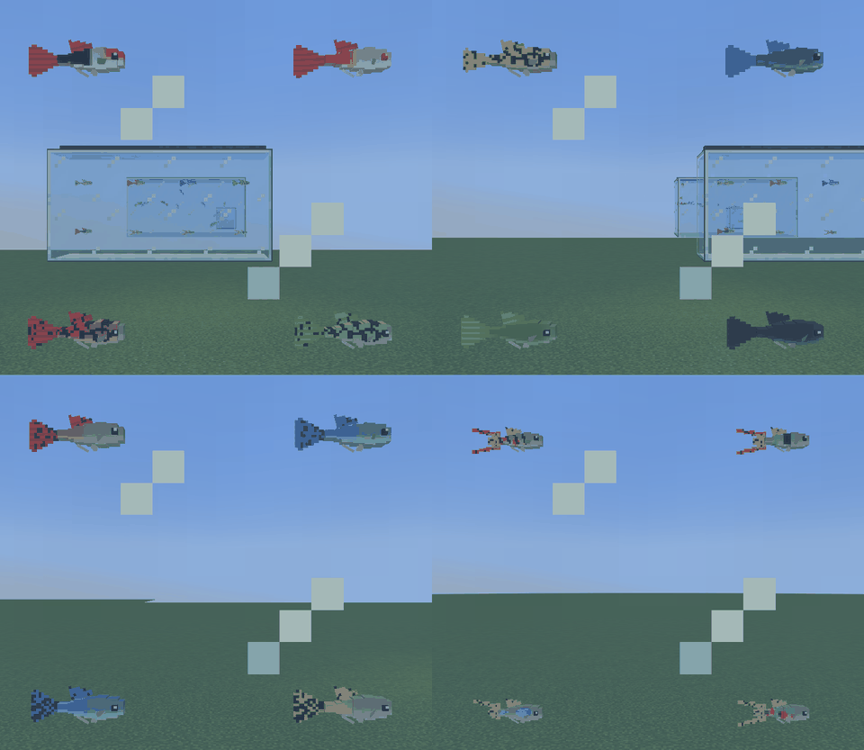
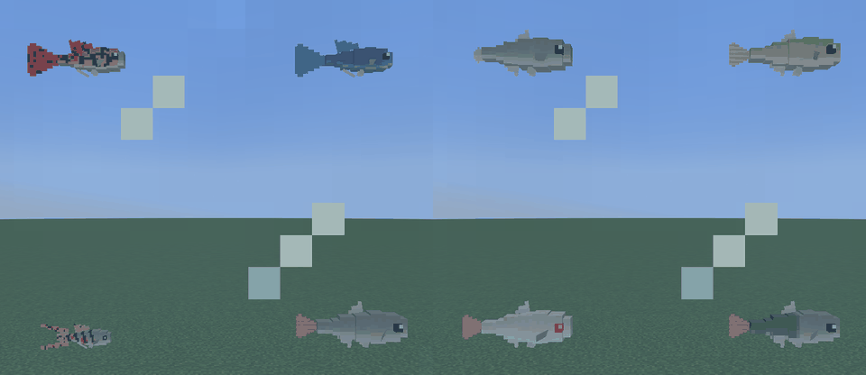
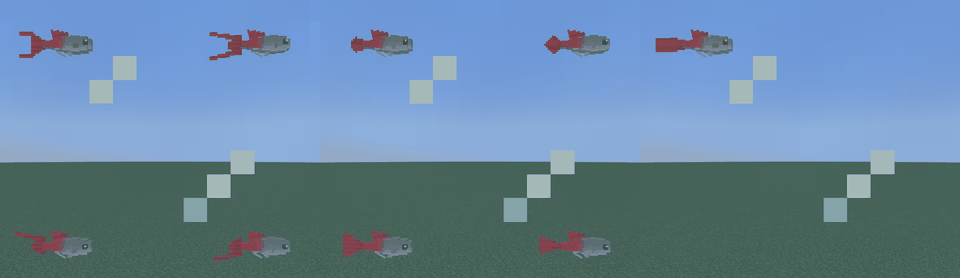
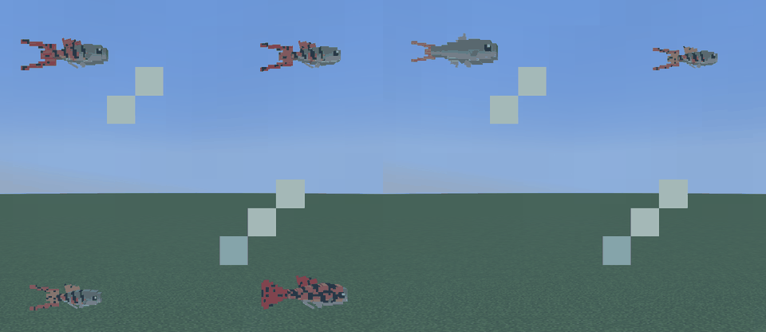

---
navigation:
  title: Guppy Genetics
  icon: bettacraft:endler_guppy_bucket
  parent: tankmates/livebearers.md
  position: 40
feature: tankmates.livebearerGenetics
---

# Guppy and Endler Genetics

Every [guppy](guppy.md) and [endler](endler_guppy.md) has its own genes, modelled on real guppy genetics. The young
inherit them at birth: one allele of every gene from the mother, one from the father. The tank menu shows a fish's
strain on the animals tab; hover over the name for every gene (shown allele first, the hidden one grey, "pure" when
both are the same).

## What the genes decide

| Gene | Alleles (most dominant first) |
|---|---|
| Tail shape | Lyretail, Double sword, Top sword, Bottom sword, **Round tail** (wild), Spade, Delta (fan), Triangle, Flag tail |
| Tail colour | Red, Black, Orange, **Clear** (wild), Yellow, Green, Blue, White |
| Tail pattern | Mosaic, Grass (dots), Leopard, **Spots** (wild), Plain |
| Body colour | each its own gene: Gold (g), Blond (b), Albino (a), Blue (r) are recessive, Dark (D) is dominant |

* A **top sword** and a **bottom sword** together make a **double sword**, like in real guppies.
* Body colours: albino (red eyes, no black pigment) shows over everything, blond and blue together give
  **pink white**, then dark, gold, blond and blue. Two recessive alleles are needed: carriers look wild.
* The long fancy tails (delta, triangle, flag) are recessive to the short round tail of wild guppies: a cross of a
  fancy guppy with a wild one has short tails, their young bring the long tails back.

## The X and the Y

The **patterns** sit on the sex chromosomes. A female has two X, a male one X and the Y.

* **Y patterns go only from the father to his sons.** A son always gets his father's Y, a daughter never. Wild type
  (orange and black spots), Cobra, Tuxedo, Japan Blue, Moscow, Red Tail and Red Head can sit on the Y of a guppy, the
  endler's Peacock, Tiger and Black Bar on the Y of an endler.
* **X patterns** (Tuxedo, Cobra, Moscow) zig-zag: a son gets his X from his mother, a daughter one X from each parent.
* **Females are grey** with small tails and short fins, but they carry every gene; of the patterns only a faint
  tuxedo shows on them. So keep the father of a line: his sons inherit his pattern for sure.

## Tail shapes

## Named strains

A fish whose genes show the look of a known strain gets its name, like the named betta varieties. Strains with a Y
pattern can only be males.

| Strain | Needs |
|---|---|
| Tuxedo Koi | tuxedo, red head (Y), red tail |
| Albino Full Red | albino, red tail (Y), red tail colour |
| Red / Green / Yellow Cobra | cobra, red / green / yellow tail |
| Blue / Green / Black Moscow | moscow, blue / green / black tail |
| Half Black Red (Tuxedo), Half Black Blue | tuxedo, red / blue tail |
| Japan Blue | japan blue (Y) |
| Full Red | red tail (Y), red tail colour |
| Red Mosaic, Blue Mosaic | mosaic, red / blue tail |
| Blue Grass, Yellow Grass | grass, blue / yellow tail |
| Leopard | leopard tail, not red, green or yellow |
| Full Gold | gold body, yellow or orange tail, plain |
| Platinum White | pink white (or albino) body, white tail |
| Full Black | dark body, black tail |
| Red Double Sword | double sword, red tail |
| Lyretail | lyretail, a coloured tail |
| Wild Guppy | wild body, wild Y, clear tail |
| Endler Tiger, Endler Black Bar, Endler Japan Blue | the endler's Y pattern |
| Endler Yellow Tail, Endler Wild Type | peacock (Y), yellow / any other tail |

The advancement **Guppy Collection** counts every strain you have bred (a bred fish that grows up in a tank).

## Endlers and hybrids

Endlers have their own alleles: swords instead of long tails, orange or yellow tails with coloured edges, and their
Y patterns. Guppies and endlers **cross freely** (a female takes a male of her own kind three times as often): the
young are hybrids of the mother's species, in size and look between the two, and carry the endler share of their
ancestry (half, then a quarter or three quarters when crossed back). Hybrids have no strain name; crossed back over
generations they become guppies or endlers again.

## Getting them

* The **wandering trader** sells wild-caught guppies and endlers and pure-bred strains (Red Cobra, Blue Moscow, Full
  Gold, Tuxedo Koi, Japan Blue, Endler Tiger, Black Bar, ...).
* The [aquarium net](../getting_started/catching.md) brings wild fish (some carry a bred allele hidden), now and then a
  group of feral fancy guppies.
* Fish from worlds before this version keep their look: the old varieties (Wild, Red, Blue Grass, Green Cobra, Tuxedo;
  endler Wild, Tiger, Black Bar) become Wild Guppy, Full Red, Blue Grass, Green Cobra, Half Black Red and the endler
  Wild Type, Tiger and Black Bar.

The switch `features.tankmates.livebearerGenetics` (common config) turns all this off: then the old fixed varieties show again
(the genes are kept).
