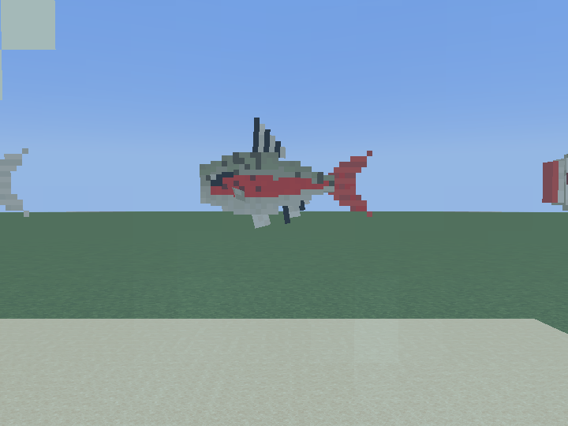

---
navigation:
  title: Odessa Barb
  icon: bettacraft:odessa_barb_bucket
  parent: tankmates/barbs.md
  position: 20
item_ids:
  - bettacraft:odessa_barb_bucket
  - bettacraft:odessa_barb_spawn_egg
---

# Odessa Barb

Silver-olive with dark-edged scales; the male wears a broad scarlet band along the side and black-spotted fins, the female two dark spots.

**Origin:** the rivers of central Myanmar.

## Profile

| | |
|---|---|
| Group | Barbs |
| Scientific name | *Pethia padamya* |
| Size in the game | about 6 cm (0.48 blocks) |
| Temperature | 18–26 °C |
| Breeding temperature | 22–25 °C |
| Water | fresh water, hardy |
| Water chemistry | pH 6.0–8.4, TDS 0–700 ppm |
| Shoal | from 6 fish |
| Swims | in the middle |
| Stocking | counts as 0.55 fish |
| Breeding | Scatters its eggs (fine plants, spawning mop), 30–80 young |
| Betta tank | too cool |

## Breeding

At 22–25 °C a pair scatters 30–80 eggs into fine-leaved plants, java moss or a **spawning mop**. The parents and every other fish eat the eggs they reach; in a spawning mop most are safe. Live food gets them ready faster.

## Keeping

* Cooler than a betta tank (18–26 °C); peaceful and hardy.

## Obtaining

* **[Aquarium net](../equipment/tank_net.md)** in rivers: 0.49–0.58 % per swing (about 1 in 173–205 swings), 1–4 at a time.
* **Wild** in rivers, in groups of 3–6 (spawn weight 3) (config `features.tankmates.barbsAndLoaches`).
* **Wandering trader** (usual offers): 6 for 5 emeralds; one of 37 in this offer.
* **[Breeding](breeding.md)**: Scatters its eggs (fine plants, spawning mop).

The biomes of biome mods count too ([biome tags](../settings.md)).
