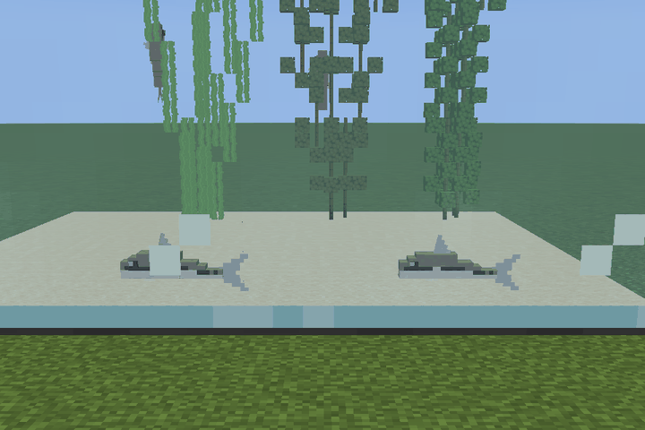

---
navigation:
  title: Otocinclus
  icon: bettacraft:otocinclus_bucket
  parent: tankmates/plecos.md
  position: 40
item_ids:
  - bettacraft:otocinclus_bucket
  - bettacraft:otocinclus_spawn_egg
---

# Otocinclus

A tiny sucker catfish that grazes the glass and the leaves clean, in a small group.

**Origin:** plant-rich streams of South America.

## Profile

| | |
|---|---|
| Group | Otocinclus |
| Scientific name | *Otocinclus vittatus* |
| Size in the game | about 4 cm (0.33 blocks) |
| Temperature | 21–27 °C |
| Breeding temperature | 22–26 °C |
| Water | fresh water, sensitive |
| Water chemistry | pH 5.8–8.0, TDS 0–500 ppm |
| Shoal | from 5 fish |
| Swims | on the glass and the bottom |
| Stocking | counts as 0.3 fish |
| Breeding | Glues its eggs to the glass (after a cool water change), 6–18 young |
| Betta tank | too cool |
| Special | eats algae |

## Breeding

Rarely, at 22–26 °C: a few eggs on the glass and leaves (6–18).

## Keeping

* Grazes the algae off the glass and partly lives on them; without algae it needs algae wafers.
* Bottom fish: gets only part of the sinking food while faster fish are around - algae wafers go straight to it.

## Obtaining

* **[Aquarium net](../equipment/tank_net.md)** in rivers: 0.32–0.38 % per swing (about 1 in 260–308 swings), 1–4 at a time.
* **[Aquarium net](../equipment/tank_net.md)** in jungle water: 0.44–0.52 % per swing (about 1 in 194–230 swings), 1–4 at a time.
* **Wild** in rivers, in groups of 3–5 (spawn weight 2) (config `features.tankmates.wildSpawns`).
* **Wild** in jungle water, in groups of 3–5 (spawn weight 5) (config `features.tankmates.wildSpawns`).
* **Wandering trader** (usual offers): 6 for 3 emeralds; one of 37 in this offer.
* **[Breeding](breeding.md)**: Glues its eggs to the glass (after a cool water change).

The biomes of biome mods count too ([biome tags](../settings.md)).
