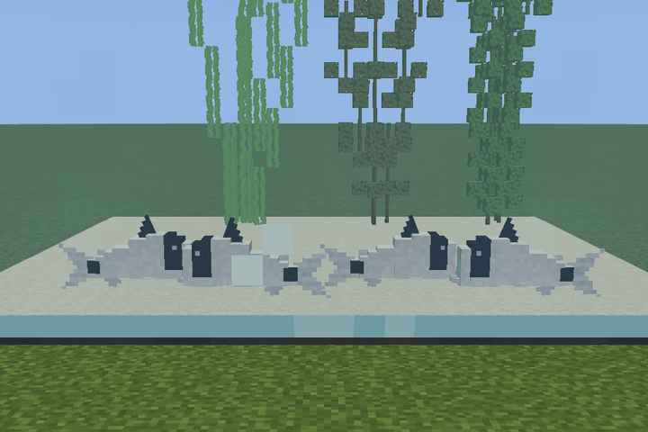
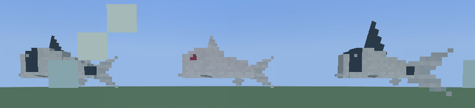

---
navigation:
  title: Panda Cory
  icon: bettacraft:panda_cory_bucket
  parent: tankmates/corydoras.md
  position: 20
item_ids:
  - bettacraft:panda_cory_bucket
  - bettacraft:panda_cory_spawn_egg
---

# Panda Cory

Cream with a black eye mask, black dorsal fin and a spot at the tail base. Likes it cool.

**Origin:** cool clear streams of the Rio Ucayali in Peru.

## Profile

| | |
|---|---|
| Group | Corydoras |
| Scientific name | *Corydoras panda* |
| Size in the game | about 4.5 cm (0.37 blocks) |
| Temperature | 20–26 °C |
| Breeding temperature | 21–25 °C |
| Water | fresh water, normal |
| Water chemistry | pH 5.8–8.0, TDS 0–500 ppm |
| Shoal | from 6 fish |
| Swims | on the bottom |
| Stocking | counts as 0.45 fish |
| Breeding | Glues its eggs to the glass (after a cool water change), 12–30 young |
| Betta tank | too cool |
| Special | gulps air at the surface, 3 colour varieties |

## Varieties

Varieties: Wild type, Albino, Longfin. The **Albino** has no black at all and red eyes; the **Longfin** has the wild colours with a long, flowing tail and dorsal fin. The longfin is rare: the trader and the wild bring it a quarter as often as the albino. The wild type is dominant, the bred forms are recessive: only two equal alleles show the form (carriers look wild). Of two different bred forms the one listed first shows. Wild fish and the wild-type fish of the trader now and then carry a form hidden; the menu shows the genes in a tooltip. Switch: `features.tankmates.tetraCoryForms`.

## Breeding

A cool water change sets them off: at least a quarter of the water fresh, cooling the tank by 1.5 °C. The female glues 12–30 eggs to the glass, the decoration and leaves. The other fish like to eat them: take them out with the net into a fish bag and raise them in a tank without adults.

## Keeping

* Bottom fish: gets only part of the sinking food while faster fish are around - algae wafers go straight to it.
* Darts up to the surface for a gulp of air now and then.

## Obtaining

* **[Aquarium net](../equipment/tank_net.md)** in jungle water: 0.7–0.83 % per swing (about 1 in 121–144 swings), 1–4 at a time.
* **Wild** in jungle water, in groups of 3–6 (spawn weight 8) (config `features.tankmates.wildSpawns`).
* **Wandering trader** (usual offers): 6 for 4 emeralds; one of 37 in this offer.
* **[Aquarist villager](../getting_started/aquarist.md)** (Master): 2 for 14 emeralds; one of about 20 in this offer (config `features.tankmates.wildSpawns`).
* **[Breeding](breeding.md)**: Glues its eggs to the glass (after a cool water change).

The biomes of biome mods count too ([biome tags](../settings.md)).
